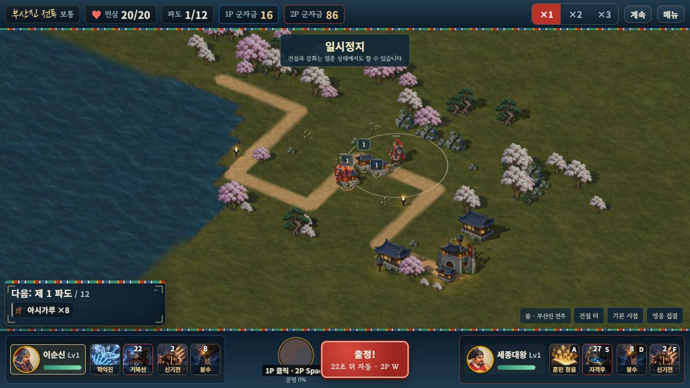
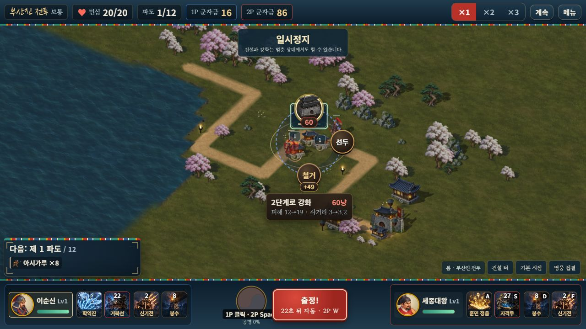
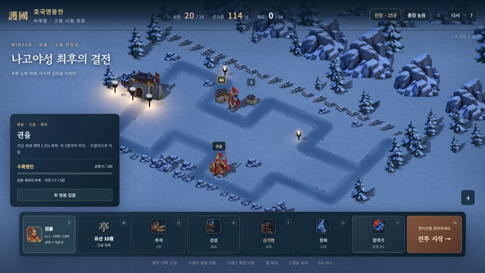

# 전장 가림을 줄인 유산 표시와 스킬 발동음

2026-10-11. 실제 로컬 2인 테스트에서 여러 유산의 이름·단계 박스가 전장을 가리는 문제를 개선했다.

## 유산 표시

평소에는 반투명한 작은 `1`·`2`·`3`·`4A`·`4B` 배지만 표시한다. 실제 데스크톱/414px 모바일에서 기본 배지는 24×22 CSS 픽셀이다. 최종 특화는 금색으로 구분하고 건물 그림의 기존 크기와 단계별 장식은 유지한다.

선택하거나 가리키거나 키보드 초점을 둔 건물만 이름·상세 단계·강화 막대를 펼친다. 큰 박스를 모두 반투명하게 남기는 대신 표시 자체를 줄이고, 설명은 필요할 때 읽을 수 있게 했다. 펼쳐진 크기를 측정한 뒤 주변 배지를 재배치하며, 가리킨 배지는 기존 위치에서 펼쳐져 포인터 아래에서 도망가지 않는다. 이동한 배지는 실제 지붕까지 연결선으로 표시한다. 스킬 조준 중에는 설명을 접고 배지의 불투명도를 낮춰 목표 선택을 방해하지 않는다.

## 스킬 발동음과 음악 설정

영웅 기술·궁극기·장착 비기가 실제로 발동하면 약 0.2~0.35초의 짧은 WebAudio 합성음을 한 번 재생한다. 기술·궁극기·비기는 같은 계열의 소리에서 음높이와 길이를 구분한다. 재사용 대기·사망·소유권 거절·잘못된 슬롯에서는 발동음을 내지 않는다. 두 사람이 동시에 같은 종류를 써도 각 발동을 전달한다. 기존 타격·포탄·합격기 소리는 유지한다.

`?mute=1`은 현재 탭의 음악·효과음만 임시로 끄며 저장 설정을 0으로 덮어쓰지 않는다. 기존 버전에서 이미 0으로 저장된 설정은 다음 두 방식으로 효과음을 켤 수 있다.

- [배경음 없이 효과음만 플레이](http://localhost:8080/?sound=effects): `?sound=effects` 주소는 탭을 열 때 효과음을 기본 0.7로 복구하고 음악은 끈다. 이후 효과음 슬라이더를 0으로 내리면 그대로 유지한다.
- 설정의 **배경음 끄고 효과음 켜기** 버튼은 사용자가 선택한 값으로 효과음/음악 설정을 저장한다.

`mute=1`과 `sound=effects`를 함께 쓰면 임시 전체 무음이 우선한다. 이때 설정에는 임시 무음 안내와 효과음 전용 주소 링크를 표시한다. 작업 중 모든 브라우저 검증은 임시 무음으로 진행했다. 재생 중인 사용자 Chrome은 새로고침하거나 이동시키지 않았다.

## 검증과 범위

- 새 15개 + 기존 294개, **309개 / 23검사군** 통과. 밀집 배치 12개·선택/포인터/키보드·HUD 여백·종료 정리·볼륨 설정·실제 발동 16개+비기 8종·로컬 동시 발동·온라인 JSON/최종 전송을 검사했다.
- Astra xhigh가 찾은 자유 미리보기 선택 패널의 단계 막대 숨김과 온라인 종료 직전 이벤트 중복을 수정했다. 독립 재현과 최종 검토에서 남은 필수 수정은 없다.
- 단일 HTML에서 1P 클릭 건설 2회, 2P E키 건설 1회, 각자 군자금 156/156→16/86, 실제 양측 기술 발동과 재사용 표시, 선택/키보드 상세·조준 축소·414×896 가로 넘침 없음을 확인했다. 민심 20/20에서 멈췄고 승패·해금·보상은 발생시키지 않았다.
- 별도 자유 미리보기에서 실제 강화 1→2→3→4A, 선택 패널의 단계 막대 4개, 데스크톱/414px 최대 배지를 확인했다. 브라우저 4B 강화는 이번에 수행하지 않았으며 자동 검사에서 4A/4B를 모두 확인했다.
- 음악을 끈 채 새 소리가 SFX 채널로만 전달되는지 합성 노드로 검사했다. 사람이 스피커로 들은 음질 평가는 이번 검증에 포함하지 않는다. 실제 두 기기의 온라인 지연·오디오 정책과 실제 휴대폰 검증은 후속 범위다.
- 승인 원화·전장 1,664자세·가격·피해·재사용 시간·소유권 규칙은 유지한다. 기존 기준 fixture/비교 필터를 바꾸지 않고 솔로 seed42·협동 seed7 완주 SHA가 같음을 확인했다. 시뮬레이션 변경은 성공 후 표시 전용 발동 신호 3개이며, 세션 변경은 최종 스냅샷 전송 후 이미 보낸 이벤트 큐를 비우는 것이다.
- 서버/단일 HTML 빌드 통과. 단일 HTML **119,362,827바이트**, 방향/중간 시트 104장·메뉴 1장·기본 큰 그림 8장·의상 큰 그림 16장 등 기존 배포 그림을 각각 한 번 포함한다. 원본/참조 PNG는 계속 제외한다.

[실행 검사](BATTLE_FEEDBACK_RUNTIME_VALIDATION.json) · [전체 회귀](BATTLE_FEEDBACK_REGRESSION_VALIDATION.json) · [브라우저](BATTLE_FEEDBACK_BROWSER_VALIDATION.json) · [내장 그림](BATTLE_FEEDBACK_EMBEDDED_VALIDATION.json) · [원본 보존](BATTLE_FEEDBACK_SOURCE_VALIDATION.json) · [릴리스](BATTLE_FEEDBACK_RELEASE_VALIDATION.json)
