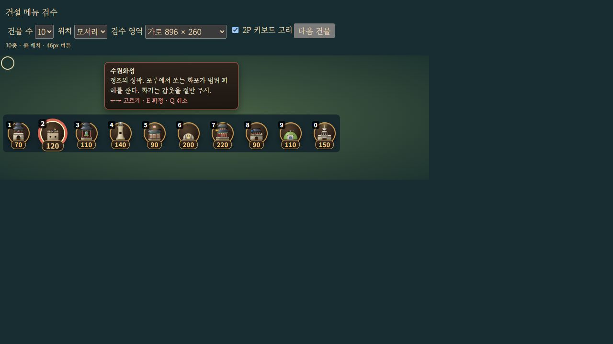

# 건설 메뉴 겹침과 건물 점 표시 수정

2026-10-11. 건설 메뉴의 항목이 많을 때 버튼·가격·단축키가 겹치던 문제를 고쳤다. 각 항목의 실제 각도와 선택 시 1.14배 확대 영역까지 계산해 원의 반지름을 정한다. 메뉴 전체를 화면 안으로 옮기며, 원형으로 들어갈 공간이 부족하면 여러 줄로 표시한다. 아주 작은 영역은 스크롤할 수 있다. 재화 갱신 뒤 1P의 스크롤·키보드 초점을 유지하고 2P의 현재 선택을 보이게 한다. 2P 메뉴와 설명창은 1P 마우스 입력을 통과시킨다.

건물의 네 점은 **건물 바닥 바로 아래에 고정**한다. 밀집 배치를 이유로 다른 자리로 옮기지 않으며 연결선을 만들지 않는다. 40×20px 선택 영역 안에 6px 점 네 개를 두고, 이름·단계 설명은 별도의 절대 위치 창으로 펼친다. 설명을 열어도 점 위치는 변하지 않는다. 정식 전장과 별도 자유 전장 모두 적용했다. 최종 A/B 색, 단계별 채움, 건물 크기는 유지한다.

검증은 메뉴 8개·표시와 발동음 15개를 포함한 전체 **395개 / 29검사군**을 통과했다. 실제 패키지 전장에서 1P 클릭과 2P E키로 각각 건설했고, 군자금은 156/156→86/86이다. 점 두 묶음은 40×20px이며 연결선은 0개다. 별도 검수 화면은 414×742·896×260·320×180 **컨테이너**에서 실제 Ring DOM을 확인했다. 최종 검수 때 브라우저 viewport 변경이 적용되지 않아 이 기록을 새 휴대폰 viewport 검증으로 표현하지 않는다. 실제 휴대폰 터치 검증은 별도 범위다.

[메뉴 검사](BUILD_LAYOUT_RUNTIME_VALIDATION.json) · [메뉴 DOM 검수](BUILD_LAYOUT_BROWSER_VALIDATION.json) · [건물 점 DOM 검수](BUILD_DOTS_BROWSER_VALIDATION.json) · [표시 검사](TOWER_DOTS_RUNTIME_VALIDATION.json) · [전체 회귀](ROADMAP_REGRESSION_VALIDATION.json)

개발 서버의 `/dev/build-menu-review.html`에서 건물 수·위치·검수 영역·2P 선택을 바꿀 수 있다. 이 화면은 저장 데이터에 쓰지 않고 웹 배포 패키지에는 포함하지 않는다.
