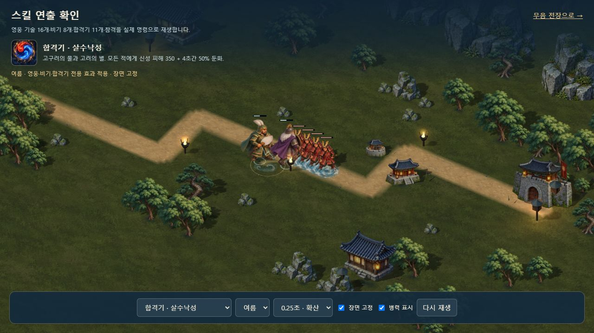
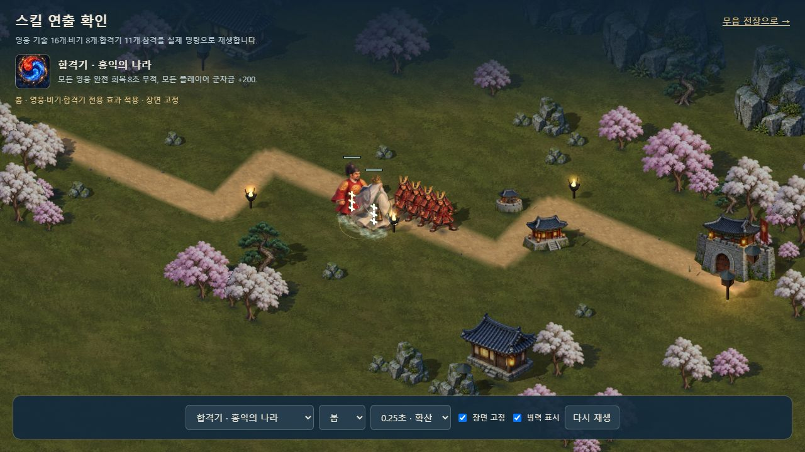

# 불꽃·물결·치유의 8프레임 원화

2026-10-11. 합격기 효과의 공용 충격파에 더해 불꽃·물결·치유를 각각 **8프레임**으로 제작했다. 불꽃은 구리빛과 금빛, 물결은 푸른 청록과 흰 포말, 치유는 옥색 연꽃과 작은 금빛 빛점을 사용한다. 기존 실제 피해 대상·지연 착탄·아군 회복 좌표와 효과 수 상한을 따른다. 지원 계열 일부와 빛 효과는 기존 충격파 및 조합 문양을 사용한다.

| 계열 | 보존 원본 | 배포 그림 | 크기 |
| --- | --- | --- | --- |
| 불꽃 | `assets/3d/fixed/source/combo-fire-v1.png` | `assets/3d/fixed/combo-fire-v1.webp` | 433,404바이트 |
| 물결 | `assets/3d/fixed/source/combo-flood-v1.png` | `assets/3d/fixed/combo-flood-v1.webp` | 488,450바이트 |
| 치유 | `assets/3d/fixed/source/combo-heal-v1.png` | `assets/3d/fixed/combo-heal-v1.webp` | 492,970바이트 |

원본은 각각 1,774×887의 투명 4×2 시트다. **내장 `image_gen.imagegen`**으로 생성했으며 정확한 제출 프롬프트·실행 ID·경로는 [COMBO_ELEMENT_PROMPTS.json](COMBO_ELEMENT_PROMPTS.json)에 보존한다. 원본 픽셀을 다시 그리거나 리사이즈하지 않고 무손실 WebP로 인코딩했다. 알파와 보이는 RGB 차이는 0, 모든 프레임의 경계 접촉은 0이며 투명 여백을 검사했다. 합계 1,414,824바이트다.

텍스처는 전장 소유이며 각 메시가 자신의 UV와 중심을 가진다. 부분 실패 시 기존 충격파로 대체하고, 종료 후 늦게 도착한 디코딩은 자원을 되살리지 않는다. 실제 두 아군에게만 치유 문양을 표시하는 경우와 개별 계열 실패·자원 해제를 포함해 합격기 런타임 **19개**를 통과했다. 전체 회귀는 395개다. 브라우저에서 불꽃 4개·물결 4개·치유 2개의 실제 효과와 프레임을 확인했고 경고·오류는 0이다.

새 원화는 세 계열이다. **11조합 각각의 독립 8프레임 시트나 캐릭터의 장편 동작을 제작한 범위는 아니다.** 기존 1,664자세와 네 박자 캐릭터 동작은 유지한다.

[픽셀·경계 검사](COMBO_ELEMENT_ASSET_VALIDATION.json) · [런타임 검사](COMBO_IMPACT_RUNTIME_VALIDATION.json) · [브라우저 검수](COMBO_ELEMENT_BROWSER_VALIDATION.json) · [앞선 효과 설계](COMBO_IMPACTS.md)
