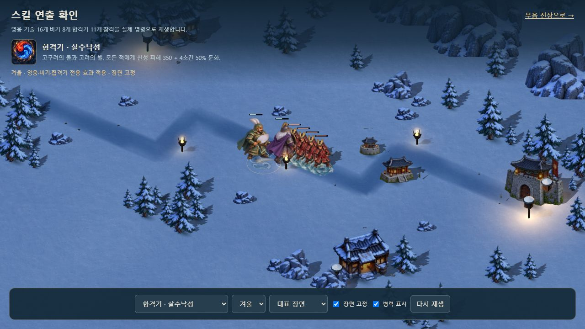
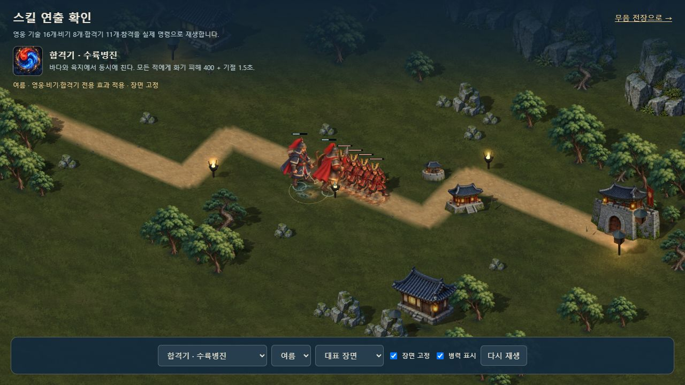

# 합격기 11종의 전장 효과

2026-10-11. 기존 조합별 중앙 문양에 실제 대상·착탄 위치의 짧은 그림 효과를 연결했다. 중립색 충격파 원화 8프레임을 새로 제작하고 기존 물결·화염·빛·치유와 11개 조합 모티프를 함께 사용한다. 공격 효과는 대체로 0.82~1.05초, 치유는 1.15초에 끝나며 지면과 병력이 보이도록 옅게 사라진다.

즉시 공격은 피해 계산 전에 복사한 대상 좌표를 사용한다. 피해로 적이 죽거나 새 적이 생겨도 다른 대상으로 효과가 옮겨가지 않는다. 낙성우·대포탄은 기존 투사체가 실제로 폭발한 좌표와 시각을 사용한다. 낙성우의 고정 목표와 대포탄의 추적 방식은 기존 전투 그대로다. 지원은 영웅·유산·새 의병, 치유는 회복한 영웅에게 표시한다. 지원과 치유에 공격 충격파를 붙이지 않는다.

| 조합 | 주 표현 |
| --- | --- |
| 이순신 + 세종 | 영웅·유산의 따뜻한 지원 문양 |
| 을지 + 강감찬 | 물결·청록 충격파 |
| 곽재우 + 권율 | 영웅·새 의병의 지원 문양 |
| 권율 + 이순신 | 주홍 화염 충격파 |
| 을지 + 세종 | 푸른 봉인 문양·충격파 |
| 강감찬 + 이순신 | 낙성우의 실제 지연 착탄 |
| 안중근 + 세종 | 금빛·화염 충격파 |
| 단군 + 을지 | 번개 모티프·보랏빛 충격파 |
| 안중근 + 이순신 | 대포탄의 실제 지연 착탄 |
| 단군 + 세종 | 영웅의 초록 치유 문양 |
| 일반 합격기 | 금빛 공통 충격파 |

효과용 사건은 최대 24개 대상 좌표를 고르게 담으며 실제 피해 대상 수를 제한하지 않는다. 각 대상의 그림·문양·입자는 한 묶음으로 정리하고 전체 64묶음 상한을 적용한다. 프레임별 UV는 각 그림이 소유하고 공유 텍스처를 이동시키지 않는다. 일시정지·재생·만료·다시 시작·늦은 로딩·실패 시 대체 표시와 자원 해제를 검사했다.

새 원본 3개와 정확한 내장 imagegen 프롬프트는 `assets/3d/fixed/source/combo-impact-flipbook-*`에 보존했다. V1·V2는 경계 접촉 때문에 제외하고 V3을 선택했다. 선택 원본은 1,774×887, 8칸의 최소 투명 여백 51px, 경계 픽셀 0이다. 배포 WebP는 **439,244바이트**이며 원본 대비 알파·보이는 RGB 차이는 0이다. 프레임의 실제 중심을 메시에 보정하며 그림 픽셀은 수정하지 않는다. 조합별로 완전히 다른 8프레임 원화를 11세트 제작한 범위는 아니다.

## 검증

- 전체 **325개 / 24검사군** 통과. 최종 입자·프레임 경계 조정 뒤 합격기 16개·기존 효과 8개·비기 8개를 다시 통과했다. 11조합×180틱에서 기존 코드와 전투 상태·기존 사건이 동일하며 솔로/협동 완주 두 판 SHA도 유지한다.
- 실제 명령 비교 화면에서 11조합, 사계절, 지연 공격의 0.10/0.65/3초를 확인했다. 지연 공격은 0.10초에 착탄 효과 0개, 0.65초에 3개, 3초에 0개다. 같은 장면 8회 반복의 geometry·texture·효과 수는 동일했다.
- 414×896 화면은 가로 넘침 0이다. 새 단일 HTML의 로컬 2인에서 1P 마우스 건설·2P E키 건설, 군자금 156/156→86/156→86/86, 1P 조준 확정·2P A키 발동과 정지를 확인했다. 사용자 Chrome의 플레이는 건드리지 않았다. 모든 검수는 `?mute=1`이며 경고·오류 로그는 0이다.
- 서버·단일 HTML 빌드를 통과했다. HTML은 **119,953,437바이트**이며 충격파 WebP를 한 번 포함하고 보존 원본 PNG 3개는 제외한다. 전장 1,664자세·유산 50외형과 크기·저장·입력·전투 수치는 유지한다.
- Astra xhigh가 실제 좌표·지연 착탄·소유권·정지·자원 해제를 검토했으며 최종 필수 수정은 없었다. 실제 WebGL 화면과 모바일 크기는 별도 브라우저로 확인했다. 실제 휴대폰의 성능·발열과 사람이 느끼는 전투 밸런스 평가는 남은 범위다.

[자산 검사](COMBO_IMPACT_ASSET_VALIDATION.json) · [런타임](COMBO_IMPACT_RUNTIME_VALIDATION.json) · [전체 회귀](COMBO_IMPACT_REGRESSION_VALIDATION.json) · [브라우저](COMBO_IMPACT_BROWSER_VALIDATION.json) · [내장 그림](COMBO_IMPACT_EMBEDDED_VALIDATION.json) · [릴리스](COMBO_IMPACT_RELEASE_VALIDATION.json)
