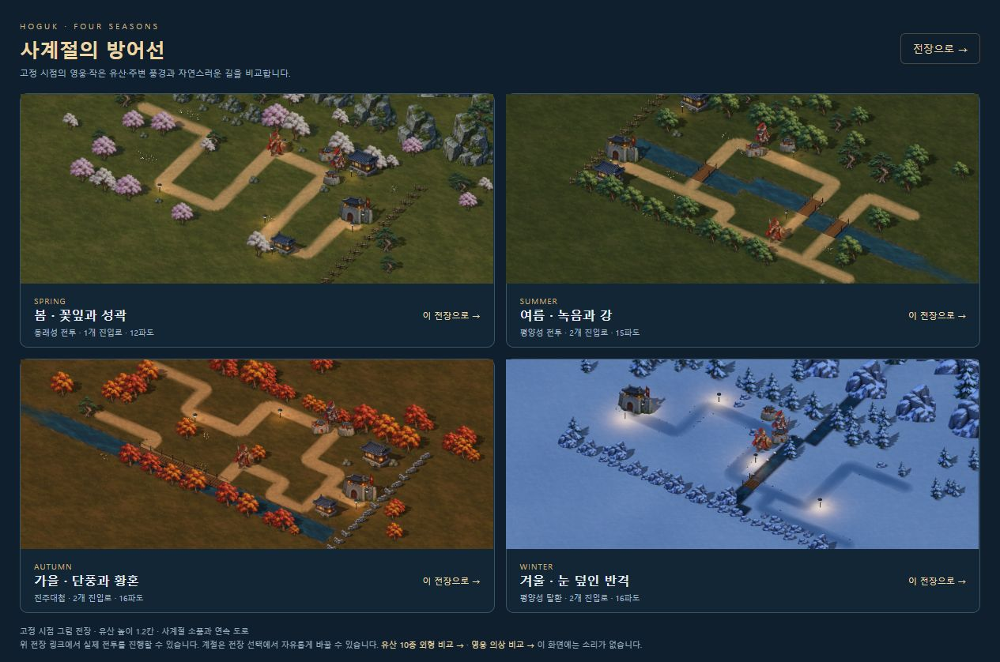

# 기기 성능·조작과 도로 마감

2026-10-14. 요청한 세 항목 중 PC 렌더링·입력 개선과 기존 지도 안의 도로 마감을 구현했다. 공개 배포는 사용자가 보류했다. 실제 휴대전화·외부 두 기기까지 검증 완료한 상태는 아니다.

## 성능과 원화 보존

| 같은 PC, 128명·병력28종 | 그리기 호출 | 프레임 | p95 |
| --- | ---: | ---: | ---: |
| 변경 전 높은 품질 | 803 | 60fps | 17ms |
| 단일 패스·중복 보관 해제 뒤 높은 품질 | 513 | 60fps | 16.8ms |
| 가벼운 품질 | 345 | 60fps | 16.8ms |

변경 전후 높은 품질의 그리기 호출은 약36% 줄었다. 원래도60fps여서 FPS가 상승했다고 표현하지 않는다. 이는 고정된 밀집 표시 장면의 PC 관측값이며 전체 캠페인/모바일/발열 성능 보증이 아니다.

평면 일러스트·투영 그림자·가림 힌트는 `DoubleSide`를 유지하면서 `forceSinglePass`로 불필요한 두 번째 면 그리기를 생략한다. 캐릭터 시트를 원본 해상도의 개별 프레임으로 복사한 후 중복 전체 캔버스를0×0으로 비운다. 양쪽 전장은 프레임·텍스처를 따로 소유하며, 원본 프레임의 픽셀 크기·12px 여백·UV·발 기준과 복구용 원화는 유지한다.

28종 비교 장면의 캐릭터 캔버스 보관량은638,217,172→261,162,268바이트다. 중복377,054,904바이트(약359.6MiB)를 제거했다. 이것은 RGBA 캔버스 backing store 계산이며 브라우저 전체 RAM·GPU RAM·일시적인 이미지 디코딩 메모리 측정이 아니다. 실제 선택 영웅2명 기본 시트는22,831,168→10,244,704바이트다.

가벼운 품질은 긴 투영 그림자를 줄이되 발밑 접지 그림자와 원화 해상도를 유지한다. 품질 복귀 시 이미 사라진 사망 그림자를 되살리지 않는다.

## 그래픽 복구와 조작

WebGL 손실 때 그리기·로컬/호스트 시뮬레이션·전장 명령을 대기시키고, 복구 때 Three 내부 초기화 뒤 장면 전용 PMREM 반사를 다시 만든다. 기존 사용자 일시정지 값은 바꾸지 않는다. 종료된 전장과 오래된 복구 응답은 재개하지 않는다. 복구 실패 안내에서 다시 전장에 입장할 수 있다.

길게 누르기·포인터·2P 이동 키·기술 조준·양쪽 건설 메뉴를 손실 시 정리한다. 로딩 도중 새 입력이나 지연된 길게 누르기가 명령을 만들지 않는다. 게스트 자신의 그래픽 손실만으로 호스트 전체 전투를 멈추는 기능은 추가하지 않았다. 게스트는 최신 스냅샷으로 돌아온다.

제품 전장의 진행 중0.883초/240냥 동결·복구 후1.133초 진행, 사용자 일시정지 중0.267초 유지, 자유 전장의 진행 중0.350초/50냥 동결·일시정지 중0.617초 유지를 실제 드라이버 손실/복구로 확인했다. 로컬2P는 복구 후1P 클릭·2P E키 건설과 각각156→86냥의 독립 지갑을 확인했다. QA는 별도127.0.0.1:8097 프로필에서 수행했다.

주요 기술·메뉴·배속·카메라·합격기 버튼의 최소 조작 크기는44px다. 실제 게임을414×896·360×800·896×414 CSS 프레임 안에서 실행해 버튼 영역·가로 넘침·합격기 라벨을 확인한다. 브라우저 viewport 변경 도구가 기존/새 탭에 적용되지 않아 해당 크기의 실제 iframe을 사용했다. 물리 휴대폰이나 터치/고밀도 화면 에뮬레이터의 검수라고 부르지 않는다. 가로 프레임에서 실제 버튼 클릭→학익진 조준→지점 클릭으로 기술 재사용 시간이0→14초가 되는 것도 확인했다. 합성 터치 이벤트의 길게 누르기·두 손가락 취소·앱 전환 취소는12개 입력/프레임 검사에 포함한다.

## 길과 배경

26개 지도에서 길 외곽을 작은 곡선으로 연결하고 다져진 두 자국의 명암을 더했다. 월드 좌표의 연속 UV·불규칙한 가장자리·사계절 재질과 수목/물가/소품 톤을 유지한다. 길 페인트는 기존 이동 통로 안에서만 둥글어진다. 적의 실제 직각 이동 중심·경로 길이·속도·물·다리·건설 자리는 그대로 검사한다. 새로운 자유 곡선 내비게이션 지도나 실제 지형 높이 제작까지 마친 범위가 아니다.

## 검증과 남은 범위

- 전체451개/34검사군, 지형9개(26지도), 그래픽 복구4개, 입력/프레임12개, 선택 원화14개, 공개 패키지 HTTP/WS3개를 통과했다.
- 기존 보통 솔로·협동2판의 전투 이벤트·수입·결과·기존 스냅샷 SHA는 동일하다. 후반 난이도는 사용자 요청으로 보류한다.
- 단일 HTML·웹 외부 파일·ZIP·원화 바이트·압축/캐시를 검증했다. 검수용 페이지와 원본 PNG 보관함은 공개 패키지에서 제외한다.
- Astra 하이 검토가 발견한 자유 전장 복구 대기 누락을 수정하고 실제 화면과 회귀 검사를 다시 통과했다. 최종 재검토에서 추가 차단 결함은 없었다.
- 프레임 검수 도구의 초기화/다시 읽기 중 `MutationObserver.observe` 오류가 기록됐다. 게임·Three 소스와 번들에는 이 API가 없어 검수 계층 발생으로 추정하되 단정하지 않는다. 직접 실행한 최종 웹 패키지와 사계절/성능 화면의 경고·오류는0이었다. 자세한 오류도 브라우저 JSON에 보존한다.
- 실제 Docker 이미지 빌드/실행, 여러 실제 PC·휴대폰의 전체 메모리/발열/장시간 입력, LTE + PC 두 기기 협동, 공개 서버 운영은 미검증이다. 공개 배포는 보류했고 서버 실행·도메인 발급은 하지 않았다.

[전체 회귀](DEVICE_ROADS_REGRESSION_VALIDATION.json) · [실제 화면·측정 기록](DEVICE_ROADS_BROWSER_QA.json) · [공개 배포 준비와 보류](PUBLIC_DEPLOYMENT.md) · [릴리스 기록](DEVICE_ROADS_RELEASE_VALIDATION.json).
