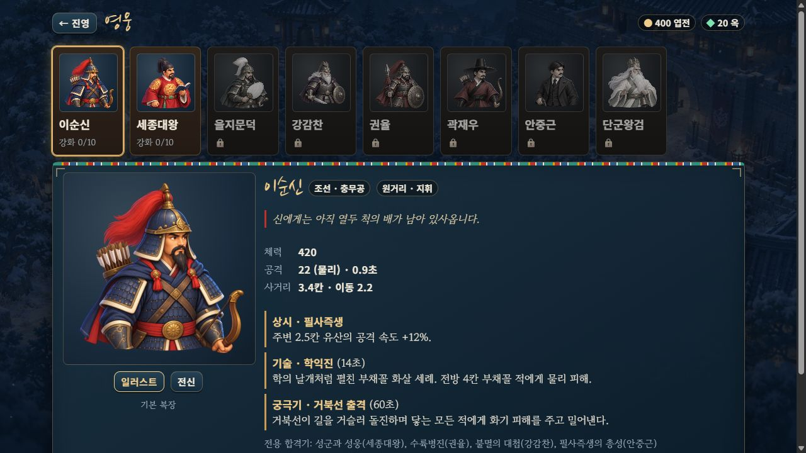
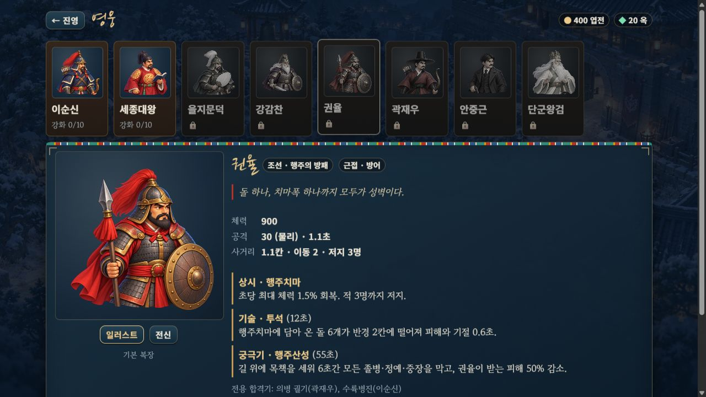
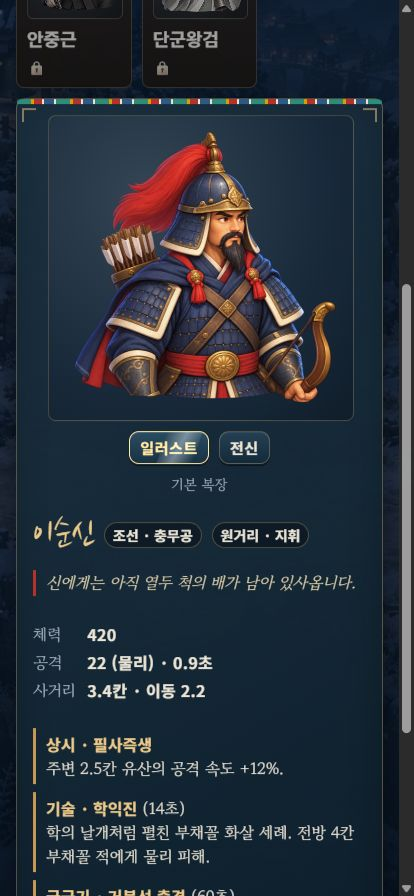
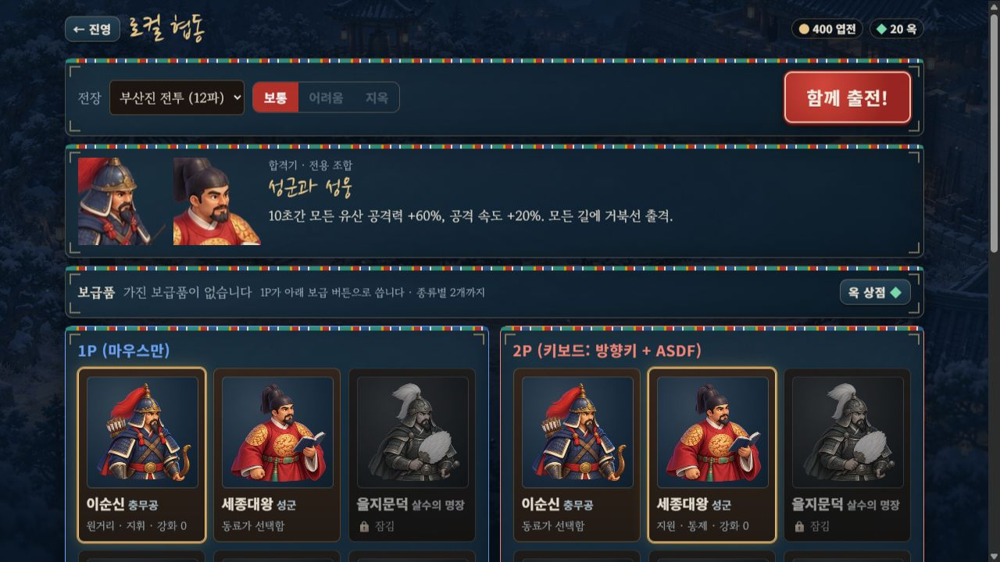
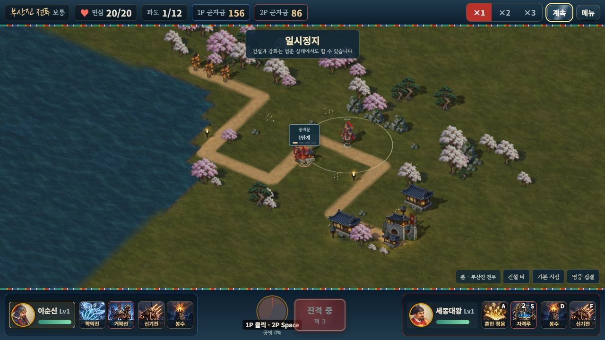

# 영웅 8명 큰 메뉴 일러스트 · 2026-10-11

기본 영웅 8명의 전용 상반신 원화를 제작해 **영웅 도감의 카드·304px 상세 그림과 솔로/로컬/온라인 출전 선택 카드**에 연결했다. 작은 전장 준비 그림을 크게 늘리던 부분을 별도 그림으로 보완했다. 부드러운 입체감·남색 그림자·따뜻한 피부와 절제한 금속빛을 같은 기준으로 맞췄다.


## 외형과 적용 범위

| 영웅 | 유지한 구분 | 배포 그림 |
|---|---|---|
| 이순신 | 남색 갑옷·망토, 붉은 투구 깃, 활·화살통 | [yi-bust-v1.webp](../assets/illustrated/portraits/yi-bust-v1.webp) |
| 세종대왕 | 검은 익선관·붉은 곤룡포·책 | [sejong-bust-v1.webp](../assets/illustrated/portraits/sejong-bust-v1.webp) |
| 을지문덕 | 녹색 갑옷·흰 투구 깃·깃털 부채 | [eulji-bust-v1.webp](../assets/illustrated/portraits/eulji-bust-v1.webp) |
| 강감찬 | 백발·흰 수염, 보라 망토, 검·방패 | [gang-bust-v2.webp](../assets/illustrated/portraits/gang-bust-v2.webp) |
| 권율 | 붉은 망토·창·둥근 방패 | [gwon-bust-v2.webp](../assets/illustrated/portraits/gwon-bust-v2.webp) |
| 곽재우 | 검은 갓·붉은 도포·활·화살통 | [gwak-bust-v1.webp](../assets/illustrated/portraits/gwak-bust-v1.webp) |
| 안중근 | 검은 코트·조끼·넥타이, 짧은 콧수염·권총 | [ahn-bust-v1.webp](../assets/illustrated/portraits/ahn-bust-v1.webp) |
| 단군왕검 | 백발·흰 도포·녹색 옷깃·금관·종 | [dangun-bust-v1.webp](../assets/illustrated/portraits/dangun-bust-v1.webp) |

도감은 **일러스트 / 전신**을 바꿔 볼 수 있다. 전신은 승인된 원래 준비 자세를 표시한다. 타이틀의 전신 8명, 의상실 전신 16종, 전투 HUD의 작은 얼굴과 평면/고정 시점 전장의 **1,664자세**는 원래 그림을 유지한다. 유산 50외형의 높이 1.2칸과 사계절 전장도 유지한다.

특수 의상을 장착하면 **그 의상의 기존 준비 그림 상반신**을 사용한다. 이번 새 원화는 기본 복장 8명이며 특수 의상 16종의 전용 큰 흉상까지 제작한 범위는 아니다. 잘못된 의상 ID나 다른 영웅의 의상은 기본 복장으로 정규화한다.





## 원본·프롬프트·재현

원화는 **내장 `image_gen.imagegen`**으로 제작했다. 외부 API/CLI는 사용하지 않았다. 승인된 메뉴 시트에서 기본 준비 자세를 픽셀 그대로 잘라 각 영웅의 참조로 사용했고, 첫 이순신 흉상은 나머지 그림의 화풍·조명 참조로 사용했다.

- [정확한 생성·수정 프롬프트 10개](../assets/illustrated/portraits/source/prompts.json)
- [원본 PNG 10개와 승인된 참조 PNG 8개](../assets/illustrated/portraits/source/)
- [배포 경로·크기](../src/data/hero-bust-data.js), [별도 지연 로더](../src/render/hero-busts.js)
- [균일 축소·여백·픽셀 검증 도구](../tools/hero-bust-assets.mjs)

권율은 좌우 여백을, 강감찬은 오른쪽 방패 잘림을 원화에서 수정해 v2를 선택했다. 최종 원본 8개는 **알파 128 이상인 원본 경계 픽셀이 0**이다. 단순히 여백을 더해 잘린 부분을 숨기는 것으로 검수를 끝내지 않았다. 강감찬은 검과 방패가 가로로 펼쳐진 구도여서 다른 영웅보다 표시 높이가 약 10–16% 작으며 얼굴·장비가 식별되는 것을 최종 화면에서 확인했다.

완전히 투명한 바깥 행·열만 정리하고 모든 비영(非零) 알파 원본 픽셀을 보존한 범위를 균일 축소했다. 사방 **32px 투명 여백을 둔 640×640 무손실 WebP 8개, 합계 2,267,434바이트**다. 축소된 기준 이미지와 배포 WebP의 알파·보이는 RGB 차이는 0이고 승인된 참조 8개도 원래 포즈와 픽셀이 같다. 그림을 코드로 다시 칠하거나 색상을 바꾸지 않았다.

```bash
node tools/hero-bust-assets.mjs
node tools/test-hero-busts.mjs
node tools/hero-menu-assets.mjs
npm run build:3d
npm run build
node tools/verify-embedded-art.mjs
node tools/check-motion-determinism.mjs
```

`hero-bust-assets.mjs --write`로 같은 배포 그림과 자산 보고서를 재생성할 수 있다. [모음 비교 화면](http://localhost:8080/dev/hero-bust-review.html?mute=1)에는 8명 일러스트와 원래 전신 전환이 있다.

## 로딩과 검증

흉상은 전장 그림 로더와 분리했다. 모듈을 읽거나 기존 `preloadArt()`를 실행하는 것으로는 흉상 이미지를 요청하지 않는다. 도감·출전 카드가 필요할 때 영웅별 한 번만 요청하고 같은 영웅을 표시하는 양측 카드는 같은 Promise·이미지를 공유한다. 전투 입장 준비 목록에는 추가하지 않았다.

이미지가 준비되기 전과 로딩 실패·잘못된 크기에서는 기존 상반신이 먼저 보인다. 화면을 떠난 뒤 요청이 끝나도 제거된 캔버스를 다시 칠하거나 이전 UI를 삽입하지 않는다. 준비된 8개 이미지 캐시는 메뉴 재방문 때 재사용하며 메모리에서 퇴출하는 정책까지 추가한 범위는 아니다.

새 **12개 검사**는 지연 요청·중복 방지·실패/크기 오류·제거된 캔버스·16의상 대체·잘못된 ID·작은 HUD/전신 유지와 **실제 도감/로컬 준비 DOM 및 두 출전 사양**을 확인한다. 기존 272개를 다시 실행해 **총 284개 / 21검사군**을 통과했다. 이전 솔로 seed42·협동 seed7 완주 SHA도 기준 fixture와 같으며 기준 파일을 바꾸지 않았다.

최신 단일 HTML은 **113,580,049바이트**다. 기존 방향/중간 시트 104장·메뉴 1장·지면 3장·계절 수목 1장·마을 소품 2장·물 1장·기술 시트 4장과 새 흉상 8개를 각각 한 번 포함한다. 흉상 원본/참조 PNG 18개, 중간 원화 보존 PNG 256개와 기존 제외 자산은 배포에 넣지 않는다.

브라우저에서는 최신 단일 HTML의 8명 선택과 전신 전환, **414×896 도감 가로 넘침 없음**, 로컬 양측 16흉상과 동료 선택 금지를 확인했다. 정상 UI로 이순신/세종을 출전시켜 기존 HUD 얼굴·첫 적 진군·2P 실제 E키 숭례문 건설을 확인했다. 군자금은 **156/156→156/86**, 첫 파도 민심 20/20에서 정지했다. 두 검수 탭 콘솔 경고/오류는 0이다. 승패·해금·구매·승리 보상은 발생시키지 않았다. 이번에는 양측 개별 방향키·모든 기술을 다시 시연하지 않았으며 해당 규칙은 기존 자동 검사와 앞선 브라우저 기록 범위다.

**GPT-6 Astra xhigh**가 원화·로더·대체 표시·UI 변경을 검토했고, 강감찬 잘림 수정 후 원본/배포 검사와 실제 모음·도감 화면을 재검토해 필수 수정 없음으로 확인했다. 실제 휴대폰 메모리·발열, 외부 네트워크 온라인 협동, 사람 플레이 후반 밸런스는 이번 검증 범위에 포함하지 않는다.

- [자산·투명 여백·픽셀 검사](HERO_BUST_ASSET_VALIDATION.json)
- [새 실행 검사 12개](HERO_BUST_RUNTIME_VALIDATION.json)
- [전체 284개 회귀 검사](HERO_BUST_REGRESSION_VALIDATION.json)
- [실제 브라우저·2인·화면 기록](HERO_BUST_BROWSER_VALIDATION.json)
- [빌드·변경 보존·검토·GitHub 반영](HERO_BUST_RELEASE_VALIDATION.json)






