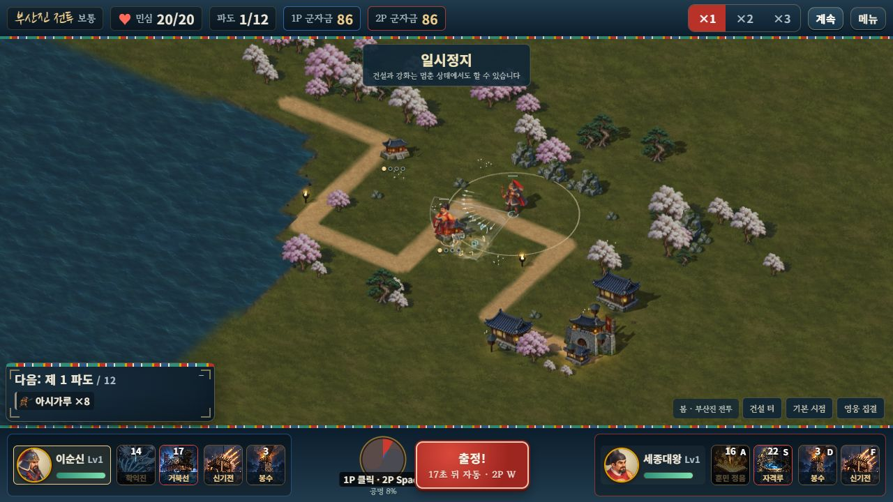

# 선택 영웅 원화 로딩과 메모리 정리

2026-10-11. 전장마다 기본 영웅 8명의 방향 시트를 전역 캐시에 준비하던 방식을 바꿨다. 실제 참여 영웅의 기본 시트만 해당 전장이 소유한다. 이순신·세종 로컬 협동은 기본 시트 2장, 같은 영웅의 서로 다른 의상 두 명은 기본 시트 1장과 의상 시트 2장을 준비한다. 의상 로딩 실패에 대비한 기본 그림도 선택 영웅만 준비한다.

기본·의상·중간 원화·병력·풍경이 모두 준비될 때까지 기존 로딩 화면과 전투 시계 정지를 유지한다. 같은 스냅샷은 로딩 Promise를 교체하지 않는다. 일부 원화만 먼저 완료된 뒤 영웅 구성이 바뀌어도 공통 기본 시트를 다시 읽지 않는다. 원화 한 장의 실패는 해당 영웅의 대체 그림으로 완료하고 같은 로스터에서 계속 재요청하지 않는다.

영웅을 바꾸면 활성·사망 루트와 선택 참조부터 제거하고 빠진 시트의 텍스처·그림자 재질·geometry를 해제한다. 퇴장한 이순신 별칭도 지운다. 종료 시 전장 소유 map과 그림 bucket의 참조를 비우며 이전 요청이나 종료 후 응답이 현재 화면을 되살리지 못하게 한다. 서로 다른 전장은 기본 캔버스와 GPU 텍스처를 공유하지 않는다. 풍경·메뉴·정적 대체 그림의 기존 공용 캐시는 별도다.

| 기본 방향 원화 캔버스 | RGBA 저장량 계산 |
| --- | ---: |
| 전체 기본 영웅 8명 | 85,067,488바이트 |
| 이순신 + 세종 | 22,831,168바이트 |
| 차이 | 62,236,320바이트, 약 73.16% 감소 |

원본 시트와 분리된 16프레임 캔버스의 실제 너비×높이×4를 합한 값이다. 최신 실제 브라우저의 2명 전장과 8명 비교 화면에서도 각각 같은 값을 확인했다. 디코더·브라우저 부가 비용·GPU·의상·병력·메뉴 캐시를 포함하는 전체 게임 메모리 측정값은 아니다. 배포 그림을 삭제하거나 화질을 낮추지 않았으므로 단일 HTML 용량 감소를 뜻하지 않는다.

전체 영웅이 필요한 비교 화면은 계속 8명을 준비한다. 미지정 로스터는 전체 8명, 명시적 빈 로스터는 0명으로 구분하며, 빈 게스트는 첫 스냅샷을 받은 뒤 필요한 두 명만 준비한다. 의상→기본 방향 그림→정적 그림 순서와 중간 원화 정체성을 유지한다. 승인된 1,664자세·건물 크기·전투 계산·저장·입력·각자 군자금은 바꾸지 않았다.

## 검증

- 새 **13개** 검사와 기존 **325개**, 전체 **338개 / 25검사군** 통과. 실제 생성자의 선택 요청 수·빈 목록·미지정 8명·다섯 종류 로딩의 완료 순서 5가지·같은 Promise·부분 완료 후 교체·실패·오래된 세대·종료·현재 시트와 자원 수명·실제 HUD·게스트 후속 스냅샷을 검사했다.
- 두 전장 비공유 검사는 **동일 모듈의 생성자** 두 개를 사용하며 두 번째 전장이 기본 시트를 다시 요청하고 별도 캔버스·GPU를 가지는지 확인한다. Astra 하이가 찾은 검사 허점과 부분 완료 뒤 재디코딩 경로를 보완했고 최종 추가 필수 수정은 없다.
- 최신 단일 HTML에서 실제 로컬 2인 양측 건설·1P 조준 기술·2P A키 기술·방향키 입력·정지를 확인했다. 군자금156/156→156/86→86/86, 민심20/20이다. 기본 2장과 중간 2장이 준비됐고 414×896에서도 가로 넘침 0, 기본 시트 수 2를 유지한다.
- 자유 전장에서 기본 이순신/권율→백의종군/행주 산성→을지/강감찬→단군 한 명을 실제 메뉴로 교체했다. 기본 시트는 2→2→2→1장, 장착 의상은 해당 두 장만 준비한다. 미지정 영웅 비교 화면은 기본 8장을 유지하고 새 합격기 충격파도 정상이다. 경고·오류는 0이며 모든 검수는 `?mute=1`이다. 사용자 Chrome의 플레이는 건드리지 않았다.
- 서버·단일 HTML 빌드와 내장 그림 검사를 통과했다. HTML은 **119,955,783바이트**이고 기존 104방향/중간 시트와 메뉴·풍경·기술·충격파 그림을 각각 한 번 포함한다. 이번 변경은 로딩·해제 코드이며 원화·전투 시뮬레이션·완주 기준 fixture는 유지했다.

실제 휴대폰의 전체 메모리·발열·프레임, 외부 네트워크 두 기기와 사람 플레이 밸런스는 별도 검증 범위로 남긴다.

[13개 로딩 검사](HERO_LOADING_RUNTIME_VALIDATION.json) · [전체 회귀](HERO_LOADING_REGRESSION_VALIDATION.json) · [실제 브라우저](HERO_LOADING_BROWSER_VALIDATION.json) · [내장 그림](HERO_LOADING_EMBEDDED_VALIDATION.json) · [릴리스](HERO_LOADING_RELEASE_VALIDATION.json)
