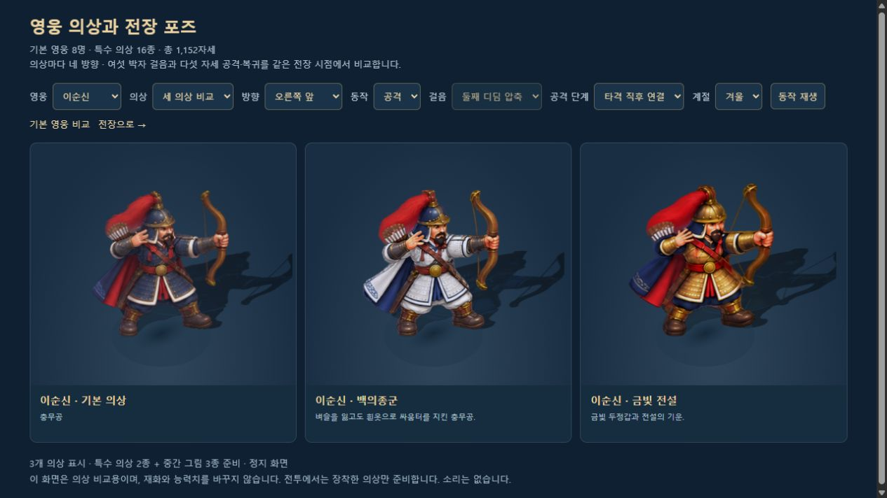
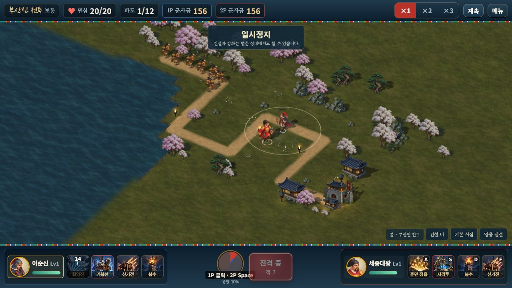

# 영웅의 긴 동작과 조합별 합격기 원화

2026-10-14. 사용자가 선택한 2번 작업이다. 기본 영웅 8명과 특수 의상 16종의 걸음·공격 사이에 새 자세를 연결하고, 합격기 11종에 각각 독립된 연속 원화를 추가했다. 로컬 2인 협동을 유지했으며, 후반 난이도 조정은 사용자 요청으로 보류했다.



## 이번에 적용한 범위

| 대상 | 이전 | 이번 |
| --- | --- | --- |
| 영웅 24외형 | 외형당 4방향×8자세, 합계768 | 외형당4방향×12자세, 합계1,152 |
| 새 영웅 원화 | — | 디딤 압축 A/B·타격 직후·마지막 정리, 24×16=384자세 |
| 영웅 보행 | 네 박자 | 여섯 박자, 같은 이동 거리 주기 |
| 영웅 공격 | 발사/타격·후속·복귀 | 발사/타격·직후 연결·후속·복귀·마지막 정리 |
| 병력 28종 | 896자세 | 기존 그림과 네 박자 동작 유지 |
| 준비된 캐릭터 그림 | 1,664자세 | 2,048자세 |
| 합격기 | 공용/계열8프레임과 조합 문양 | 11종 각각16프레임, 합계176프레임 |

보행 순서는 기존 첫 디딤→새 첫 압축→기존 첫 중간→기존 둘째 디딤→새 둘째 압축→기존 둘째 중간이다. 이동 거리로 위상을 계산하므로 20/60/120fps에서 같은 거리는 같은 주기를 만든다. 압축 자세에서 멈추면 해당 지지발로 착지한다.

공격은 실제 발사·타격 cue에 즉시 시작한다. 새 그림을 보여주려고 피해나 투사체 발사를 늦추지 않는다. 표시 복귀의 끝 부분만 기존0.09초에서0.14초로 늘며, 새 공격은 이전 복귀를 즉시 끊는다. 정지 착지 중 재이동하면 바로 보행을 잇는다. 일시정지·기절·큰 위치 보정·게스트 보간의 기존 규칙도 유지한다.

지원 합격기 성군과 성웅·의병 궐기·홍익의 나라는 실제 아군 좌표에서 전용 원화를 표시한다. 불멸의 대첩·필사즉생의 총성은 기존 투사체의 실제 착탄 시점과 좌표를 사용한다. 효과는 cue당24곳·동시에64뿌리 상한을 유지한다.

## 원화와 제작 기록

내장 `image_gen.imagegen`으로 제작했다. CLI나 외부 생성 모델을 사용하지 않았다. 기존 승인 의상의 준비·양발 이동·공격·후속·복귀를 정확히 잘라 참조 시트로 삼았다. 얼굴·머리 장식·무기 손·복식 색상을 참조하며, 이순신의 활/남색 망토와 권율의 창/붉은 망토를 구분했다. 단군은 허리의 방울과 두 빈손을 유지한다.

- 영웅 원본·정확한 프롬프트·참조: [long-motion/source](../assets/3d/fixed/long-motion/source/). 공통 생성 지시와 캐릭터별 조건은 [generation-briefs.json](../assets/3d/fixed/long-motion/source/generation-briefs.json), 실제 호출별 지시는 각 `.prompt.json`에 있다.
- 선택한 행: [long-motion-specs.json](../tools/long-motion-specs.json). 이순신 금빛 의상의 남은 화살을 제거한 v2, 강감찬 홍의 v2와 금빛 v3의 교정된3행만 선택했다. 나머지 행은 각v1을 유지한다.
- 합격기 원본·정확한 프롬프트: [combo-sequences/source](../assets/3d/fixed/combo-sequences/source/). 정면으로 내려다본 원화이며 기울어진 바닥 원근을 그림에 중복으로 넣지 않는다. 살수낙성의 초기v1/v2는 보존용이고 v3만 배포한다.
- 의미상 원점: [combo-sequence-specs.json](../tools/combo-sequence-specs.json). GPT-6 Astra high가 태양·매듭·인장·물의 눈·폭발 발원점 좌표를 검토했다. 변하는 빛/연기의 무게중심을 따라가지 않는다. 선명한 문양의 판독 오차는 약±5px, 빛핵이 사라진 포탄 마지막 행은 이전 발원점과 연기의 빈 중심으로 추정해 약±10px다.

원본·거부 후보·프롬프트는 보존한다. 기계적 처리만 수행했다. 영웅은 정확한 영역 자르기, 원본 시트마다 일정한 배율로 기존 기준 높이 맞추기, 투명 여백과 패킹을 사용한다. 합격기는 크기를 다시 그리거나 조정하지 않고 모든 원본 셀을 잘라32px 이상의 투명 여백으로 재배치한다. 원본의 알파1~15 잔여가 있으므로 원본 경계 전체가 완전 투명하다고 주장하지 않는다.

배포 WebP는 영웅24장22,704,878바이트, 합격기11장12,337,780바이트다. 패킹 결과 대비 WebP의 알파와 보이는RGB 차이는 모두0이다. 영웅의 기준 높이 맞춤에 사용한 리사이즈 이전/이후가 픽셀 동일하다는 뜻은 아니다. [영웅 자산 검사](LONG_MOTION_ASSET_VALIDATION.json) · [합격기 자산 검사](COMBO_SEQUENCE_ASSET_VALIDATION.json).

## 로딩·실패·자원 소유

전투에 참여하는 외형과 가능한 조합만 준비한다. 반복 요청의 Promise와 교체 중 공통 요청을 재사용하며, 빠진 원화의 전장 소유 자원을 해제한다. 이전 세대의 늦은 응답이나 종료 후 응답은 현재 전장의 준비 상태를 바꾸지 않는다. 영웅과 합격기가 모두 준비된 현재 전장에서 첫 틱을 시작한다.

새 영웅 시트가 실패하면 같은 외형의 기존 동작을 사용한다. 기존 의상 원본이 실패하면 기존 대체 외형 규칙을 따르며, 다른 옷의 추가 자세를 섞지 않는다. 조합 전용 시트가 실패하면 기존 계열/공용8프레임을 사용한다. 전용16프레임과 대체8프레임은 각 mesh가 자신의 UV·피벗·재질을 소유한다. 공유 텍스처의 offset을 바꾸지 않는다.

## 확인한 결과와 한계

새 영웅 동작13개, 합격기 연속 원화15개를 포함해 **439개 / 32검사군**이 통과했다. 전체384새 자세의 방향·발 기준·그림자, 거리 주기·공격 즉시 시작·정지·실패·늦은 로딩·소유자 분리를 검사했다. 합격기의176 UV/피벗 프레임, 지원/지연 착탄, 선택 로딩과 종료를 검사했다. 변경 전 보통 솔로·협동 완주2판의 전투 이벤트·수입·결과·기존 스냅샷 SHA도 같다. 시뮬레이션·성장·저장·네트워크 코드와 기존 결정성 fixture를 바꾸지 않았다.

[전체 회귀](LONG_MOTION_REGRESSION_VALIDATION.json) · [영웅 런타임13개](LONG_MOTION_RUNTIME_VALIDATION.json) · [합격기 런타임15개](COMBO_SEQUENCE_RUNTIME_VALIDATION.json).

실제 브라우저 WebGL에서24외형×4방향×새4자세의384전환을 DOM 표시값과 대조했다. 대표 이순신/강감찬 의상 그림을 시각 검수했고, 합격기11종을 실제 명령의 대표 시점에서 확인했다. 두 번째11종 재생에서 텍스처67개가 유지됐다. 이는 해당 검수 화면의 캐시가 준비된 상태이며 전체 게임 RAM/발열이나 모든 기기의 성능 인증이 아니다. 발원점 표식으로 물결과 치유의 중심도 확인했다.

최신 웹 빌드의 정상 메뉴로 로컬2인에 출전해1P 우클릭 이동·지정 학익진,2P 실제 방향키600ms 이동·A키 훈민정음을 확인했다. 민심20/20·군자금156/156·1/12파에서 정지했다. 승패·구매·보상 수령은 발생시키지 않았다. 사용자 Chrome 플레이는 조작하지 않았으며 별도8097 QA 서버를 사용했다. 네 검수 탭의 콘솔 경고·오류는0이다. [브라우저 기록과 검사 한계](LONG_MOTION_BROWSER_VALIDATION.json).



GPT-6 Astra high는 의미상 원점과 교정 원화, 최종 비동기/실패/소유자/지원/지연착탄 코드를 읽기 전용으로 검토했으며 완료를 막는 결함이나 필수 수정을 발견하지 못했다. 모바일·다른 PC의 실제 기기 측정, 외부 WAN 두 기기 접속, 자유 곡선 지형은 남는다. 후반 난이도 조정은 사용자가 보류한 상태다.

## 빌드와 재현

```bash
node tools/long-motion-assets.mjs
node tools/combo-sequence-assets.mjs
node tools/test-long-motion.mjs
node tools/test-combo-sequences.mjs
node tools/test-roadmap-regression.mjs --output=LONG_MOTION_REGRESSION_VALIDATION.json
node tools/check-motion-determinism.mjs
node tools/build-3d.mjs
node tools/build.mjs
node tools/build-web.mjs
node tools/verify-embedded-art.mjs
python tools/package-web.py
python tools/verify-web-package.py
```

단일 HTML은168,627,271바이트, 방향/중간 시트128장과 독립 합격기11장을 각각 한 번 포함한다. 보존 원본322PNG는 포함하지 않는다. 웹은198개 배포 원화125,391,288바이트를 원본과 동일한 바이트로 전달한다. 생성물 `dist/`는 Git에서 제외하고 재현 소스·선택한 배포 원화·서버 번들·원본/프롬프트·검사/화면/문서를 커밋한다. 단일 HTML은 솔로/로컬 협동용이고 온라인 협동은 웹 서버 주소를 사용한다. [릴리스 검사](LONG_MOTION_RELEASE_VALIDATION.json).

구현 커밋 [`6f7b030`](https://github.com/evilmuff0805-create/Td/commit/6f7b03037232977a230bd0c31941fc0bf4724c84)를 기존 작업 브랜치에 푸시하고 원격 SHA 일치를 확인했다. [원격 확인 기록](LONG_MOTION_PUBLISH_RECEIPT.json)에 확인 시각과 검사 기록 해시를 보존한다.
