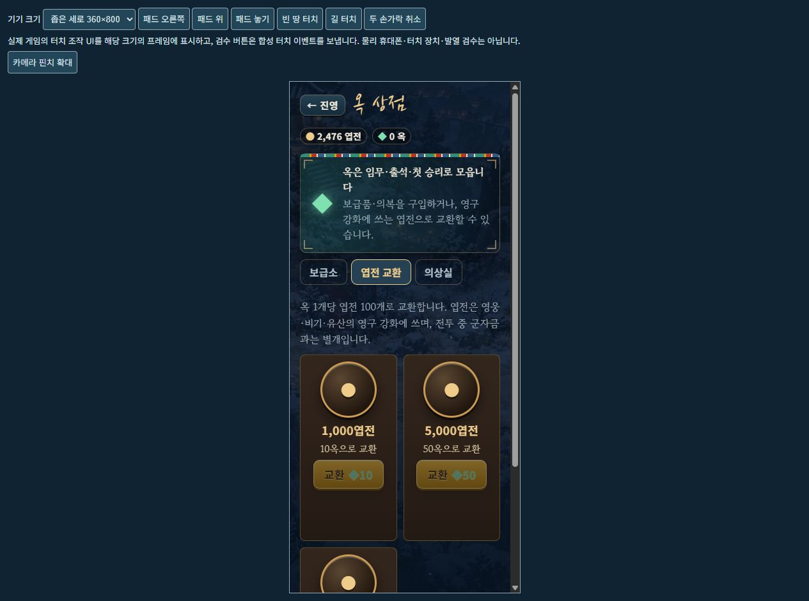

# 모바일 페이지 확대 방지와 엽전 교환

2026-10-18 · 구현·검증 완료, 아스트라 검토 후 공개 반영 진행

사용자가 휴대폰에서 HUD까지 확대돼 돌아오지 않는 화면을 보내고, 좌하단 웨이브 설명 박스 제거와 옥으로 코인 구매를 요청했다. 이번 코인은 기존 영구 성장 재화인 **엽전**이다. 솔로1영웅·방 협동·독립 군자금·기존 저장과 보통 솔로 피해 보정은 유지한다.

## 페이지 확대 방지

사진에서는 전장과 HUD가 함께 커져 있어 카메라 줌과 별개의 브라우저 페이지 확대 경로를 점검했다. 기존 `body { touch-action: manipulation }`은 핀치를 허용하고 캔버스·패드만 `none`이었다. 실제 휴대폰의 간헐 원인을 재현으로 확정한 것은 아니다.

전투 중에는 문서 루트와 body에 **`pan-x pan-y`**를 적용해 페이지 핀치를 배제하고, 메뉴·건설 목록의 일반 스크롤을 허용한다. 캔버스·패드의 `none`과 OrbitControls 두 손가락 카메라 확대는 유지한다. viewport의 최대 배율 제한과 Safari `gesturestart/change/end`의 기본 동작 차단도 전투 수명에 묶는다. `touchstart/move/end`와 PointerEvent를 새로 차단하거나 전파를 멈추지 않는다.

전투 종료 때 원래 viewport·문서 속성을 복원한다. 같은 document의 줌 제한을 두 곳에서 사용해도 마지막 소유자가 해제할 때만 복원하도록 WeakMap 참조 수를 사용한다. 아스트라가 최초 중첩 해제 문제를 재현했고, 수정 후 두 해제 순서·중복 해제·재등록·서로 다른 document를 독립 확인했다.

**이미 브라우저 전체가 확대된 화면을 강제로 되돌리는 기능은 아니다. 새 버전으로 새로고침해 시작해야 한다.** `visualViewport.scale` 역수로 HUD를 축소하는 방식은 사용하지 않는다. 실제 휴대폰 native pinch와 브라우저 접근성 설정의 확대 강제 허용은 이 PC에서 확인하지 못했다.

## 웨이브 설명 제거

좌하단 `.wave-card`의 생성·갱신·재배치 참조와 관련 CSS9규칙을 제거했다. 접힌 제목이나 접기 버튼도 남기지 않는다. 상단 파도 수·하단 조기 호출/카운트다운·자동 파도 진행·실제 전술 효과는 유지한다. 별도의 첫 플레이 도움말은 기존 설정을 따른다.

## 옥 상점의 엽전 교환

| 사용 옥 | 받는 엽전 |
|---:|---:|
| 10 | 1,000 |
| 50 | 5,000 |
| 100 | 10,000 |

보급소·엽전 교환·의상실 탭을 제공한다. 모든 묶음은 **1옥=100엽전**으로 같고 대량 할인은 없다. 교환 전에 사용량과 지급량을 확인하며, 잔액이 부족하면 버튼을 잠근다. 고정 상품 ID·안전한 정수·부족 잔액·합산 overflow를 거래 함수에서 다시 검사한다. 옥 차감과 엽전 지급을 함께 반영하고 한 번 저장한다.

확인 중 중복 클릭, 이미 처리한 버튼, 상점을 떠난 뒤 늦게 도착한 확인, 바뀐 프로필과 잔액을 검사한다. 무효 요청은 저장·차감·지급을 하지 않는다. 교환은 전투 군자금·품계·임무·전투 통계를 직접 올리지 않는다. 앞선 무환전 성장75전장 기록과 새 교환 기능은 구분한다.

## 검증

전체 **525개/40검사군**이 통과했다. 새12검사는 실제 viewport 수명·상품 거래·상점 확인 UI의 취소/중복/늦은 처리·저장 후 재로드를 검사한다. 기존 패드16검사와 전투 완주2판SHA도 유지한다. 두 빌드·내장 그림·웹195그림·ZIP manifest 전체 SHA를 확인했다. [전체 회귀](MOBILE_UX_REGRESSION_VALIDATION.json) · [새 런타임 검사](MOBILE_UX_RUNTIME_VALIDATION.json) · [빌드/ZIP](MOBILE_UX_BUILD_VALIDATION.json)

실제 IAB의 게임 프레임414×896·360×800·896×414에서 웨이브 카드0·페이지 배율1·조작44px 이상·HUD 넘침 없음을 확인했다. 개발용 합성 포인터로 실제 OrbitControls 카메라1.12→2.08, 기본 시점1.12 복귀를 확인했다. 패드 유지 중 기술 시전·숭례문 건설·손 떼기와 전투 종료 후 viewport 복원도 확인했다. 긴 건설 목록은 줌 제한이 켜진 상태에서 scrollTop0→165, 상점은0→245로 스크롤됐다. 전투 메뉴는 가로 화면에 전부 들어왔으며 `overflow:auto`를 유지했다.

상점은 취소 후 무차감,476엽전/20옥→1,476/10, 새로고침 뒤 동일 잔액을 확인했다. 빠른 더블클릭은 확인창1개만 만들었고 한 번 확인한 뒤2,476/0·모든 교환 버튼 비활성으로 바뀌었다. 모두 로컬 QA 프로필이다. [실제 DOM·입력·한계](MOBILE_UX_BROWSER_VALIDATION.json)

[414px 전장](screenshots/mobile-ux/game-414.png) · [360px 전장](screenshots/mobile-ux/game-360.png) · [896px 가로](screenshots/mobile-ux/game-896.png) · [제한 중 건설 목록 스크롤](screenshots/mobile-ux/locked-build-list-scroll.png)

개발 IAB 도구에서 기존과 같은 `MutationObserver.observe` 오류3개가 기록돼 원기록을 보존했다. 제품 `src/**/*.js`와 배포 스크립트에는 해당 문자열이 없으며, 도구가 클릭할 요소를 찾지 못한 경우가 있었다. 이를 실제 제품 콘솔 오류0으로 바꿔 쓰지 않는다. 공개 빌드의 브라우저 검수는 배포 후 별도로 기록한다.

**물리 휴대폰·native pinch·LTE·앱 잠금/전환·장시간 발열 검수는 미완료**다. 합성 포인터의 페이지 배율1은 실제 브라우저 핀치 재현을 대신하지 않는다. 아스트라는 이 잔여 위험을 수용하고, 현재 브라우저/빌드 조건을 통과하면 같은 Railway 주소·단일 서버·기존 자원 제한·검증된 커밋 고정으로 배포하도록 승인했다. [아스트라 검토](MOBILE_UX_ASTRA_REVIEW.json)
