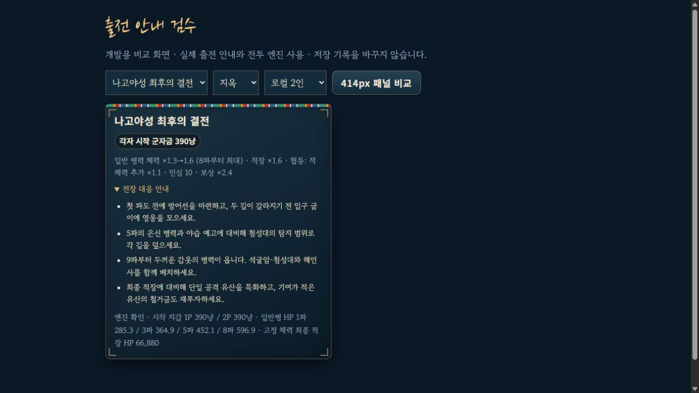

# 지옥 초반 조정과 출전 안내

2026-10-12. 지옥의 일반 병력 체력을 첫 파도1.3배에서8파1.6배까지 점진적으로 올리고, 출전 전에 실제 시작 군자금과 대응 안내를 표시했다. 후반 재시도 부담 전체를 해결한 작업은 아니다.

## 적용

| 파도 | 지옥 일반 병력의 난이도 체력 배율 |
| --- | --- |
| 1 | 1.3 |
| 3 | 약1.386 |
| 5 | 약1.471 |
| 7 | 약1.557 |
| 8 이후 | 기존1.6 |

적장은 모든 파도에서 기존1.6배다. 전장의 기본·성장·중간 적장 보정은 별도로 적용하며 협동은 적 체력에1.1배를 추가한다. 따라서 지옥 협동의 난이도·협동 결합 배율은 일반 병력1.43→1.76, 적장1.76이다. 이 배율을 호스트에서 한 번 계산해 스냅샷으로 전달한다. 충차 파괴·적장 소환의 일반 병력은 소환 주체의 원래 파도를 기준으로 한다.

보통·어려움 수치, 적장의 HP, 이동 속도·갑옷·저항·포상 배율, 시작 군자금과 영구 성장 비용은 유지했다. 첫 파도의 일반 병력 HP는 이전 지옥보다18.75% 낮다. 초반 처치와 수입·경험치가 달라지면 이후의 전투 양상도 달라지므로 후반 체감까지 동일하다는 뜻은 아니다.

캠페인 지도·솔로 출전 준비·로컬 협동·온라인 로비에 시작 군자금과 난이도를 표시한다. 협동은 각자의 금액과 적 체력 추가 보정을 명시한다. 기본적으로 접혀 있는 ‘전장 대응 안내’에서 길목 분담, 은신 편성과 야습, 철갑 대응, 최종 적장 대비를 확인할 수 있다. 탐지·대응 유산은 해당 플레이어의 해금에 맞춘다. 온라인도 각 기기의 실제 프로필을 사용한다.

## 후보 비교와 한계

2026-10-11의 [실제 획득 성장 원본](DIFFICULTY_PROGRESSION_VALIDATION.json)에서 전장별 첫 시도 직전의 성장 상태를 고정했다. 원본 SHA256은 `86d812c9344137c76df507a3824947c23748f591c003c0a383ecacd29eb82dd8`이다. 아래228판은 같은 성장·시드·전술·준비 방식에서 후보를 비교하는 진단이며, 새 캠페인 완주나 사람 승률로 집계하지 않는다. 일반 명령과 실제 가격을 사용하지만 시작 자금 후보에는 진단용 최초 지갑 덮어쓰기가 있다. 지급·저장·영구 강화를 수행하지 않는다.

| 비교 | 조건 | 기존 승리 | 후보 승리 | 기록 |
| --- | --- | --- | --- | --- |
| 시작 자금+15% / +30% | 지옥·검토 전술·즉시 출발 | 3/12 | 7/12 · 8/12 | [탐색](OPENING_BUDGET_EXPLORATION.json) |
| 시작 자금+30% | 지옥·다른 전술·즉시 출발 | 3/12 | 2/12 | [보류 표본](OPENING_BUDGET_HOLDOUT.json) |
| 시작 자금+30% | 지옥·30초 준비 | 8/18 | 11/18 | [준비 비교](OPENING_BUDGET_PREPARED.json) |
| 시작 자금+15% | 어려움·즉시 출발 | 12/12 | 11/12 | [어려움](OPENING_BUDGET_HARD.json) |
| 일반 HP1.3→1.6 | 지옥·검토 전술·즉시 출발 | 3/12 | 7/12 | [탐색](OPENING_HP_EXPLORATION.json) |
| 일반 HP1.3→1.6 | 지옥·검토 전술·30초 준비 | 8/18 | 9/18 | [준비 비교](OPENING_HP_PREPARED.json) |
| 일반 HP1.3→1.6 | 지옥·다른 전술·즉시 출발 | 2/12 | 1/12 | [보류 표본](OPENING_HP_HOLDOUT.json) |
| 일반 HP1.3→1.6 | 지옥·다른 전술·30초 준비·새 시드 | 3/12 | 3/12 | [최종 확인](OPENING_HP_CONFIRMATION.json) |

시작 자금 증가는 시드·전술별 역효과가 있어 채택하지 않았다. HP 후보도 일관된 승률 개선은 아니다. 최종 확인은 시드65537·65539·65543, 순천/현해탄, 솔로/로컬의12쌍이다. 기존3승을 보존했고9파 도달6→7, 평균 남은 민심1.33→2.0이었다. 같은 확인에서도 순천 솔로65537은9→5파, 로컬65537은11→8파에 패배해 악화한 사례가 있다. GPT-6 Astra high 검토를 거쳐 지옥 초반 일반 병력의 제한된 완화로 채택했으며, 전체 지옥 밸런스 개선이나 재도전 문제 해결로 해석하지 않는다.

## 실제 보상·구매 경로 재검사

기존 검사기의 기본 legacy 정책을 유지하고 선택 가능한 prepared 정책을 추가했다. 첫 시도부터 유산20레벨 할인 가격과 봉수 중복 회피를 고려하며, 실제30초 준비 시간 동안 건설·이동한 뒤 자동 출발한다. 각 전장 최대12회, 무료 성장·임의 해금·아이템 구매·옥 전환 없이 출석1회와 정상 보상으로 진행한다. 매 판 소비액과 저장 복원을 확인한다.

첫 전략은1~4장 balanced/기본 배치,5장 fresh/성문 쪽(현해탄 ice/후미 건설),최종전 nam/솔로 입구 또는 로컬 집결이다. 이후 ice/후미, fresh/성문, nam/집결, balanced/중간, bul/분산을 사용한다. 1~6회 A특화와 솔로 cannon·로컬 focus 강화,7~12회 alt특화와 반대 강화 정책을 사용한다. 이는 고정된 자동 정책이며 최적 전략이 아니다. 각 시도의 전술·분기·시드·성장·보상을 보고서에 남긴다.

| 모드·캠페인 시드 | 보통 | 어려움 | 지옥 | 전투 | 패배 | 결과 |
| --- | --- | --- | --- | --- | --- | --- |
| 솔로·2 | 25/25 | 25/25 | 16/25 | 81 | 15 | 지옥 직산12회 상한 실패 |
| 로컬2인·2 | 25/25 | 25/25 | 25/25 | 90 | 15 | 75조합 완료 |

[보고서](DIFFICULTY_PREPARED_PROGRESSION.json)의 `allPassed=false`를 보존한다. 솔로 지옥 직산의 마지막 실패 때 영웅10/10, 비기5/5, 유산8종30·남한산성19·석빙고24였다. 이 조건은 우선 남은 밸런스 범위다. 이전97회 정책·시드1의1,021패와 다른 정책·시드이므로 패배 감소율을 계산하지 않는다. 지옥 직산 이후 솔로 전장은 이번 새 성장 경로로 검증하지 못했다.

## 구현 검증과 화면

전체 **411개 / 30검사군**을 통과했다. [회귀 결과](OPENING_REGRESSION_VALIDATION.json), [신규16개 검사](OPENING_BALANCE_RUNTIME_VALIDATION.json)는 모든25전장·모든 병종의 보통/어려움 기존 HP, 적장·8파 이후 HP, 소환 원래 파도, 스냅샷, 지갑·소유, 실제 안내 수치와 저장 복원을 확인한다. 보통의 기존 솔로/협동 완주2판 SHA는 동일하다. 샌드박스의 루프백 연결 제한으로 처음 실패한 HTTP/WebSocket 검사는 제한 밖에서 다시 실행해 웹14·복구22개를 통과했다.

별도8095 검수 서버에서 실제 캠페인·솔로 장착·로컬 준비·온라인 호스트 로비 화면을 확인했다. 로컬 전투의 시작 지갑156/156과2P E키 건설 후156/86을 확인했다. 검수용 온라인 방은 나가기 버튼으로 정리했다. 지옥 최종전은 저장을 바꾸지 않는 개발 비교 화면에서 실제 안내와 엔진의 각자390냥·협동 최종 적장66,880HP를 확인했다. 좁은 화면 검사는 브라우저 viewport 대신 실제414px 패널의 client/scroll 폭412/412를 사용했다. 물리 휴대폰·WAN·사람의 후반 체감 검증은 포함하지 않는다.




서버 번들·단일 HTML·외부 자산 웹 폴더·ZIP을 다시 만들었다. 단일 HTML121,857,037바이트, 웹 폴더 manifest 합계93,760,166바이트, ZIP91,876,482바이트다. 배포 그림163파일의 바이트와 ZIP189항목의 해시를 확인했다. 새 그림을 제작하거나 해상도를 바꾼 작업은 아니다. [릴리스 기록](OPENING_BALANCE_RELEASE_VALIDATION.json).

```powershell
node tools/test-opening-balance.mjs
node tools/test-roadmap-regression.mjs --output=OPENING_REGRESSION_VALIDATION.json
node tools/check-motion-determinism.mjs
node tools/verify-progression.mjs --policy=prepared --seed-start=2 --seeds=1 --attempts=12 --difficulties=normal,hard,hell --output=DIFFICULTY_PREPARED_PROGRESSION.json
node tools/measure-opening-budget.mjs --stages=s21,s24 --gold=1 --hp=legacy,ramp --opening=prepared --tactics=alternate --seeds=65537,65539,65543 --output=OPENING_HP_CONFIRMATION.json
```

성장 검사는 미완주 때 보고서를 저장한 뒤 종료 코드1을 반환한다. 날짜별 임무·출석은 실행 날짜의 영향을 받는다. 저장된 원본 보고서와 이번 기록은 서로 다른 시점의 증거로 해석한다.
