# 호국영웅전 프로젝트 리뷰

> 갱신: 2026-10-14 · 현재 구현과 남은 작업을 기록하는 기준 문서
> 저장소: [evilmuff0805-create/Td](https://github.com/evilmuff0805-create/Td) · 작업 브랜치: [`claude/korean-hero-tower-defense-i8ard8`](https://github.com/evilmuff0805-create/Td/tree/claude/korean-hero-tower-defense-i8ard8)

## 현재 상태

기본 전장은 **고정된 높은 시점의 2.5D 일러스트**다. 실제 3D 지면 위에 투명 캐릭터·건물 그림을 배치하고, 기존 시뮬레이션의 이동·건설·사거리·피해·협동 명령에 연결했다. 전장 25곳, 영웅 8명, 유산 10종, 왜군 22종을 같은 표현으로 사용한다.

가장 최근에는 **Railway 공개 테스트 서버를 배포했다**. [음소거로 바로 플레이](https://hoguk-game-production.up.railway.app/?mute=1)할 수 있으며 기존 로컬2P와 방 코드 온라인 협동을 유지한다. 실제 Linux Docker 빌드·싱가포르 단일 인스턴스·CPU0.5/메모리0.5GB 제한을 확인했다. 공개 HTTPS/WSS 3검사와 실제 브라우저 두 창의 방 참가·양측 이동·일시정지·각자 건설(156/156→86/86)을 통과했다. Astra 하이 검토·모든 전장 그림 준비·콘솔 경고/오류0을 확인했다. 실폰+LTE 등 물리 두 기기와 장시간 운영 검수는 남는다. [주소·방법·정확한 배포 범위](PUBLIC_DEPLOYMENT.md) · [실제 네트워크 검사](PUBLIC_NETWORK_VALIDATION.json) · [브라우저 기록](PUBLIC_BROWSER_VALIDATION.json).

앞선 작업에서는 **원화 해상도를 유지한 렌더링·메모리 개선, WebGL 복구, 휴대폰 크기의 조작 버튼, 사계절 도로 마감**을 적용했다. 같은 PC의128명·28종 비교에서 높은 품질803→513회 그리기/60fps, 중복 캐릭터 캔버스 약359.6MiB 감소를 관측했다. 주요 버튼은44px 이상이며414·360 세로/896 가로 배치를 검수했다. 실제 제품/자유 전장의 드라이버 복구와 로컬2P 양쪽 건설, **451개/34검사군**과 기존 완주2판SHA를 통과했다. 당시에는 공개 배포가 보류 상태였다. 현재 공개 실행 결과는 위 최신 배포 기록을 따른다. [정확한 범위와 화면](DEVICE_AND_ROADS.md) · [최신 공개 배포](PUBLIC_DEPLOYMENT.md).

앞선 작업에서는 **영웅 24외형의 긴 동작과 합격기 11종의 독립 연속 원화를 연결했다**. 새384자세로 영웅1,152·병력896·캐릭터 전체2,048자세를 준비한다. 영웅은 여섯 박자 걸음과 다섯 자세 공격·복귀를 사용하며 합격기마다16프레임을 갖는다. 같은 의상·무기·발 기준과 선택 로딩을 유지하고 잘못 남은 화살·강감찬 뒤쪽 검 자세를 교정했다. **439개 / 32검사군**, 기존 보통 완주2판 SHA·실제 로컬2P 양측 이동/기술·두 배포 빌드·ZIP·Astra 하이 검토를 통과했다. 후반 난이도 조정은 사용자가 보류했다. [원화·프롬프트·정확한 범위](LONG_MOTION.md) · [릴리스 검사](LONG_MOTION_RELEASE_VALIDATION.json).

앞선 작업에서는 **지옥 초반 일반 병력의 HP와 출전 안내를 조정했다**. 일반 병력은1파1.3배→8파1.6배이며 적장은 기존 배율이다. 캠페인·솔로 준비·로컬·온라인에 실제 시작 군자금과 협동 추가 체력, 접힌 전장 대응 안내를 표시한다. 전체 **411개 / 30검사군**, 기존 보통 완주2판 SHA·새 빌드·ZIP·실제2P 건설의 독립 지갑을 확인했다. 새12회 준비 정책의 획득 성장 검사는 솔로66/75·로컬75/75로, 솔로 지옥 직산은 미완주다. 후반 재도전 문제를 해결 완료로 표시하지 않는다. [조정·유불리 비교·실패 기록](OPENING_BALANCE.md) · [릴리스 기록](OPENING_BALANCE_RELEASE_VALIDATION.json).

앞선 작업에서는 **건설 메뉴가 많을 때의 겹침을 고치고 네 점을 연결선 없이 건물 바로 아래에 고정했다**. 선택 확대·가격·단축키를 포함해 간격을 계산하고, 공간이 부족하면 줄 배치·스크롤로 바꾼다. 점은 설명이 열려도 움직이지 않는다. 실제 로컬 2인에서 1P 클릭·2P E키 건설과 군자금156/156→86/86을 확인했다. [메뉴·점 표시와 정확한 검수](BUILD_MENU_LAYOUT.md).

함께 **웹 배포 폴더·압축/캐시·재접속 복구·입력 취소와 프레임 계측·어려움/지옥의 획득 재화 경로·불꽃/물결/치유 각8프레임**을 추가했다. 전체 **395개 / 29검사군**, 기존 완주2판 SHA와 자산 내장 검사를 통과했다. 솔로75+로컬75 전장·난이도 조합을 실제 보상과 구매로 완주했지만 패배가1,021회라 사람의 적정 난이도 인증으로 보지 않는다. 새 원화는 세 계열이며 11조합 각각의 장편 원화나 긴 캐릭터 동작을 추가한 범위는 아니다. 실제 휴대폰·외부 WAN 확인은 남는다. [이번 범위와 배포](ROADMAP_RELEASE.md) · [성장 기록과 한계](DIFFICULTY_PROGRESSION.md) · [원화·정확한 프롬프트](COMBO_ELEMENTS.md).

앞선 작업에서는 **선택 영웅의 기본 시트만 전장 소유로 준비하고 교체·종료 메모리를 정리했다**. 실제 2인 전장은 기본 2장, 미지정 전체 비교 화면은 8장을 유지한다. 이순신·세종 기본 원화 캔버스의 저장량 계산은 85,067,488→22,831,168바이트로 약73% 줄며 전체 게임 메모리 측정값은 아니다. 당시 **338개 / 25검사군**을 통과했다. [정확한 범위와 당시 검증](HERO_LOADING.md).

앞선 작업에서는 **합격기 11종에 실제 대상·착탄 효과를 연결했다**. 새 충격파 원화 8프레임과 기존 물결·화염·빛·치유·조합 문양을 사용하며, 지원은 아군 좌표에 표시한다. 낙성우·대포탄은 기존 투사체의 실제 폭발 위치와 시각을 따른다. 전체 **325개 / 24검사군**, 기존 완주 SHA·사계절·지연 착탄·8회 자원 수·414px·실제 로컬 2인·두 빌드·Astra xhigh 최종 검토를 통과했다. [정확한 범위와 검증](COMBO_IMPACTS.md).

앞선 작업에서는 **건물 아래 네 점으로 강화 단계를 표시하도록 바꿨다**. 1·2·3단계는 해당 개수만큼 채우고 최종 A는 금색 네 점, B는 청록색 네 점으로 구분한다. 평소에는 점만 보이고 선택·가리킴·키보드 초점에서 이름과 상세를 펼친다. 표식은 건물 바닥을 따라가며 밀집한 곳에서도 기본 점을 건물 위로 올리지 않는다. 관련 **46개 / 3검사군**, 실제 로컬 2인 건설·독립 군자금·414px·A/B 강화·두 빌드를 확인했다. [표시와 정확한 검증 범위](TOWER_DOTS.md).

앞선 작업에서는 **작은 숫자 배지와 스킬 발동음을 추가했다**. 성공한 기술·궁극기·장착 비기마다 짧은 소리를 전달하며 두 사람의 동시 발동을 보존한다. 임시 무음은 저장 설정을 덮어쓰지 않고 `?sound=effects`로 음악 없이 효과음만 켤 수 있다. 당시 전체 **309개 / 23검사군**과 두 빌드·완주 SHA·Astra xhigh 수정 후 검토를 통과했다. 숫자 배지는 현재 네 점으로 교체했다. [당시 표시·소리·실제 검증](BATTLE_FEEDBACK.md).

앞선 작업에서는 **특수 의상 16종의 큰 흉상과 의상실 미리보기를 추가했다**. 기본 8명과 합계 24개 외형이 도감·출전 선택·의상실에서 같은 톤을 사용한다. 의상별 지연 로딩·실패 격리·늦은 응답·구매/장착·전신 모드 유지를 검사하고 좁은 화면의 영웅 이름 줄바꿈도 고쳤다. 새 16그림은 640×640 무손실 WebP 합계 4,333,550바이트다. 작은 HUD·전장 1,664자세·유산 크기·로컬 2인은 유지하며 전체 **294개 / 22검사군**, 픽셀·완주 SHA·두 빌드·Astra xhigh 최종 검토를 통과했다. [최신 원화·프롬프트·적용과 검증](SKIN_BUST_ART.md).

앞선 작업에서는 **목책·돌담·옹기·보급짐과 겨울 외형 12개를 추가했다**. 반복 경계 장식 248칸을 122개 그림으로 정리하고 안전한 마당 목책 13개·기존 짐 7곳을 연결했다. 새 소품의 실제 네 모서리를 길·건설·물·다리 여백 안에 맞췄고 당시 272개 / 20검사군을 통과했다. [원화·배치·검증](VILLAGE_SCENERY.md).

앞선 작업에서는 **이동→디딤→정지와 방향·조준 전환을 다듬었다**. 일시정지 중 늦은 조준, 60Hz/120Hz 반복 위치 깜빡임과 검사기 방향을 보완했다. 당시 262개 / 19검사군과 Astra xhigh 재검토를 통과했다. [동작 전환 기록](MOTION_TRANSITIONS.md).

앞선 작업에서는 **적군·적장·아군과 이동체 28종의 중간 동작 원화 448장을 추가했다**. 네 방향의 중간 걸음 A·B와 공격 후·복귀를 연결해 병력은 기존 448장과 새 448장, 총 **896자세**다. 영웅 24외형의 768자세를 합한 전체 준비 그림은 **1,664장**이다. 앞선 1,216장의 픽셀·좌표와 로컬 2인 조작·소유·군자금·실제 전투 계산을 유지한다. 전령·거북선은 네 박자 이동만 실제로 사용하며 추가 공격/복귀 그림은 검토용 예비 자세다. [원화·정확한 범위·검증](COMBAT_INBETWEENS.md).

앞선 작업에서는 특수 의상 16종의 중간 동작 원화 256장을 추가해 기본 영웅과 의상의 모든 외형을 네 박자 보행·공격 복귀에 연결했다. [의상 작업 당시 기록](SKIN_INBETWEENS.md).

앞선 작업에서는 기본 영웅 8명의 중간 원화 128장을 추가해 기본 영웅 총 256자세와 네 박자 보행·공격 복귀를 연결했다. [기본 영웅 작업 당시 기록](HERO_INBETWEENS.md).

앞선 작업에서는 **타이틀·도감·의상실·출전 선택·전투 HUD·평면 모드의 기본 영웅 8명과 의상 16종을 확정된 전장 그림에 연결했다**. 승인된 준비 포즈를 색상·투명도 변경 없이 메뉴용 한 시트로 묶고 얼굴 영역을 따로 맞췄다. 로컬 2인 조작·소유·재화는 유지한다. [범위와 검증](HERO_MENU_ART.md).

앞선 작업에서는 **비기 8개·전용/일반 합격기 11개·참격에 전용 그림 20개를 추가했다**. 비기의 해결 좌표와 실제 폭탄·대포탄·한파를 따르고, 합격기는 조합별 중앙 문양을 사용한다. 실제 피해·시간·양측 입력·각자 군자금은 유지한다. [정확한 범위와 검증](TACTIC_ART.md).

앞선 작업에서는 **숲의 높낮이·절벽·한옥 주변 짐·등불 배치를 다듬었다**. 26지도×사계절에서 원래 경로·건설 자리·물·다리를 보존한다. 성문 등불은 진입로 옆의 안전한 자리에만 놓고 유산 높이 1.2칸과 로컬 2인 규칙은 유지한다. [배치 범위와 검증](SCENERY_LAYOUT.md).

앞선 작업에서는 **영웅 기술·궁극기 16개에 각각 다른 그림 모티프를 연결했다**. 학익진 전체 그림·거북선 항적·자격루·낙성우·총구·마늘·번개 등은 실제 명령의 좌표와 시점을 따른다. 기존 아이콘 디자인은 유지하면서 두 시트를 WebP로 압축했다. 로컬 2인과 기존 전투 수치는 유지한다. [기술 연출 범위와 검증](SKILL_SIGNATURES.md).

앞선 동작 작업에서는 **캐릭터의 발걸음을 실제 이동 거리에 연결하고 공격 복귀·피격·사망을 다듬었다**. 로컬 1P 마우스·2P 방향키/ASDF/E를 유지하며 게스트 보간·반복 공격·일시정지·재출전도 보완했다. 승인된 832포즈는 변경하지 않았다. [동작 범위와 검증](MOTION_REFINEMENT.md).

앞선 작업에서는 **낮은 연속 물가와 차분한 그림 수면을 실제 강·바다에 연결**하고 외곽 수면의 계단형 종료를 고쳤다. 원래 물·다리·건설 판정은 유지하며 먼 수면만 보간을 보존해 최적화했다. [최신 물가 범위와 검증](WATER_REFINEMENT.md).

앞선 작업에서는 **봄 꽃나무·여름 활엽수·가을 단풍 총 6개를 제작해 실제 전장에 연결**하고 모바일 영웅 이름표의 화면 넘침을 수정했다. 기존 설송과 상록수 군락도 유지한다. [계절 수목 범위와 검증](SEASONAL_SCENERY.md).

앞선 지형 작업에서는 **길을 하나의 연속 메시로 바꾸고 풀·흙·눈·다져진 길 재질의 반복을 줄였다**. 25전장과 별도 겨울 전장에서 실제 경로·건설 자리·물·다리는 유지한다. 사계절 비교도 실제 그림 영웅·작은 유산·소품을 표시한다. [지형 범위와 검증](TERRAIN_REFINEMENT.md).

앞선 작업에서는 사용자 확정 **이순신 v2와 기본 영웅의 톤을 특수 의상 16종까지 확장**했다. 의상별 16포즈, 총 **256포즈**를 추가해 전장용 준비 그림은 **832개**다. 앞선 병력 확장에서는 새로 **28종 × 16 = 448포즈**를 실제 전투에 연결했고, 기존 영웅 **8명 × 16 = 128포즈**와 합하면 준비된 기본 전장 포즈는 **576개**다. 네 방향의 준비·이동 두 자세·공격을 사용하며 전령·거북선의 마지막 네 자세는 예비 전투 준비 그림이다. 승인된 영웅 그림은 유지했다. 이순신의 남색 망토·활·화살통과 권율의 붉은 망토·창·방패 구분도 그대로다.

유산은 **10종 × 기본·2단계·3단계·최종 A·B = 50개 전용 외형**을 사용하고, 표시 높이는 모든 단계에서 **1.2칸으로 일정**하다. 스킬 공용 그림 8종·영웅 전용 16모티프·비기/합격기/참격 20모티프도 연결돼 있다. 전장에 필요한 병종·현재 장착한 의상·선택한 영웅 외형의 중간 시트만 준비하고, 전장 변경 때 빠진 전용 그림 자원을 해제한다.

최초의 순수 Canvas 2D 구현 이후 실제 3D 전투, 관절 모델, 전용 재질을 거쳐 현재의 그림 전장으로 바뀌었다. [2026-10-09 리뷰](PROJECT_REVIEW_2026-10-09.md)는 당시 기록으로 보존한다. 이전 모델 문서와 스크린샷의 '현재'·검사 수·성능 수치는 각 작업 시점의 기록이며, 최신 범위는 이 문서와 아래의 그림 전장 문서를 기준으로 한다.

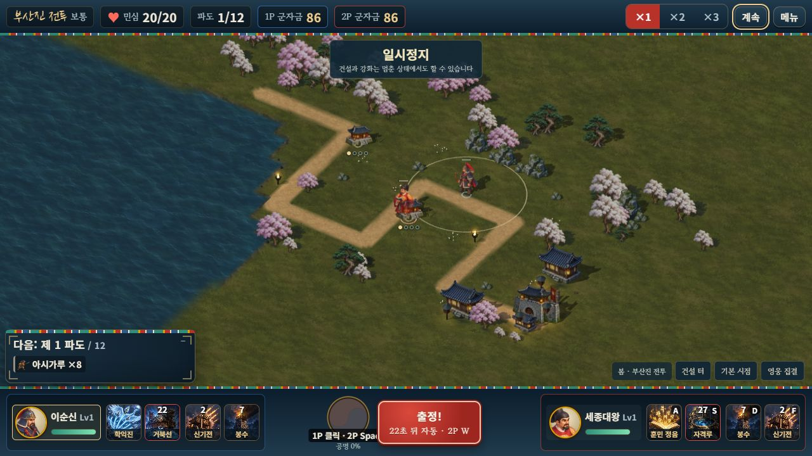

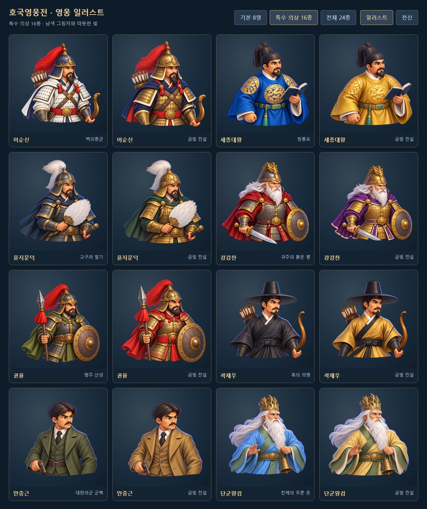

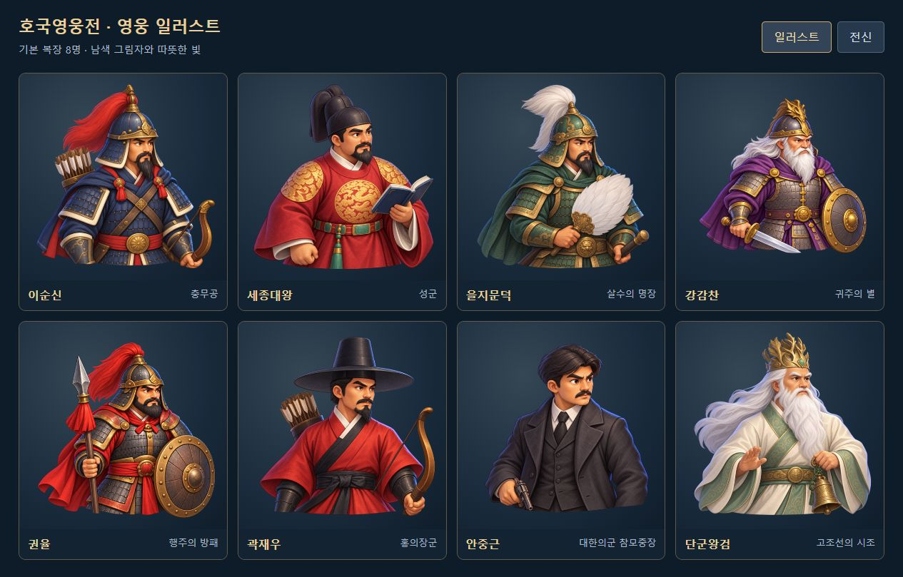

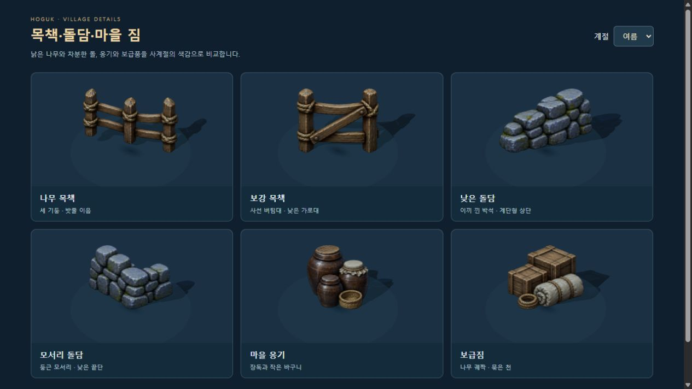

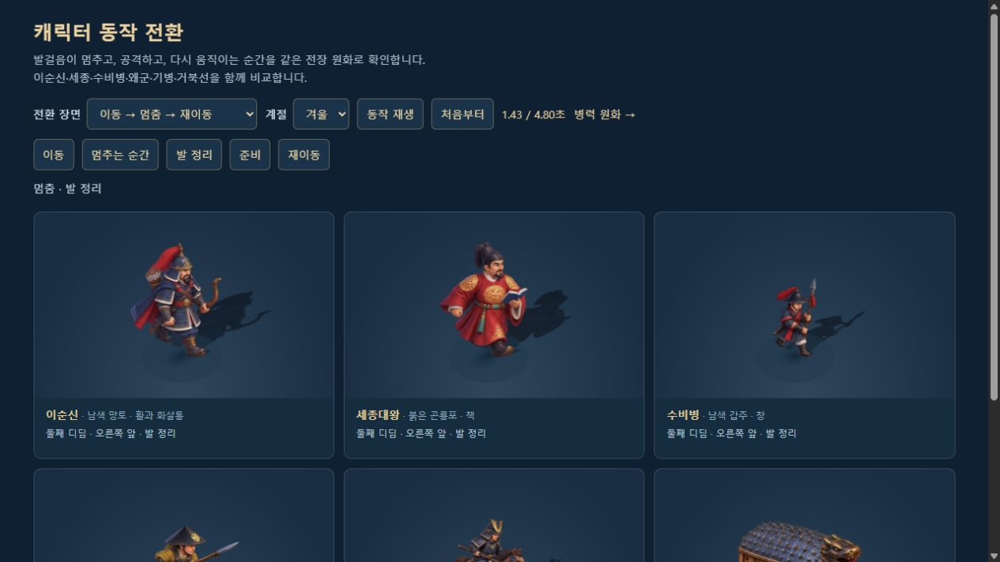

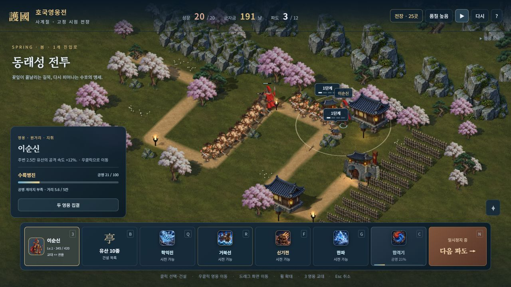

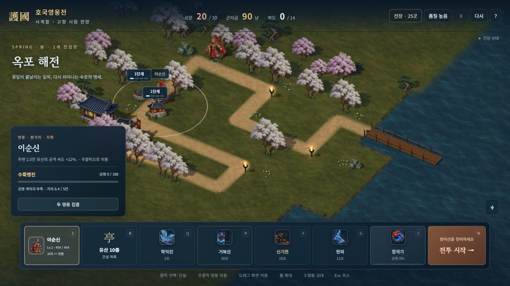

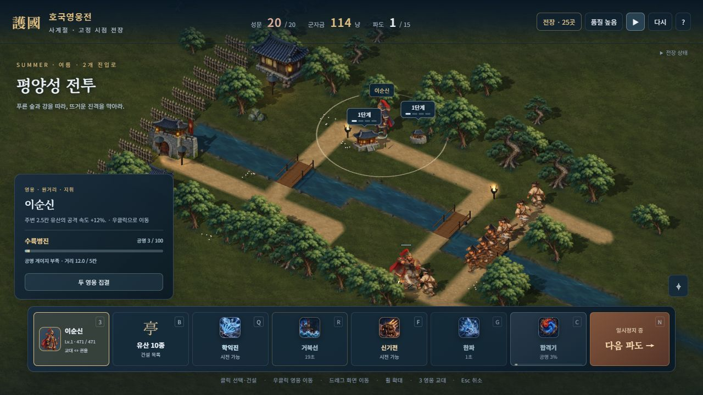

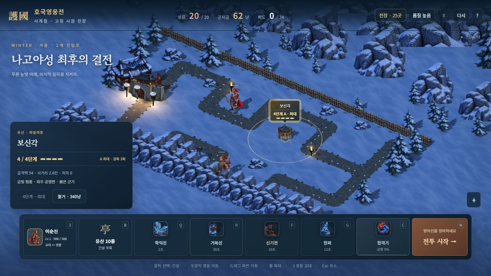

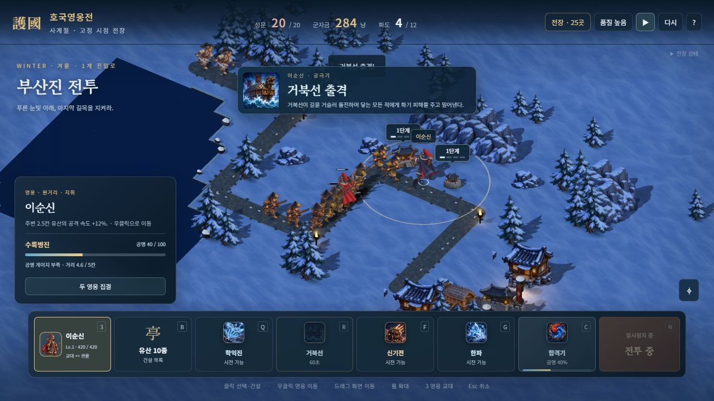

## 합의한 미술 방향

- 참고 이미지의 입체 애니메이션풍 색감과 미감을 기준으로 한다. 남색·주홍·오래된 금속색, 차가운 환경광과 따뜻한 등불을 함께 사용한다.
- 전투는 고정된 높은 시점으로 진행한다. 기본 그림 모드의 카메라 회전은 막고 이동·확대·축소를 사용한다.
- 건물은 작게 유지한다. 기본·강화·최종 특화의 크기를 키우지 않고 기와·장식·등불·깃발·핵심 장비와 단계 표식으로 상태를 구분한다.
- 봄·여름·가을·겨울을 전장별로 배치한다. 모든 전장을 겨울이나 강설로 통일하지 않는다.
- 메뉴·일시정지 등 조작 글자는 가독성 있는 굵은 고딕 계열을 사용한다. 작업 중 게임은 `?mute=1`로 열어 음악·효과음을 끈다.

## 구현된 게임 범위

| 구분 | 현재 구현 |
|---|---|
| 전투 모드 | 혼자 영웅 2명 지휘 · 한 화면 로컬 2인 · 방 코드 온라인 2인 |
| 전장 | 5장 25전장 · 보통/어려움/지옥 · 다중 경로·해전·최종 적장 |
| 영웅 | 이순신·세종대왕·을지문덕·강감찬·권율·곽재우·안중근·단군왕검 8명, 기술·궁극기 16개 |
| 유산 | 숭례문·수원화성·보신각·첨성대·해인사·석굴암·경복궁·남한산성·석빙고·불국사 10종, 단계·특화 외형 50개 |
| 적군 | 일반 병력 10종 · 적장 12명, 최종 도요토미 히데요시 포함 |
| 전투 시스템 | 비기 8종 · 보급품 4종 · 전용 합격기 10종과 기본 합격기 · 전술 예고·파훼 · 전령 이벤트 |
| 성장 | 품계 18단계 · 엽전/옥 · 영웅/비기 영구 강화 · 유산 복원 30단계 · 장별 첫 승리 포상 |
| 진영 | 저장·불러오기 · 영웅/유산 해금 · 상점 · 의복 16종 · 일일/주간 임무 · 7일 출석 |
| 표시·설정 | 체력·상태·은신/탐지 · 선택·사거리·착탄 예고 · 건물 아래 네 점·선택/초점 상세 · 스킬 발동음·음악 없는 효과음 프리셋 · 가벼운 품질 · 평면 모드 대체 · 음량·화면 흔들림 설정 |

온라인은 호스트가 시뮬레이션을 실행하고 게스트가 명령을 보내는 방식이다. 상대 영웅 이동과 상대 유산 철거를 검증하며, 게스트의 영구 이탈 때 호스트가 인계받는다. 임시 끊김은30초 예약·재접속·전체 상태와 원화 ACK 후 재개하며 결과 캐시도 사용한다. 메뉴와 성장·보상은 실제 전투 세션에 연결돼 있다. [복구 범위와22개 검사](ROADMAP_RELEASE.md).

## 최신 미술 적용 범위

| 대상 | 적용과 정확한 범위 |
|---|---|
| 캐릭터·적군·소품 | 투명 그림 시트와 접지 그림자를 사용한다. 그림 로딩 실패 시 기존 표현으로 대체한다. |
| 기본 영웅 8명 | 기존 128장과 새 중간 128장, 총 256포즈. 각각 네 방향의 준비·네 보행·발사/타격·타격 후·복귀 32포즈를 사용한다. 원래 배율·발 기준점·그림자·가림 실루엣을 함께 전환하고 실제 이동 거리와 공격 시각을 따른다. 피격·사망·일시정지·재출전도 유지한다. |
| 이순신 톤 수정 | 부드러운 비율·넓은 남색 면·절제한 금속 명암의 v2를 사용한다. 활·화살통·남색 망토로 권율과 구분한다. 타이틀 전신·작은 HUD·평면 모드는 승인된 같은 준비 포즈를 사용한다. 특수 의상도 같은 톤의 전용 32포즈를 사용한다. |
| 전장 원화 로딩 | 선택 기본 영웅·의상·중간 원화만 전장이 소유한다. 교체·종료 시 이전 자원과 참조를 정리한다. 미지정 전체 비교는8명,빈 게스트는0명이며 첫 스냅샷 뒤 선택 원화를 준비한다. 원화·해상도는 유지한다. |
| 큰 메뉴 흉상 | 기본 8명·의상 16종, 총 24개 전용 그림을 도감·출전·의상실에 외형별 지연 로딩한다. 도감 상세 304px, 도감/의상실 전신 전환과 의상실 미리보기. 준비 전·실패 시 해당 기존 의상 상반신으로 대체한다. |
| 병력·적장·아군 | 일반 왜군 10종·적장 12명·아군과 이동체 6종의 기존 448장과 새 중간 448장, 총 896포즈. 네 박자 이동과 타격·공격 후·복귀, 실제 뒷모습·발 기준점·접지 그림자를 전환한다. |
| 특별 의복 16종 | 기존 256장과 새 중간 256장, 총 512포즈. 각각 네 방향의 준비·네 보행·발사/타격·타격 후·복귀 32포즈를 사용한다. 장착한 의상과 그 의상의 중간 시트만 준비한다. 중간 시트 실패는 기존 의상 동작, 원래 의상 실패는 승인된 기본 영웅으로 대체하며 다른 옷의 중간 그림이 섞이지 않는다. 정상 소유·구매·장착·능력치 규칙을 유지한다. |
| 유산 강화 | 전용 그림 50개와 기본→보강→완성→최종 A/B 단계 표시. 모든 단계 높이 1.2칸. 실제 비용·공격·해금은 기존 엔진이 결정한다. |
| 스킬 효과 | 공용 그림 8종에 영웅 16기술의 개별 모티프를 추가했다. 실제 투사체·장판·이동체·생성 위치를 사용한다. 비기 8개와 합격기 11개·참격의 개별 그림도 추가했다. 합격기11종은 공용 충격파8프레임·기존 모티프와 새 불꽃/물결/치유 각8프레임으로 실제 대상·착탄을 표시한다. 조합별로 독립적인 8프레임 원화를 11세트 제작한 범위는 아니다. 아이콘 25칸은 기존 디자인·해상도·알파를 유지하며 WebP로 압축했다. |
| 이동 병기 | 출격 거북선·전령의 방향별 준비·네 박자 이동, 각각 20자세를 실제 경로·피해·보상 이벤트에 연결했다. 기존/추가 공격·복귀 그림 12자세는 검토용 예비 자세이며 새 공격 행동을 추가한 범위가 아니다. |
| 지형·주변 환경 | 계절별 지면·길·물·박석, 나무·한옥·바위·등불·소품을 실제 지도 좌표에 조립한다. 실제 직각 이동 중심은 유지하고 길 외곽을 둥근 연속 메시로 마감한다. 불규칙한 가장자리·다져진 자국·풀/흙/눈/길 재질을 사용한다. 물·다리·건설 중심을 침범하지 않는다. 자유 곡선 지도는 남은 범위다. |
| 강·바다·물가 | 낮은 .125칸 연속 물가와 .25칸 그림 수면. 외곽 물은 풍경 끝까지 연장하고 먼 상수 영역·페이드 스트립만 보간을 보존해 병합한다. 실제 물·다리·경로·건설 판정은 유지한다. |
| 계절 수목 | 봄 벚꽃·여름 활엽수·가을 단풍 각각 두 변형, 총 6개를 실제 지도와 주변 숲에 혼합한다. 겨울 설송·먼 숲은 기존 그림이며 시트 실패 시 기존 소품으로 대체한다. |
| 마을 소품 | 목책 2형태·돌담 2형태·옹기·보급짐의 비겨울/겨울 12개. K 248칸→122그림·마당 목책 13개·기존 짐 7곳. 새 그림의 실제 네 모서리 여백·계절 재조립·대체 표시를 검사했다. |
| 기존 3D 모델 | 관절·얼굴·복식·무기·유산 모델은 대체 표현과 비교 도구에 보존한다. 기본 전장의 캐릭터 표현은 그림이다. |

새 유산·영웅·병력 포즈는 실제 투명 경계를 따라 개별 텍스처로 분리하고 사방에 12픽셀 여백을 둬 축소 시 이웃 그림이 섞이지 않게 했다. 영웅 128포즈·병력 448포즈·특수 의상 256포즈의 이웃 혼입·누락·중복 픽셀은 모두 0이며 원본과 WebP의 알파도 일치한다. 병력과 의상은 시트 외곽 접촉도 0이다. 원본 PNG·배포 WebP·최종 생성 프롬프트와 자산 검사 결과를 저장소에 함께 보존한다.

추가 중간 원화는 기본 영웅 128장·특수 의상 256장·병력 448장, 총 **832장**이다. 정확한 자르기·균일 리사이즈·포장 뒤 무손실 WebP **52장(48,364,004바이트)**으로 배포한다. 이번 병력 28장 합계는 **25,817,292바이트**다. 포장 여백은 24px이며 원래 외형의 기준 높이를 유지한다. 선택 원본 97개 시트와 새 448칸의 혼입·누락·중복·외곽·알파·보이는 RGB 차이는 0이다. [최신 병력 중간 원화](COMBAT_INBETWEENS.md) · [앞선 의상](SKIN_INBETWEENS.md) · [앞선 기본 영웅](HERO_INBETWEENS.md).

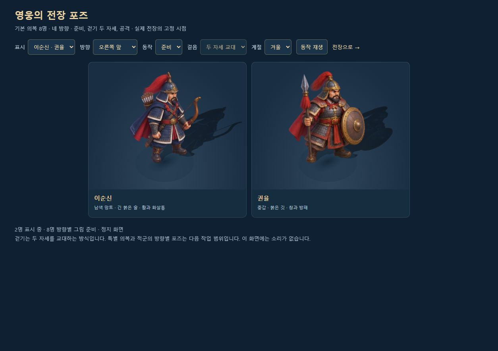

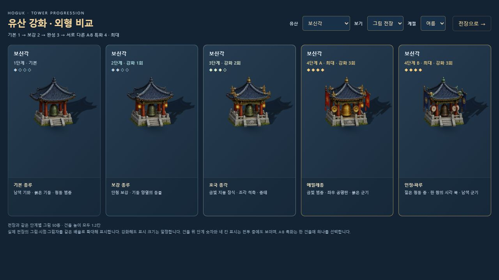

## 실행과 빌드

포함된 번들로 플레이할 때는 **Node.js 18 이상**에서 저장소 폴더를 열고 서버를 실행한다.

```bash
node server/server.js
```

게임: [http://localhost:8080/?mute=1](http://localhost:8080/?mute=1). 작업 중에는 음소거 주소를 사용한다. 음악 없이 효과음만 플레이하려면 [효과음 전용 주소](http://localhost:8080/?sound=effects)를 사용하거나 설정의 **배경음 끄고 효과음 켜기**를 선택한다. 같은 네트워크의 다른 기기와 협동하려면 PowerShell에서 `$env:HOST = "0.0.0.0"`을 설정한 뒤 서버를 실행하고 터미널의 네트워크 주소를 사용한다.

소스를 수정하거나 단일 HTML을 다시 만들 때는 개발 패키지를 설치한다.

```bash
npm install
npm run build:3d
npm run build
```

`three@0.186.1`, `esbuild@0.24.0`를 사용한다. `npm run build:3d`는 서버용 번들을 갱신하고, `npm run build`는 엔진과 그림을 포함한 `dist/hoguk.html`을 만든다. 현재 검증한 단일 HTML은 **168,632,065바이트**이며 영웅8장·병력28장·의상16장·기존 중간 시트52장·새 긴 동작24장, 총 **128방향/중간 시트**와 독립 합격기11장을 각각 한 번 포함한다. 기존 메뉴·큰 일러스트·지형·소품·스킬·공용/계열 효과도 유지한다. 캐릭터/중간 동작/독립 합격기의 보존용 PNG322장과 기타 보존용 원본·거부 후보는 포함하지 않는다. 선택 외형만 디코딩해도 단일 HTML에는 전체 배포 그림이 포함되므로 파일 크기는 커진다. `npm run build:web`은 원화 외부 파일·gzip·캐시를 쓰는 `dist/web/`을 만들고 `python tools/package-web.py`는 배포 ZIP을 만든다. [정확한 크기·실행](ROADMAP_RELEASE.md). `node_modules/`와 `dist/`는 Git 제외 생성물이며 재현 소스·원본·배포 그림·도구·서버용 번들은 저장소에 포함한다.

단일 파일은 혼자/로컬 협동용이며 온라인 협동은 서버 기본 게임 주소에서 실행한다. 앞선 단일 파일 브라우저 검증은 `/dist/hoguk.html?mute=1`에서 수행했고, 앞선 로컬 2인 건설·고정 점 검증은 별도8098서버의 실제 `dist/web` 패키지에서 수행했다. 브라우저 보안 정책 때문에 `file://` 직접 실행 검증은 하지 못했다. 선택 웹 글꼴을 받지 못하면 시스템 글꼴을 사용한다.

주요 비교 도구: [24개 외형 큰 일러스트](http://localhost:8080/dev/hero-bust-review.html?set=all&mute=1) · [영웅 8명 큰 일러스트](http://localhost:8080/dev/hero-bust-review.html?mute=1) · [마을 소품 확대](http://localhost:8080/dev/3d-village-review.html?mute=1) · [이동·정지·공격 전환](http://localhost:8080/dev/3d-motion-review.html?mute=1) · [사계절 풍경](http://localhost:8080/dev/3d-season-review.html?mute=1) · [전체 영웅 외형 1,152자세](http://localhost:8080/dev/3d-skin-pose-review.html?mute=1) · [기본 영웅 384자세](http://localhost:8080/dev/3d-hero-pose-review.html?mute=1) · [병력 896자세](http://localhost:8080/dev/3d-combat-pose-review.html?mute=1) · [강화 외형 50개](http://localhost:8080/dev/3d-tower-review.html?mute=1) · [사계절 스킬 효과](http://localhost:8080/dev/3d-effect-review.html?mute=1) · [밀집 병력 28종](http://localhost:8080/dev/3d-performance-review.html?mute=1) · [자유 전장](http://localhost:8080/3d.html?mute=1). 자유 전장은 미술·전투 비교용 지원 설정을 제공하며 정식 캠페인 보상과 구분한다.

## 현재 버전 검증

최신 버전은 **451개 / 34검사군**을 통과했다. 원화 복사·단일 패스·품질/사망 그림자·그래픽 손실/복구 대기·입력 취소·26지도 도로/건설 여백·실제 HTTP/WS 패키지를 검사했다. 동일한 보통 완주2판SHA와 실제 로컬2P 건설·독립 군자금, 제품/자유 전장 드라이버 복구와 세 화면 크기를 확인했다. 이후 공개 서버의 실제 Linux Docker 실행과 공개 HTTPS/WSS·브라우저 두 창 검수도 통과했다. 물리 두 기기·실폰/LTE·장시간 검수는 남는다. [최신 검증과 정확한 한계](DEVICE_AND_ROADS.md) · [전체 회귀](DEVICE_ROADS_REGRESSION_VALIDATION.json).

앞선 긴 동작 버전은 **439개 / 32검사군**을 통과했다. 새 동작13개·합격기 연속 원화15개와 기존 전투/협동/로딩/재접속/배포 검사를 확인했다. 실제 WebGL의24외형×4방향×새4자세384전환과11합격기 대표 장면, 최신 웹 빌드의1P 지정 학익진/우클릭 이동·2P 실제 A키 기술/방향키 이동을 검수했다. 민심20/20·각156냥·1/12파에서 정지했고 승패·구매·보상 수령은 없었다. 네 탭 콘솔 경고/오류는0이다. 두 기존 보통 완주 SHA와 시뮬/저장/네트워크 소스·결정성 fixture를 유지했다. 176개 UV/피벗은 자동 검사이며 모든 프레임의 사람 시각 검수나 물리 휴대폰/WAN 시험을 뜻하지 않는다. Astra 하이 최종 검토에서 필수 수정은 발견되지 않았다. [전체 회귀](LONG_MOTION_REGRESSION_VALIDATION.json) · [화면과 한계](LONG_MOTION_BROWSER_VALIDATION.json) · [정확한 범위](LONG_MOTION.md).

앞선 버전은 **411개 / 30검사군**을 통과했다. 신규16개는 지옥 초반 HP·기존 보통/어려움·적장·소환·지갑·소유·스냅샷·출전 안내·저장을 확인한다. 기준 보통 솔로·협동2판 SHA는 동일하다. 실제 캠페인·솔로·로컬·온라인 호스트 안내와 로컬2P E키 건설156/156→156/86을 확인했다. 개발 비교 패널은 실제414px 폭과 가로 넘침 없음을 확인한 것이며 물리 휴대폰 시험은 아니다. 단일 HTML·웹 폴더·ZIP과 원화163파일의 바이트를 검사했다. Astra 하이가 찾은 협동 추가 체력 안내를 수정한 뒤 재검토했다. 실제 휴대폰·외부 WAN·사람의 적정 후반 난이도는 미검증이다. [전체 회귀](OPENING_REGRESSION_VALIDATION.json) · [이번 범위와 반례](OPENING_BALANCE.md) · [릴리스 기록](OPENING_BALANCE_RELEASE_VALIDATION.json).

앞선395개/29검사군 작업은 웹14·재접속22·기기입력10·건설메뉴8·합격기19개, 실제 웹 패키지의 로컬2인 양측 건설·메뉴 크기별 DOM·스크롤과 새 세 계열 효과를 확인했다. [당시 회귀](ROADMAP_REGRESSION_VALIDATION.json) · [당시 범위](ROADMAP_RELEASE.md) · [건설 UI](BUILD_MENU_LAYOUT.md).

앞선 선택 로딩 버전은 **338개 / 25검사군**을 통과했다. 실제 생성자의 선택2장·같은 영웅1장·미지정8장·빈 게스트0장, 그림 완료 순서·같은 Promise·교체·실패·종료와 로컬 HUD/게스트를 검사했다. 당시 실제 로컬2인·의상/영웅 교체·414×896과 전체8명 합격기를 확인했다. [당시 상세](HERO_LOADING.md) · [회귀](HERO_LOADING_REGRESSION_VALIDATION.json) · [브라우저](HERO_LOADING_BROWSER_VALIDATION.json) · [릴리스](HERO_LOADING_RELEASE_VALIDATION.json).

앞선 합격기는 **325개 / 24검사군**을 통과했고 최종 화면 조정 뒤 합격기16·효과8·비기8을 다시 확인했다. 실제 명령 11조합·사계절·지연 착탄 0.10/0.65/3초·동일 장면 8회·414×896 가로 넘침 0·새 단일 HTML 로컬 2인 양측 건설과 기술을 검수했다. 군자금156/156→86/156→86/86, 민심20/20이며 사용자 Chrome은 건드리지 않았다. 원본 대비 알파·보이는 RGB 차이는 0이고 기존 전투 상태·기존 사건·완주 두 판 SHA는 같다. [상세](COMBO_IMPACTS.md) · [전체 검사](COMBO_IMPACT_REGRESSION_VALIDATION.json) · [브라우저](COMBO_IMPACT_BROWSER_VALIDATION.json) · [릴리스](COMBO_IMPACT_RELEASE_VALIDATION.json). 아래 309개 표와 설명은 앞선 숫자 배지·발동음 버전의 역사적 기록이다.

이번 네 점 표시 변경은 표시·발동음 15개, 정식 캠페인 16개, 고정 시점 그림 15개로 관련 **46개 / 3검사군**을 확인했다. [실행 결과](TOWER_DOTS_REGRESSION_VALIDATION.json). 아래 23개 검사군·309개는 앞선 숫자 배지/발동음 버전의 전체 검사 기록이다.

| 명령 | 통과 수 |
|---|---:|
| `node tools/selftest.mjs` | 14 |
| `node tools/test-3d.mjs` | 41 |
| `node tools/test-fixed-art.mjs` | 15 |
| `node tools/test-campaign.mjs` | 16 |
| `node tools/test-effects.mjs` | 8 |
| `node tools/test-enemies.mjs` | 12 |
| `node tools/test-combat-art.mjs` | 13 |
| `node tools/test-skin-art.mjs` | 14 |
| `node tools/test-terrain.mjs` | 8 |
| `node tools/test-seasonal-props.mjs` | 6 |
| `node tools/test-water.mjs` | 11 |
| `node tools/test-sprite-motion.mjs` | 15 |
| `node tools/test-signatures.mjs` | 12 |
| `node tools/test-scenery.mjs` | 8 |
| `node tools/test-tactics.mjs` | 8 |
| `node tools/test-menu-art.mjs` | 8 |
| `node tools/test-inbetweens.mjs` | 19 |
| `node tools/test-combat-inbetweens.mjs` | 20 |
| `node tools/test-motion-transitions.mjs` | 14 |
| `node tools/test-village-props.mjs` | 10 |
| `node tools/test-hero-busts.mjs` | 12 |
| `node tools/test-skin-busts.mjs` | 10 |
| `node tools/test-battle-feedback.mjs` | 15 |
| 합계 | **309** |

새 표시·소리 검사 15개와 기존 294개, 총 **309개 / 23검사군**을 통과했다. 검토 후 종료 이벤트 큐 수정에 관련된 자체14·캠페인16·새15개를 다시 확인했다. 유산 12개 밀집 배치·가리킨 위치 유지·키보드·조준 축소, 성공한 영웅 16기술/비기8종·동시 발동·온라인 최종 전송·무음/효과음 전용 볼륨을 검사했다. 실제 단일 HTML 로컬 2인에서 1P 건설2·2P E키건설1·각자 군자금156/156→16/86, 양측 기술·선택/초점/조준·414×896과 가로 넘침 없음을 확인했다. 자유 미리보기 1→2→3→4A 강화와 작은 최대 배지·선택 패널 단계 막대·모바일도 확인했다. 세 검증 탭의 콘솔 경고/오류는0이며 전부 무음으로 수행했다. 사람이 소리를 들어 평가한 범위는 아니다. 기존 완주SHA·fixture/비교필터·원화/데이터는 유지한다. Astra xhigh가 찾은 CSS 범위·온라인 종료 이벤트 중복을 수정했고 최종 필수 수정은 없다. [최신 범위](BATTLE_FEEDBACK.md) · [실행](BATTLE_FEEDBACK_RUNTIME_VALIDATION.json) · [전체 검사](BATTLE_FEEDBACK_REGRESSION_VALIDATION.json) · [브라우저](BATTLE_FEEDBACK_BROWSER_VALIDATION.json) · [릴리스](BATTLE_FEEDBACK_RELEASE_VALIDATION.json).

앞선 의상 흉상 검사 10개와 기존 284개, 총 294개 / 22검사군을 통과했다. 의상별 캐시·실패 격리·늦은 응답·잘못된 ID·HUD/전신 유지, 실제 의상실 DOM의 8명 미리보기·구매/장착·모드 유지와 장착 의상의 로컬 출전 사양을 확인했다. 기존 완주 두 판 SHA·기준 fixture와 전투 코드·1,664자세는 유지한다. 새 16원본·32px여백·무손실RGB/알파·승인참조 검사와 두 빌드를 통과했다. Astra xhigh는 24개 비교·로더·검사·의상실과 수정 후 모바일 화면을 검토해 필수 수정 없음으로 확인했다. 실제 단일 HTML에서 의상실8명·24그림·전신→영웅교대·414×896 이름 줄바꿈/가로넘침없음·로컬양측16흉상·중복선택금지·첫진군·2P E키건설 군자금156/156→156/86을 확인했다. 첫파도 뒤 민심20/20에서 정지했고 해당게임탭 경고/오류0이다. 브라우저 구매·장착 의상 협동과 양측 개별 이동/전체 기술 재시연은 이번 실제 브라우저 범위에 추가하지 않았다. [최신 범위](SKIN_BUST_ART.md) · [실행](SKIN_BUST_RUNTIME_VALIDATION.json) · [전체 검사](SKIN_BUST_REGRESSION_VALIDATION.json) · [브라우저](SKIN_BUST_BROWSER_VALIDATION.json) · [릴리스](SKIN_BUST_RELEASE_VALIDATION.json).

앞선 마을 소품 검사 **10개**는 26지도×사계절의 실제 그림 네 모서리 여백·K 원래 칸의 정확한 기록·비정형 경계의 빈 칸·마당 집/짐/등불 여백·세 카메라 높이·UV·그림자·실제 loadStage 계절 반복·소유자별 자원·부분 실패와 종료 뒤 완료를 확인했다. 기존 262개를 합한 **272개 / 20검사군**, 새 12형태의 RGB/알파/혼입/누락/중복/외곽 차이 0, 이전 완주 두 판 SHA·기준 fixture 불변과 두 빌드를 통과했다. Astra xhigh가 새 10개와 기존 배치/픽셀 검사를 독립 재실행하고 최종 렌더·구현을 승인했다. 브라우저 소품 6종×사계절·반복 전환 자원 수 안정·414×896 가로 넘침 없음, 같은 동래성 겨울→여름과 최신 단일 HTML의 정상 로컬 2인 양측 기술·2P 실제 E키 숭례문 건설·군자금 156/156→156/86을 확인했다. 민심 20/20·첫 파도에서 정지했고 승패·해금·구매·승리 보상은 발생시키지 않았다. 네 탭 콘솔 경고/오류는 0이다. 이번 UI 이동은 집결 명령이며 개별 방향키는 기존 Session 검사 범위다. 소품 확대 검수 장면의 안정된 텍스처 13·지오메트리 19를 전체 게임 성능으로 주장하지 않는다. [당시 범위](VILLAGE_SCENERY.md) · [실행 검사](VILLAGE_PROP_RUNTIME_VALIDATION.json) · [브라우저](VILLAGE_PROP_BROWSER_VALIDATION.json) · [릴리스](VILLAGE_PROP_RELEASE_VALIDATION.json).

앞선 동작 전환 검사 **14개**는 20/60/120fps의 발 정리, 공격/재이동 즉시 전환, 60Hz/120Hz 반복 위치, 기절·점프·되감기, 8도 경계와 새 조준, 실제 월드의 pause 중 원화/기울기/반동/그림자/총구 고정, 검사기 방향, 실제 로컬 Session 양측 기술·스냅샷·시전자 분리를 확인했다. 같은 이순신 두 명은 직접 구성한 방어 검사이며 정식 UI의 중복 선택을 뜻하지 않는다. 기존 248개를 합한 **262개 / 19검사군**, 승인 그림·기준 fixture 불변과 두 빌드를 확인했다. 변경 전 완주 두 판의 기존 이벤트/스냅샷 SHA는 같으며 비교에서는 기존 표시 전용 필드 외에 새 선택적 `cone.caster` ID만 제외한다. Astra xhigh가 찾은 반복 위치 깜빡임·검사기 좌우 부호를 수정한 뒤 최종 검토와 독립 14개 재실행을 통과했다. 브라우저 5시퀀스·23지점×6대표·사계절·재생/정지·414×896 가로 넘침 없음, 최신 단일 HTML 이순신/세종 로컬 2인의 1P 지정 학익진·2P 실제 A키 기술·집결 이동·정지를 확인했다. 화면은 4/12파도·민심 8/20·군자금 268/268이며 승패·해금·구매·승리 보상은 발생시키지 않았다. 이번 UI 이동은 집결이며 개별 방향키는 자동 Session 검사 범위다. 두 탭 콘솔 경고/오류는 0이다. [최신 범위](MOTION_TRANSITIONS.md) · [실행 검사](MOTION_TRANSITION_RUNTIME_VALIDATION.json) · [브라우저](MOTION_TRANSITION_BROWSER_VALIDATION.json) · [릴리스](MOTION_TRANSITION_RELEASE_VALIDATION.json).

앞선 병력 작업 당시 검사 **20개**는 실제 896자세·거리 기반 네 박자·공격 후/복귀·은신/정지/기절/사망·총구, 실제 로컬 Session 양측 입력·두 병영 비용·병사 소유와 스냅샷, 선택 로딩·부분 실패·오래된 요청 폐기·전장별 자원 정리를 확인했다. 진군 중에는 새 공격을 만들지 않고 성문 도착 시 바로 누출되며 기존 길막 교전에서만 공격한다는 검사도 통과했다. 기존 228개를 합한 **248개 / 18검사군**, 기존 1,216장 픽셀·파일 불변, 변경 전 완주 두 판 SHA, 두 빌드·104시트 단일 포함을 확인했다. Astra xhigh 최종 미술·런타임 검토를 통과했다. 브라우저 896자세·사계절·재생/정지·414×896 가로 넘침 없음, 최신 단일 HTML 기본 이순신/세종 로컬 2인 이동·기술과 첫 적 진군을 확인한 뒤 20/20·군자금 156/156·첫 파도에서 일시정지했다. 정상 해금·구매·승패 보상은 발생시키지 않았고 두 탭 콘솔 경고/오류는 0이다. 두 병영의 비용·소유 검증은 실제 Session 자동 검사 범위이며 이번 브라우저에서 병영을 건설한 것은 아니다. 단일 HTML은 DOM 전송 크기 한도 때문에 실제 화면·마우스·키보드로 검수했다. [최신 원화·범위](COMBAT_INBETWEENS.md) · [브라우저 기록](COMBAT_INBETWEEN_BROWSER_VALIDATION.json).

앞선 영웅 검사 19개는 24외형/768자세·거리 기반 네 박자·세 공격 자세·서로 다른 의상의 실제 로컬 Session 양측 입력/스냅샷 독립·정지·누락 조합·선택 로딩·첫 틱·게스트·자원 정리를 확인했다. 의상 검사에서는 코어/병력/원래 의상/중간 그림의 완료 순서 24가지도 통과했다. 추가 384장 픽셀 검사와 변경 전 전투 두 판 SHA 동일성, 두 빌드·76시트 단일 포함을 확인했다. Astra xhigh 최종 검토에서 추가 필수 런타임 결함은 없었다. 브라우저 768자세 전환, 백의종군/행주 산성의 선택 로딩·실제 이동/발사 후/정지, 최신 단일 HTML 기본 이순신/세종 로컬 2인 양측 이동·기술·2P 숭례문 건설과 군자금 156/86을 확인했다. 의상 검수 화면은 414×896 가로 넘침 0이며 기본 크기로 복원했다. 세 탭 콘솔 경고/오류는 0이다. 단일 HTML의 DOM 전송은 도구 크기 한도를 넘어 실제 스크린샷·마우스·키보드로 검수했다. [최신 원화와 검증](SKIN_INBETWEENS.md) · [브라우저 기록](SKIN_INBETWEEN_BROWSER_VALIDATION.json).

새 메뉴 그림 검사 8개는 24포즈의 정체성·로딩 대기·정확한 얼굴/전신 영역·평면 실제 그리기·장착 CSS·누락/크기 오류 대체·프로필 불변을 확인했다. 픽셀의 보이는 색상·알파 차이는 0이고 기존 전투 두 판 SHA도 같다. 브라우저 타이틀 8명·도감 8명·의상 24표시·단일 HTML 로컬 2인 이동/기술/건설·평면 협동·자유 전장 의상 교대를 확인했다. Astra xhigh가 찾은 자유 전장 얼굴의 세로 늘어남을 정사각 요소로 수정했고 데스크톱 HUD 40×40을 확인했다. 세 탭의 경고/오류와 1280px 넘침은 0이며 이번 모바일 검증은 별도 수행하지 않았다. [최신 메뉴 검증](HERO_MENU_ART.md).

새 비기·합격기 검사 8개는 20모티프·실제 36명령·2P 해결 좌표/소유/JSON·합격기 양측 입력·투사체·한파 교체/수명·64효과 상한·자원 정리를 확인했다. Astra xhigh가 찾은 비교 화면 시트 대기를 수정했고 전투 SHA도 같다. 브라우저 36장면·사계절·단일 HTML 로컬 2인·반복 자원 수 일치와 두 탭 경고/오류 0을 확인했다. 이번 414px 설정은 반영되지 않아 모바일 검증으로 기록하지 않는다. [최신 비기·합격기 검증](TACTIC_ART.md).

새 소품 검사 8개는 26지도×사계절 배치 불변·길/건설/물/다리 발 범위·고리형 한옥·문 옆 짐·안전한 등불·실제 조립/해제·2P 건설 비용을 확인했다. Astra xhigh가 지적한 성문 등불의 길 중심 배치를 수정한 뒤 재검토를 통과했다. 사계절·414×896·정식 로컬 2인과 28종 밀집 표시 128→64명도 확인했다. 자동 거리는 선언된 소품 발 범위에 대한 검사이며 전체 수관의 가림을 보증하지 않는다. [배치 검사](SCENERY_PLAN_VALIDATION.json) · [브라우저 기록](SCENERY_BROWSER_VALIDATION.json).

영웅 전용 기술 16개는 실제 명령·투사체·장판·이동체와 연결되며, 새 검사 12개에서 실제 생성 좌표·양측 소유권·JSON 전달·학익진 범위·12회 번개·늦은 준비·실패·일시정지·자원 정리를 확인했다. 기존 25칸 아이콘은 디자인을 유지하면서 배포를 압축했다. 원래 솔로/협동 완주 두 판의 전투 이벤트·스냅샷·수입·승패 SHA도 같다. 비교에서는 이번에 추가한 표시 전용 `abilityCue` 이벤트만 제외한다. 브라우저 실제 명령 26개·사계절·414×896·최신 정식 로컬 2인·단일 HTML과 반복 자원 수 일치를 확인했고 세 탭의 경고·오류는 0이다. Astra xhigh의 학 그림 잘림 지적을 수정했고 번개 대기 구체·예고 병합까지 최종 검토했다. [최신 기술 검증](SKILL_SIGNATURES_VALIDATION.json) · [브라우저 기록](SKILL_SIGNATURE_BROWSER_VALIDATION.json).

검사에는 실제 영웅 루트의 128포즈, 포즈 공통 배율·발 기준점·그림자·가림 그림 동기화, 영웅 시트 일부 누락과 공유 자원 정리를 포함한다. 실제 엔진의 건설·강화·A/B 선택 50조합, 동일한 작은 건물 크기, 선택·발사 원점, 비동기 그림 로딩·실패·종료, 스킬 이벤트·장판 만료, 세션·저장·협동·첫 승리 포상 검사도 통과했다.

후속 이순신 v2 교체 후에는 **고정 그림 검사 15개**와 **8시트·128포즈 픽셀 검사**를 다시 실행했다. 이웃 혼입·누락·중복과 알파 변경은 모두 0이다. 다른 일곱 영웅의 원본·WebP·프롬프트·포즈 데이터가 이전 커밋과 같은지 확인했다. 두 빌드와 단일 HTML의 8시트 단일 포함 검사도 통과했다. 요청한 **GPT Astra xhigh**의 미술 비교에서도 톤 일치와 권율 구분에 필수 수정이 없다는 판정을 받았다. [이순신 최신 검증](YI_TONE_REFINEMENT_VALIDATION.json).

새 검사 13개는 실제 병력 루트 28종의 448포즈·발 기준점·그림자·UV, 25전장 파도·전술·분열·적장 증원 준비, 은신·기절·사격 예고·사망, 실제 거북선·전령 이벤트와 개인/공용 자원 정리, 일부 시트 실패 대체와 비동기 로딩 순서를 포함한다. Astra 검토로 늦은 이전 전장의 완료가 새 카메라·로딩 표시를 바꾸는 결함과 로딩 중 키보드 궁극기 소모를 수정했다. 구루시마·시마즈의 첫 시트에 있던 이웃 픽셀 9개·69개는 전체 인물 간격을 넓힌 v2로 해결했으며 최종 미술·픽셀 검토도 통과했다.

이번 브라우저 확인은 병력 448개 포즈의 개별 전환, 사계절·단독 표시·재생/정지, 자유 전장 4파도 진입과 실제 거북선 출격, 부산진→나고야성→부산진 병종 준비 12→21→12종, 정식 단일 HTML 동래성의 영웅·13병종 로딩과 첫 파도 전 일시정지, 비교·정식 화면의 414×896 표시를 포함한다. 네 검사 탭의 콘솔 경고·오류와 확인한 모바일 가로 넘침은 없었다. 정식 검증에서 승패 보상을 발생시키지 않았다. PC 혼합 렌더링 부하 장면은 64·128·64명에 6종 아군·이동체를 더해 28종을 표시했고 관측값은 60fps·p95 17ms였다. 이는 이동을 지정한 표시 부하 장면의 측정이며 실제 휴대폰이나 전체 게임의 성능 보증은 아니다. [최신 병력 검증](COMBAT_DIRECTIONAL_ART_VALIDATION.json) · [브라우저 기록](COMBAT_DIRECTIONAL_ART_BROWSER_VALIDATION.json).

특수 의상 후속 작업에서는 256포즈·같은 영웅을 고른 두 소유자의 서로 다른 의상·정상 프로필과 세션 전달·장착값 중복 제거·코어/병력/의상 로딩 순서·첫 틱 보류·게스트 수신 유지·실패 대체·이전 요청 무효화·살아 있는 영웅과 사망 잔상의 자원 정리 검사 14개를 추가했다. Astra xhigh의 구현 재검토도 통과했다. 브라우저에서 256포즈·사계절·재생/정지·실제 의상 전투·재시작 유지·의상 2→1종 전환·414×896 표시와 단일 HTML 제목 기동을 확인했다. 콘솔 경고·오류와 확인한 모바일 가로 넘침은 없었다. [특수 의상 검증](SKIN_DIRECTIONAL_ART_VALIDATION.json) · [브라우저 기록](SKIN_DIRECTIONAL_ART_BROWSER_VALIDATION.json).

새 지형 검사 8개는 26지도 경로·지도 불변, 합류·모서리·맵 밖 진입의 실제 보간 알파, 물·다리·건설 중심 제외, 지면 연속성, 실제 사계절 풍경 병합·자원 해제를 확인한다. 새 지면 3장도 단일 HTML에 각각 한 번 포함한다. Astra xhigh 설계·구현 검토와 실제 사계절 전장·겨울 2파도·강/다리·재시작·414×896 표시를 통과했다. 브라우저 경고·오류와 확인한 모바일 가로 넘침은 없었다. [지형 검증](TERRAIN_REFINEMENT_VALIDATION.json) · [브라우저 기록](TERRAIN_BROWSER_VALIDATION.json).

새 수목 검사 6개는 계절 선택·겨울 그림 보존, 실제 나무 메시의 높이·줄기 기준점·UV·그림자, 사계절 지도 불변, 계절 소유자별 색·자원 정리, 누락 대체·종료 후 늦은 완료를 확인한다. 새 시트 6개의 이웃 혼입·누락·중복·외곽 접촉·알파 변경은 모두 0이며 기존 832포즈의 픽셀·좌표 검사도 다시 통과했다. 봄 실제 3파도·사계절 전장·414×896 표시를 확인했고, 발견한 모바일 이름표 넘침과 화면 밖 이름표를 수정 후 카메라 이동·선택창·Astra xhigh 재검토로 확인했다. 수정 후 확인한 가로 넘침과 콘솔 경고·오류는 없었다. [계절 수목 검증](SEASONAL_SCENERY_VALIDATION.json) · [브라우저 수정 전후](SEASON_TREE_BROWSER_VALIDATION.json).

새 물가 검사 11개는 26지도 불변·물 coverage·보드 밖 외곽 면적·보간 알파·건설 중심 여백·높이·UV·RGBA·사계절 정렬·자원 해제·그림 실패 대체를 확인한다. 먼 큰 면과 페이드 스트립의 기존 정점·변 중간점 보간도 원래 세밀한 면과 일치한다. Astra xhigh가 지적한 도로 덮임과 수면 교차를 수정했고, 외곽 종료·최적화까지 최종 재검토에서 추가 필수 결함이 없었다. 사계절 다섯 전장·실제 여름 첫 파도/정지·414×896 표시·단일 HTML 제목을 확인했으며 해당 탭의 콘솔 경고·오류와 가로 넘침은 없었다. [물가 최신 검증](WATER_REFINEMENT_VALIDATION.json) · [브라우저 기록](WATER_BROWSER_VALIDATION.json).

앞선 이순신·권율 톤 비교, 영웅 128포즈, 유산 50외형·강화·스킬 검증은 각각의 상세 보고서에 보존한다.

전체 성장 검증은 앞선 [실제 수입 성장 보고서](PROGRESSION_VALIDATION.json)에 있다. 새 기록 4개(혼자/로컬 × 시드 2개)가 실제 획득 재화와 정상 구입만 사용해 보통 25전장을 모두 완주했다. 총 138전투·38회 재도전이다. 이 결과는 특정 봇 전략의 관측이며 사람의 체감 난이도나 어려움·지옥의 실제 수입 완주를 보증하지 않는다.

기존 150전투 회귀와 최종 전장 전략 비교, 모델별 성능 수치는 각 보고서에 보존한다. 최신 그림 전장의 모든 기기 성능을 이전 모델 측정으로 대체하지 않는다.

## 문서와 파일 위치

| 목적 | 위치 |
|---|---|
| 현재 프로젝트 현황 | 이 문서 `docs/PROJECT_REVIEW.md` |
| 최신 지옥 초반·출전 안내·성장 진단·검증 | [OPENING_BALANCE.md](OPENING_BALANCE.md) · [전체411개 검사](OPENING_REGRESSION_VALIDATION.json) |
| 배포·입력·온라인 복구 구현 | [ROADMAP_RELEASE.md](ROADMAP_RELEASE.md) |
| 건설 메뉴 겹침·선 없는 건물 아래 점 | [BUILD_MENU_LAYOUT.md](BUILD_MENU_LAYOUT.md) · [실제 전장](BUILD_DOTS_BROWSER_VALIDATION.json) |
| 불꽃·물결·치유 각8프레임과 프롬프트 | [COMBO_ELEMENTS.md](COMBO_ELEMENTS.md) · [정확한 프롬프트](COMBO_ELEMENT_PROMPTS.json) |
| 어려움·지옥 획득 재화 성장과 전술 | [DIFFICULTY_PROGRESSION.md](DIFFICULTY_PROGRESSION.md) · [실제 경로](DIFFICULTY_PROGRESSION_VALIDATION.json) · [고정 상태 재현](EARNED_TACTICS_VALIDATION.json) |
| 최신 그림 구조·제작·범위 | [ART.md](ART.md) |
| 선택 영웅 원화 로딩·메모리·최신 검증 | [HERO_LOADING.md](HERO_LOADING.md) · [회귀](HERO_LOADING_REGRESSION_VALIDATION.json) · [브라우저](HERO_LOADING_BROWSER_VALIDATION.json) · [릴리스](HERO_LOADING_RELEASE_VALIDATION.json) |
| 합격기 11종 실제 대상·착탄·8프레임·최신 검증 | [COMBO_IMPACTS.md](COMBO_IMPACTS.md) · [회귀](COMBO_IMPACT_REGRESSION_VALIDATION.json) · [브라우저](COMBO_IMPACT_BROWSER_VALIDATION.json) · [릴리스](COMBO_IMPACT_RELEASE_VALIDATION.json) |
| 건물 아래 네 점·최신 검증 | [TOWER_DOTS.md](TOWER_DOTS.md) · [관련 검사](TOWER_DOTS_REGRESSION_VALIDATION.json) · [브라우저](TOWER_DOTS_BROWSER_VALIDATION.json) · [릴리스](TOWER_DOTS_RELEASE_VALIDATION.json) |
| 앞선 숫자 배지·스킬 발동음 | [BATTLE_FEEDBACK.md](BATTLE_FEEDBACK.md) · [실행](BATTLE_FEEDBACK_RUNTIME_VALIDATION.json) · [브라우저](BATTLE_FEEDBACK_BROWSER_VALIDATION.json) · [릴리스](BATTLE_FEEDBACK_RELEASE_VALIDATION.json) |
| 의상 16종 큰 일러스트·의상실·최신 검증 | [SKIN_BUST_ART.md](SKIN_BUST_ART.md) · [자산](SKIN_BUST_ASSET_VALIDATION.json) · [실행](SKIN_BUST_RUNTIME_VALIDATION.json) · [브라우저](SKIN_BUST_BROWSER_VALIDATION.json) · [릴리스](SKIN_BUST_RELEASE_VALIDATION.json) |
| 기본 영웅 8명 큰 일러스트·도감·선택 | [HERO_BUST_ART.md](HERO_BUST_ART.md) · [자산](HERO_BUST_ASSET_VALIDATION.json) · [실행](HERO_BUST_RUNTIME_VALIDATION.json) · [브라우저](HERO_BUST_BROWSER_VALIDATION.json) · [릴리스](HERO_BUST_RELEASE_VALIDATION.json) |
| 이동·정지·조준·pause 전환 | [MOTION_TRANSITIONS.md](MOTION_TRANSITIONS.md) · [실행 검사](MOTION_TRANSITION_RUNTIME_VALIDATION.json) · [브라우저](MOTION_TRANSITION_BROWSER_VALIDATION.json) · [릴리스](MOTION_TRANSITION_RELEASE_VALIDATION.json) |
| 병력 중간 원화 448장·총 896자세·협동 | [COMBAT_INBETWEENS.md](COMBAT_INBETWEENS.md) · [통합 검사](COMBAT_INBETWEEN_RELEASE_VALIDATION.json) · [브라우저](COMBAT_INBETWEEN_BROWSER_VALIDATION.json) |
| 특수 의상 중간 원화 256장·전체 외형 768자세 | [SKIN_INBETWEENS.md](SKIN_INBETWEENS.md) · [통합 검사](SKIN_INBETWEEN_RELEASE_VALIDATION.json) · [브라우저](SKIN_INBETWEEN_BROWSER_VALIDATION.json) |
| 기본 영웅 중간 원화 128장·256자세·협동 | [HERO_INBETWEENS.md](HERO_INBETWEENS.md) · [자산 검사](INBETWEEN_ASSET_VALIDATION.json) · [동작 검사](INBETWEEN_RUNTIME_VALIDATION.json) · [브라우저](INBETWEEN_BROWSER_VALIDATION.json) |
| 메뉴·의상·HUD·평면 영웅 톤 | [HERO_MENU_ART.md](HERO_MENU_ART.md) · [검사](HERO_MENU_VALIDATION.json) · [브라우저](HERO_MENU_BROWSER_VALIDATION.json) |
| 비기·합격기·참격 20그림·협동 | [TACTIC_ART.md](TACTIC_ART.md) · [검사](TACTIC_VALIDATION.json) · [브라우저](TACTIC_BROWSER_VALIDATION.json) |
| 마을 소품 12원화·경계 반복·최신 검증 | [VILLAGE_SCENERY.md](VILLAGE_SCENERY.md) · [검사](VILLAGE_PROP_RUNTIME_VALIDATION.json) · [브라우저](VILLAGE_PROP_BROWSER_VALIDATION.json) · [릴리스](VILLAGE_PROP_RELEASE_VALIDATION.json) |
| 주변 소품 배치·집/짐/등불·협동 | [SCENERY_LAYOUT.md](SCENERY_LAYOUT.md) · [검사](SCENERY_PLAN_VALIDATION.json) · [브라우저](SCENERY_BROWSER_VALIDATION.json) |
| 영웅 16기술·아이콘 압축·최신 검증 | [SKILL_SIGNATURES.md](SKILL_SIGNATURES.md) · [결과 JSON](SKILL_SIGNATURES_VALIDATION.json) · [자산 검사](SKILL_SIGNATURE_ASSET_VALIDATION.json) |
| 연속 물가·그림 수면·최신 검증 | [WATER_REFINEMENT.md](WATER_REFINEMENT.md) · [결과 JSON](WATER_REFINEMENT_VALIDATION.json) |
| 계절 수목 6개·모바일 이름표·검증 | [SEASONAL_SCENERY.md](SEASONAL_SCENERY.md) · [결과 JSON](SEASONAL_SCENERY_VALIDATION.json) |
| 연속 도로·지면 재질·사계절 비교 | [TERRAIN_REFINEMENT.md](TERRAIN_REFINEMENT.md) · [결과 JSON](TERRAIN_REFINEMENT_VALIDATION.json) |
| 특수 의상 256포즈·장착 로딩·검증 | [SKIN_DIRECTIONAL_ART.md](SKIN_DIRECTIONAL_ART.md) · [결과 JSON](SKIN_DIRECTIONAL_ART_VALIDATION.json) · [자산 검사](SKIN_POSE_ASSET_VALIDATION.json) |
| 병력·적장·이동체 448포즈·로딩·검증 | [COMBAT_DIRECTIONAL_ART.md](COMBAT_DIRECTIONAL_ART.md) · [결과 JSON](COMBAT_DIRECTIONAL_ART_VALIDATION.json) · [자산 검사](COMBAT_POSE_ASSET_VALIDATION.json) |
| 이순신 v2 톤·권율 구분·최신 검증 | [YI_TONE_REFINEMENT.md](YI_TONE_REFINEMENT.md) · [결과 JSON](YI_TONE_REFINEMENT_VALIDATION.json) |
| 기본 영웅 128포즈·경계·동작·검증 | [HERO_DIRECTIONAL_ART.md](HERO_DIRECTIONAL_ART.md) · [결과 JSON](HERO_DIRECTIONAL_ART_VALIDATION.json) · [자산 검사](HERO_POSE_ASSET_VALIDATION.json) |
| 유산 50외형·경계·크기·검증 | [TOWER_STAGE_ART.md](TOWER_STAGE_ART.md) · [결과 JSON](TOWER_STAGE_ART_VALIDATION.json) · [자산 검사](TOWER_STAGE_ASSET_VALIDATION.json) |
| 캐릭터 동작·로컬 협동 | [MOTION_REFINEMENT.md](MOTION_REFINEMENT.md) · [검증](MOTION_REFINEMENT_VALIDATION.json) |
| 스킬 그림·이동 병기 | [PAINTED_EFFECTS.md](PAINTED_EFFECTS.md) · [결과 JSON](PAINTED_EFFECTS_VALIDATION.json) |
| 고정 시점 전장·포즈·표시 검증 | [FIXED_BATTLE_ART_VALIDATION.json](FIXED_BATTLE_ART_VALIDATION.json) |
| 정식 전투·협동·성장 통합 이력 | [3D_FULL_GAME.md](3D_FULL_GAME.md) · [POLISH_RELEASE.md](POLISH_RELEASE.md) |
| 설계·수치 | [GAME_DESIGN.md](GAME_DESIGN.md) · [BALANCE.md](BALANCE.md) · `src/data/` |
| 주요 구현 | `src/sim/`, `src/game/`, `src/meta/`, `src/ui/`, `src/3d/` |
| 생성 원본·배포 자산·프롬프트 | `assets/illustrated/`, `assets/3d/fixed/`, `assets/3d/painted/`, `assets/3d/art/` |
| 빌드·검사·검증 재현 | `tools/` · 화면 기록은 `docs/screenshots/` |

## 남은 작업

1. **후반 난이도 조정 — 사용자 요청으로 보류.** 기존 지옥 초반 HP 완화와 대응 안내는 유지한다. 솔로 지옥 직산과 후반 재시도 부담·영웅별 전략·경제의 사람 플레이/여러 시드 조정은 완료로 표시하지 않는다.
2. **긴 영웅 동작·조합별 합격기 원화 — 이번 범위 완료.** 영웅24외형에 새384자세·여섯 박자 걸음·다섯 자세 공격, 합격기11종에 독립16프레임을 적용했다. 병력28종의 기존896자세/네 박자 동작은 유지했다. 추가 병력 장편 동작은 별도 자산 범위다. [정확한 범위](LONG_MOTION.md).
3. **PC 성능·입력 개선과 모바일 크기 배치 — 이번 범위 완료, 실기기 실측은 남음.** 중복 캔버스·단일 패스·가벼운 그림자·그래픽 복구·44px 버튼을 적용했다. 414×896·360×800·896×414는 실제 게임의 CSS 프레임 검수이며 물리 터치/발열/전체RAM 검사가 아니다. 여러 PC·실폰 장시간 실측은 남는다. [최신 기록](DEVICE_AND_ROADS.md).
4. **온라인 공개 배포 — 완료, 물리 두 기기 검수는 남음.** Railway [공개 주소](https://hoguk-game-production.up.railway.app/?mute=1)를 발급했고 실제 Linux Docker 빌드와 공개 HTTP/WSS 3검사, 실제 브라우저 두 창의 방 참가·이동·정지·독립 자금 건설을 통과했다. 기존 끊김/복구22검사와 로컬2P를 유지한다. 실제 PC+휴대폰 LTE 등 다른 네트워크의 물리 기기, 장기 지연·부하·운영 검수는 별도다. [배포·검증과 한계](PUBLIC_DEPLOYMENT.md).
5. **기존 지도의 사계절 도로 마감 — 이번 범위 완료.** 26지도에서 둥근 길 외곽·다져진 자국·기존 수목/물가/소품 톤을 확인했다. 이동 중심·분기·물·다리·건설 판정은 유지한다. 새로운 자유 곡선 내비게이션 지도는 별도 미술·경로 범위다.

전투와 성장 시스템이 연결돼 있다는 것과 모든 미술·기기·밸런스 검증이 끝났다는 것은 별개의 상태다. 후자의 남은 범위를 완료로 표시하지 않는다.

동작 개선은 새 검사 15개와 변경 전 솔로·협동 완주 2판의 전투 이벤트·기존 스냅샷 SHA 동일성, 실제 로컬 2인 UI의 양측 이동·기술·2P 건설을 확인했다. Astra xhigh의 pause/재출전 지적을 수정하고 최종 검토를 통과했다. 당시 단일 HTML은 45,627,814바이트였고, 이후 아이콘 압축과 전용 기술 적용 버전은 위의 최신 빌드 수치를 따른다. [동작 검증](MOTION_REFINEMENT.md).

## GitHub와 프로젝트 기록 유지

2026-10-10 확인 시, 기존 GitHub 최신 커밋은 `9ddbf3a`였고 그 이후 미술·전투 작업은 로컬에만 쌓여 있었다. 누락된 코드·원본·배포 그림·검증 도구·문서를 `e693ce2`, 기본 영웅 128포즈 확장을 `fabe4d6`, 이순신 톤 수정을 `0cb2bc2`로 커밋·푸시하고 각각 원격 일치를 확인했다. 병력 448포즈와 로딩 수정은 `3714d26`으로 푸시하고 원격 일치를 확인했다. 특수 의상 256포즈와 장착 로딩 통합은 `d9c30cb`로 푸시하고 원격 일치를 확인했다. 연속 도로·지면 다듬기는 `9eabc20`으로 푸시하고 원격 일치를 확인했다. 계절 수목 6개와 모바일 이름표 수정은 `aed17c0`으로 푸시하고 원격 일치를 확인했다. 연속 물가·그림 수면과 외곽 최적화는 `7bf511b`로 푸시하고 원격 일치를 확인했다.

발걸음·공격 복귀와 협동 동작 개선은 `2b2ccfd`로 푸시하고 원격 일치를 확인했다. 영웅 전용 기술 연출은 `8e14d0d`로 푸시하고 원격 일치를 확인했다. 주변 배치 개선은 `d4b41a3`으로 푸시하고 원격 일치를 확인했다. 비기·합격기 그림은 `8d04906`으로 푸시하고 원격 일치를 확인했다. 메뉴·HUD·평면 영웅 톤 연결은 `b2e8a7d`로 푸시하고 원격 일치를 확인했다.

기본 영웅 중간 원화 128장·네 박자 보행·공격 복귀·정지/로딩 보완과 검증 기록은 `71500dd`로 푸시했다. `git ls-remote`로 원격 브랜치와 로컬 구현 커밋 `71500dd613a7b5a3c104db0c664c33e5fedb2847`의 일치를 확인했다. 정확한 범위와 남은 원화 작업은 [중간 동작 기록](HERO_INBETWEENS.md)에 보존한다.

특수 의상 중간 원화 256장·전체 영웅 외형 1,152자세와 228개 검사는 `e6f72db`로 커밋·푸시했다. `git ls-remote`로 실제 원격 브랜치와 구현 커밋 `e6f72dba28d04ace759676b98c84c881234eb49b`의 일치를 확인했다. [상세 기록](SKIN_INBETWEENS.md) · [릴리스 JSON](SKIN_INBETWEEN_RELEASE_VALIDATION.json).

적군·아군 병력 중간 원화 448장·총 896자세·전체 준비 그림 1,664장과 248개 검사·로컬 2인 유지 기록은 [`1e83d12`](https://github.com/evilmuff0805-create/Td/commit/1e83d120c99ef0e7327dd68ce284ed3c8b33a59c)로 커밋·푸시했다. `git ls-remote`로 원격 브랜치와 구현 커밋 `1e83d120c99ef0e7327dd68ce284ed3c8b33a59c`의 일치를 확인했다. 일반 진군·성문 즉시 누출 규칙은 유지하고 공격 자세는 기존 길막 교전·사격·지원 신호에서만 표시한다. 내장 imagegen 원본·프롬프트·검증·서버 번들을 포함하고 상위 프로젝트 기록도 갱신했다. [병력 작업 기록](COMBAT_INBETWEENS.md) · [릴리스 JSON](COMBAT_INBETWEEN_RELEASE_VALIDATION.json).

이동→디딤→정지·방향 경계·학익진 첫 프레임 조준·일시정지 중 표시 고정과 262개 / 19검사군, 실제 로컬 2인 검수는 [`b54febe`](https://github.com/evilmuff0805-create/Td/commit/b54febe1a0de962b58fcd303669e1deeeb398127)로 커밋·푸시했다. `git ls-remote`로 원격 브랜치와 구현 커밋 `b54febe1a0de962b58fcd303669e1deeeb398127`의 일치를 2026-10-11 05:39:31 UTC에 확인했다. 승인된 1,664자세와 기존 전투·협동 규칙을 유지하며 비교 화면·서버 번들·검증·상위 프로젝트 기록을 함께 갱신했다. [동작 전환 기록](MOTION_TRANSITIONS.md) · [릴리스 JSON](MOTION_TRANSITION_RELEASE_VALIDATION.json).

마을 소품 12원화·K 경계 반복 축소·실제 그림 여백·272개 / 20검사군과 로컬 2인 유지 기록은 [`bba91ae`](https://github.com/evilmuff0805-create/Td/commit/bba91ae68ca21b46194bc68c2a5681e60ce74aa0)로 커밋·푸시했다. `git ls-remote`로 실제 원격 브랜치와 구현 커밋 `bba91ae68ca21b46194bc68c2a5681e60ce74aa0`의 일치를 2026-10-11 06:27:12 UTC에 확인했다. 원본·정확한 프롬프트·무손실 WebP·재현 도구·서버 번들·검수 화면과 상위 프로젝트 기록을 포함했다. [원화와 검증](VILLAGE_SCENERY.md) · [릴리스 JSON](VILLAGE_PROP_RELEASE_VALIDATION.json).

기본 영웅 8명 큰 일러스트·도감/출전 선택·전신 전환과 284개 / 21검사군·로컬 2인 유지 기록은 [`e54297c`](https://github.com/evilmuff0805-create/Td/commit/e54297cb922de480d23ba991b5652fa04ed1d016)로 커밋·푸시했다. `git ls-remote`로 실제 원격 브랜치와 구현 커밋 `e54297cb922de480d23ba991b5652fa04ed1d016`의 일치를 2026-10-11 07:19:39 UTC에 확인했다. 내장 imagegen 원본 10장·정확한 참조 8장·전체 프롬프트·배포 그림 8장·검수 화면·검증 도구와 서버 번들을 포함했다. 상위 프로젝트 기록도 갱신했다. [원화와 적용 범위](HERO_BUST_ART.md) · [릴리스 JSON](HERO_BUST_RELEASE_VALIDATION.json).

특수 의상 16종 큰 일러스트·의상실 미리보기·모바일 이름 줄바꿈과 294개 / 22검사군·로컬 2인 유지 기록은 [`d664277`](https://github.com/evilmuff0805-create/Td/commit/d664277980212cffcc3451b871aa28d576b56fcf)로 커밋·푸시했다. `git ls-remote`로 실제 원격 브랜치와 구현 커밋의 일치를 2026-10-11 08:15:07 UTC에 확인했다. 내장 imagegen 원본 16장·정확한 의상 참조 16장·전체 프롬프트·무손실 WebP·서버 번들·검수 화면·검증과 상위 프로젝트 기록을 포함했다. [원화와 적용 범위](SKIN_BUST_ART.md) · [릴리스 JSON](SKIN_BUST_RELEASE_VALIDATION.json).

작은 유산 단계 배지·선택/초점 상세·성공한 스킬 발동음·효과음 전용 프리셋과 309개 / 23검사군·로컬 2인 유지 기록은 [`62b69b2`](https://github.com/evilmuff0805-create/Td/commit/62b69b2e8aaeb91ff8689180c85360565ae2908a)로 커밋·푸시했다. `git ls-remote`로 실제 원격 브랜치와 구현 커밋의 일치를 2026-10-11 08:49:08 UTC에 확인했다. 검증·서버 번들·실제 화면과 상위 프로젝트 기록을 포함하며 사용자 Chrome의 진행 중인 플레이는 건드리지 않았다. Astra xhigh가 찾은 선택 패널 단계 막대와 온라인 종료 이벤트 중복을 수정하고 최종 검토를 통과했다. [표시·소리와 검증](BATTLE_FEEDBACK.md) · [릴리스 JSON](BATTLE_FEEDBACK_RELEASE_VALIDATION.json).

건물 아래 네 점·단계별 채움·최종 A/B 색 구분·관련 검사 46개와 실제 로컬 2인 검증은 [`ff9ff45`](https://github.com/evilmuff0805-create/Td/commit/ff9ff4537683235f7dfb4ba1967e717c62358338)로 커밋·푸시했다. 실제 원격 브랜치와 구현 커밋 일치를 2026-10-11 18:09:27 KST에 확인했다. 네 점 화면·서버 번들·검증 기록을 포함하며 상위 프로젝트 기록도 갱신했다. [표시와 검증](TOWER_DOTS.md) · [릴리스 JSON](TOWER_DOTS_RELEASE_VALIDATION.json).

합격기 11종의 실제 대상·지연 착탄·충격파 8프레임과 325개 / 24검사군·로컬 2인·사계절·414px·자원 해제 검증은 [`fd74036`](https://github.com/evilmuff0805-create/Td/commit/fd740362ae590938a6dcd1f1a6ae1671b03c67e5)로 커밋·푸시했다. 실제 원격 브랜치와 구현 커밋 일치를 2026-10-11 10:03:09 UTC에 확인했다. 내장 imagegen 원본·프롬프트·무손실 WebP·두 빌드·검수 화면·상위 프로젝트 기록을 포함한다. [정확한 범위](COMBO_IMPACTS.md) · [릴리스 JSON](COMBO_IMPACT_RELEASE_VALIDATION.json).

선택 영웅 기본 시트 준비·공통 원화 재사용·교체/종료 메모리 정리와 338개 / 25검사군·실제 로컬 2인·의상/영웅 교대·414px·Astra 하이 검토 기록은 [`e3678a0`](https://github.com/evilmuff0805-create/Td/commit/e3678a0a5b03c6ba9e70c4dc465dce46bab89795)로 커밋·푸시했다. 실제 원격 브랜치와 구현 커밋 일치를 2026-10-11 10:21:40 UTC에 확인했다. 원화 화질과 전투는 유지하며 기본 원화 캔버스 저장량 계산·두 빌드·검수 화면·상위 프로젝트 기록을 포함한다. [정확한 범위](HERO_LOADING.md) · [릴리스 JSON](HERO_LOADING_RELEASE_VALIDATION.json).

웹 배포·재접속 복구·입력과 성능 계측·획득 재화 성장 검사·불꽃/물결/치유 원화와 건설 메뉴 겹침·고정 점 수정은 [`041bba5`](https://github.com/evilmuff0805-create/Td/commit/041bba523d2669b75d57a19957ad88ce17b83db4)로 커밋·푸시했다. 실제 원격 브랜치와 구현 커밋 일치를 2026-10-11 13:54:40 UTC에 확인했다. 395개/29검사군·기존 완주 SHA·웹 ZIP 해시·원본과 정확한 프롬프트·실제 로컬 2인 화면·Astra 하이 검토를 기록하고 상위 프로젝트 문서도 갱신했다. 실제 휴대폰·외부 WAN·사람의 후반 밸런스·더 긴 캐릭터 동작은 남은 범위로 구분한다. [정확한 완료 범위](ROADMAP_RELEASE.md) · [릴리스 JSON](ROADMAP_RELEASE_VALIDATION.json).

지옥 초반 일반 병력 체력 조정·출전 전 군자금/협동 배율/대응 안내와 411개/30검사군·실제 로컬 2인 지갑 검증은 [`7b0769f`](https://github.com/evilmuff0805-create/Td/commit/7b0769f6553d3a09a9d8887d23c7444fd9495adf)로 커밋·푸시했다. `git ls-remote`로 실제 원격 브랜치와 구현 커밋의 일치를 2026-10-12T13:17:00.074306+00:00에 확인했다. 228개 비교 진단과 새 유료 성장 경로 171전투도 기록했다. 새 경로는 솔로66/75·로컬75/75이며 솔로 지옥 직산은 12회 내 미완주이므로 후반 난이도 조정 완료로 표시하지 않는다. Astra 하이 검토·두 배포 빌드·실제 화면과 상위 프로젝트 문서를 포함한다. [정확한 완료 범위](OPENING_BALANCE.md) · [릴리스 JSON](OPENING_BALANCE_RELEASE_VALIDATION.json).

영웅24외형의 긴 동작·합격기11종의 독립16프레임·439개/32검사군과 실제 로컬2인 유지 기록은 [`6f7b030`](https://github.com/evilmuff0805-create/Td/commit/6f7b03037232977a230bd0c31941fc0bf4724c84)로 커밋·푸시했다. `git ls-remote`로 실제 원격 브랜치와 구현 커밋 `6f7b03037232977a230bd0c31941fc0bf4724c84`의 일치를 2026-10-13T16:07:32.252Z에 확인했다. 내장imagegen 원본·정확한 프롬프트·선택 원화·서버 번들·자산/런타임/실제 화면 검사와 상위 프로젝트 기록을 포함했다. 난이도는 사용자 요청으로 보류하고 기기 실측·외부WAN·자유 곡선 지형은 남은 범위로 구분한다. [정확한 범위](LONG_MOTION.md) · [릴리스 검사](LONG_MOTION_RELEASE_VALIDATION.json) · [원격 확인 기록](LONG_MOTION_PUBLISH_RECEIPT.json).

PC 렌더링·원화 캔버스 보관·그래픽 복구·44px 모바일 조작·26지도 도로 마감과451개/34검사군은 [`e91fe75`](https://github.com/evilmuff0805-create/Td/commit/e91fe7537df02324dbffd36d762bc549381f6e31)로 커밋·푸시했다. `git ls-remote`로 실제 원격 브랜치와 구현 커밋의 일치를 2026-10-13T17:41:07.082489+00:00에 확인했다. 실제 로컬2P 건설·독립 지갑, 제품/자유 전장 드라이버 복구, 세 CSS 프레임 크기와 최종 웹 패키지 직접 실행을 기록했다. 당시 공개 배포는 사용자 요청으로 보류했고 실폰·LTE·Docker 이미지 실행은 미검증으로 기록했다. [정확한 범위](DEVICE_AND_ROADS.md) · [릴리스 검사](DEVICE_ROADS_RELEASE_VALIDATION.json) · [원격 확인](DEVICE_ROADS_PUBLISH_RECEIPT.json).

Railway 공개 배포용 pnpm Docker 수정은 [`1b67aae`](https://github.com/evilmuff0805-create/Td/commit/1b67aae9b4be16de90c352fdb6da62c2c2971f93)로 커밋·푸시하고 원격 커밋 일치를 확인했다. 사용자 명시 승인 뒤 이 커밋을 고정해 싱가포르 CPU0.5·메모리0.5GB 서버에 실제 배포했다. 공개 HTTPS/WSS 3검사·실제 브라우저 2인 이동/건설/일시정지와 Astra 하이 검토를 기록하고 상위 프로젝트 문서도 갱신했다. [주소와 배포 기록](PUBLIC_DEPLOYMENT.md) · [적용 설정](PUBLIC_DEPLOYMENT_STATE.json).

이후 완료한 작업 단위마다 다음을 함께 수행한다.

1. 구현 범위·합의한 방향·검증 결과·남은 작업을 이 문서와 해당 상세 문서에 갱신한다.
2. 상위 작업 폴더의 `호국영웅전_PROJECT_REVIEW.md`도 이 기준 문서와 같은 내용으로 갱신한다. 저장소 안의 이 파일이 GitHub 기준본이다.
3. 변경 내용을 확인하고 같은 브랜치에 커밋·푸시한다. 원격을 강제로 덮어쓰지 않는다.
4. 로컬 커밋과 원격 브랜치의 SHA가 같은지 확인한 뒤 GitHub 반영 완료를 알린다. 실패하면 로컬 완료와 원격 미반영 상태를 구분해 알린다.

원격 반영 여부는 브랜치의 실제 커밋으로 확인한다. 문서에 진행했다고 적는 것만으로 업로드가 완료된 것으로 간주하지 않는다.

