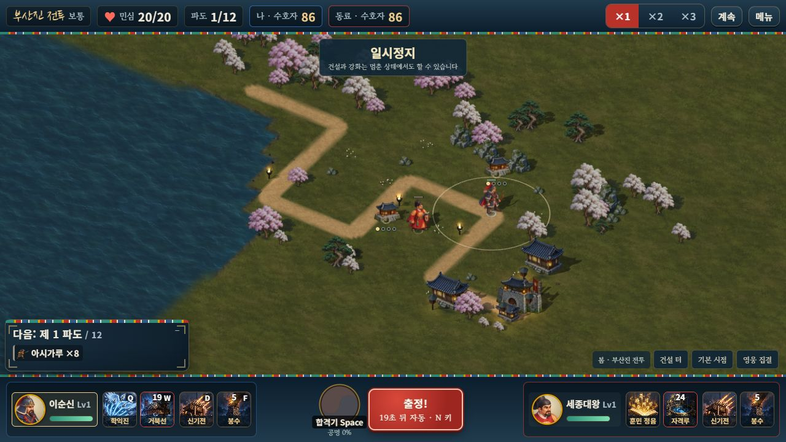
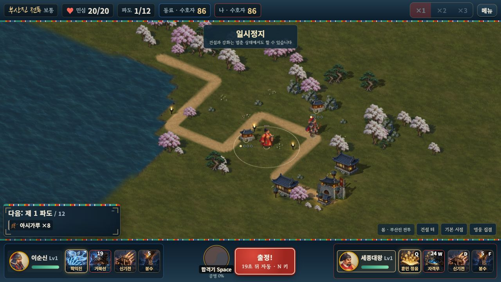

# Railway 공개 테스트 배포

2026-10-14. 사용자가 **“지금 배포해줘”**로 재개를 승인했고, 실제 Linux Docker 빌드와 공개 서버 실행을 완료했다. Railway 상태는 `SUCCESS`, 싱가포르 인스턴스 **1/1 정상 실행**이다. 이전 보류 기록은 당시 결정이며 현재 상태는 이 문서를 따른다.

**[호국영웅전 바로 플레이 — 음소거](https://hoguk-game-production.up.railway.app/?mute=1)** · [배경음 없이 효과음만](https://hoguk-game-production.up.railway.app/?sound=effects)

## 플레이 방법

- 혼자: 출정하기 → 홀로 출정.
- 한 PC에서 둘이: 협동 출정 → 로컬 협동 준비. 기존 마우스 1P·키보드 2P 조작을 유지한다.
- 서로 다른 기기: 둘 다 위 주소에 접속 → 협동 출정. 한 사람이 **방 만들기**를 눌러 코드를 알려 주고, 다른 사람은 그 코드를 입력해 **참가**한다. 서로 다른 영웅을 선택한 뒤 참가자가 준비 완료, 호스트가 함께 출전한다.

공개 주소의 저장 데이터는 브라우저·주소별로 보관하므로 기존 localhost의 성장 기록이 자동으로 옮겨지지는 않는다. 게임 계정 서버나 클라우드 저장을 추가한 범위는 아니다.

## 실제 배포 설정

- Railway `hoguk / hoguk-game`, production. 기존 다른 프로젝트는 변경하지 않았다.
- 저장소 [evilmuff0805-create/Td](https://github.com/evilmuff0805-create/Td), 브랜치 `claude/korean-hero-tower-defense-i8ard8`, 배포 커밋 [`1b67aae`](https://github.com/evilmuff0805-create/Td/commit/1b67aae9b4be16de90c352fdb6da62c2c2971f93). 해당 커밋으로 고정해 GitHub 문서 갱신만으로 재배포되지 않는다.
- Docker가 없던 잠금 파일을 참조하던 결함을 고쳤다. 빌드 단계는 `pnpm@11.28.5`, 저장소의 `pnpm-lock.yaml`과 `pnpm-workspace.yaml`, `pnpm install --frozen-lockfile --ignore-scripts --prod=false`, `node tools/build-web.mjs`를 사용한다.
- 실제 Linux 빌드에서 그림 **198개 / 125,391,288바이트**, 웹 파일 합계 **128,924,969바이트**를 만들었다. 원본 보관용 PNG·개발 화면은 제외한다. 앞선 Windows ZIP과 빌드 바이트 수를 구분한다.
- 실행 컨테이너는 `dist/web`만 담고 Node24의 `node` 사용자로 실행한다. `HOST=0.0.0.0`, `PORT=8080`, `PUBLIC_ONLY=1`. 공개 HTTPS와 동일 호스트의 `wss://…/ws`, 건강 확인 `/_health`를 사용한다.
- 싱가포르 `asia-southeast1-eqsg3a`, 인스턴스 **1개**, **CPU 0.5 vCPU / 메모리 500,000,000바이트(0.5GB)** 제한. 유휴 절전이 켜져 있어 오랫동안 미사용한 뒤 첫 접속은 잠시 지연될 수 있다. 서버와 트래픽의 실제 사용량에 Railway 요금이 발생한다.
- 방은 한 프로세스의 메모리에 보관한다. 재시작·재배포하면 진행 중 방이 사라진다. 여러 인스턴스·영속 방 저장·대규모 운영을 완료한 범위는 아니다.
- 공개 HTTP는 게임 HTML·CSS·컴파일 스크립트·그림만 허용하며 서버 파일·package·매니페스트·Git·개발 문서를 차단한다. [실제 적용 설정과 배포 ID](PUBLIC_DEPLOYMENT_STATE.json)

## 확인한 범위

`node tools/test-public-coop.mjs --url=https://hoguk-game-production.up.railway.app`로 공개 서버에서 **3검사 모두 통과**했다. HTTPS 건강 확인·gzip·내부 파일 접근 차단, 실제 WSS 두 클라이언트의 방 생성/참가·2P 이동 명령, 일시정지 상태 재접속과 명령 중복 방지를 확인했다. 서버가 준비되기 전 첫 탐색은 404였으며 정상 실행 후 재검사한 결과다. [공개 네트워크 검사](PUBLIC_NETWORK_VALIDATION.json)

실제 브라우저 두 창에서도 공개 방 생성·코드 참가·서로 다른 영웅 선택·준비·출전을 검수했다. 브라우저의 Origin 검사를 포함한 WSS 접속이 성공했고, 양측 우클릭 이동·호스트 일시정지 전파·각자 숭례문 건설을 확인했다. 군자금은 **156/156 → 86/156 → 86/86**, 민심20/20·1/12파이며 두 화면의 건물 2개·자금·정지가 일치한다. 모든 전장 그림이 준비됐으며 두 창의 콘솔 경고/오류는0이었다. 승패·상점 구매·보상 수령 없이 검수했다. [실제 화면과 DOM 기록](PUBLIC_BROWSER_VALIDATION.json)

Astra 하이 읽기 전용 검토에서 추가 배포 차단 문제는 발견되지 않았다. 제안한 실제 Docker 빌드와 브라우저 Origin/WSS 확인까지 완료했다. [검토 기록](PUBLIC_DEPLOYMENT_ASTRA_REVIEW.json)

이번 변경은 배포용 Docker 두 파일과 기록이며 게임의 전투·로컬2P 로직을 변경하지 않았다. 기존 **451개/34검사군** 통과 기록은 [앞선 릴리스](DEVICE_AND_ROADS.md)에 보존한다. 위 공개 검사는 **한 PC에서 공개 서버를 경유한 검사**다. 실제 PC+휴대폰 LTE 등 서로 다른 물리 기기·네트워크, 장시간 지연·발열·부하 검수는 남아 있다.
