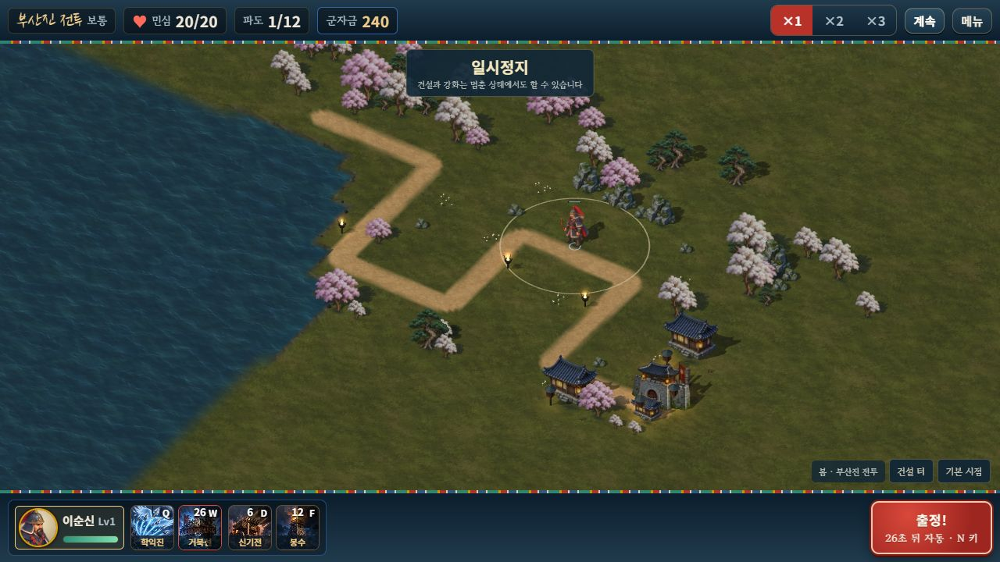

# Railway 공개 테스트 배포

2026-10-18 최신 버전은 **모바일 페이지 확대 방지 보강·웨이브 설명 제거·옥→엽전 교환**을 포함한다. 아스트라 승인 커밋 `914386dfafae62d3d5b7f64786948d0272ee6caf`를 기존 서버에 고정했고, 배포 `7cedb272-b0c4-45a0-9494-ee895a779bd5`는 **SUCCESS·인스턴스1/1·진행 중 변경0**이다.

**[호국영웅전 바로 플레이 — 음소거](https://hoguk-game-production.up.railway.app/?mute=1)** · [음악 없이 효과음만](https://hoguk-game-production.up.railway.app/?sound=effects)

## 플레이 방법

- 혼자: 출정하기 → 홀로 출정 → 영웅1명 선택 → 출전.
- 협동: 각자 같은 주소로 접속 → 협동 출정 → 한 사람은 방 만들기, 다른 사람은 코드 참가 → 서로 다른 영웅 한 명씩 → 참가자 준비 완료 → 호스트 함께 출전. 같은 화면 로컬2인은 제거했다.
- 휴대폰: 왼쪽 아래 패드 이동, 빈 터 터치 건설, 오른쪽 기술 버튼 후 전장을 터치해 시전. 각자 자기 영웅·군자금·보급품을 사용한다.
- PC: 빈 터 클릭 건설·우클릭/길 클릭 이동·Q/W 기술/궁극기·D/F 비기·Z/X/C/V 보급품이다. 합격기는 온라인에서 두 사람이 함께 Space나 버튼을 사용한다.
- 상점: 엽전 교환 탭에서 **10옥→1,000엽전·50옥→5,000엽전·100옥→10,000엽전**을 확인하고 교환한다. 엽전은 영구 강화 재화이며 전투 군자금과 별개다.

페이지 확대 방지는 전투 중에만 적용한다. 전장 카메라 핀치와 메뉴 스크롤은 유지하며 종료 때 원래 viewport를 복원한다. **이미 화면 전체가 확대돼 있으면 새로고침해 새 버전으로 시작한다.** 실제 휴대폰의 간헐 핀치 재현/완전한 수정 확인은 미완료다. [정확한 수정·검증·한계](MOBILE_UX.md)

저장은 브라우저·주소별이다. localhost 성장은 공개 주소로 자동 이전되지 않는다. 기존 공개 프로필의 재화·해금·강화·의상·성적을 보존하며 솔로 편성은 유효한 첫 영웅1명으로 호환한다. 클라우드 계정 저장을 추가한 범위는 아니다.

## 현재 운영 설정

기존 Railway `hoguk / hoguk-game`, production·싱가포르 `asia-southeast1-eqsg3a`, **인스턴스1개·CPU0.5 vCPU·메모리500,000,000바이트**를 유지한다. 같은 도메인·HTTPS·WSS `/ws`·건강 확인 `/_health`를 사용한다. 유휴 절전으로 첫 접속이 지연될 수 있고 실제 사용량/트래픽에 요금이 발생한다.

[저장소](https://github.com/evilmuff0805-create/Td)의 `claude/korean-hero-tower-defense-i8ard8` 브랜치, [`914386d`](https://github.com/evilmuff0805-create/Td/commit/914386dfafae62d3d5b7f64786948d0272ee6caf)에 고정했다. 후속 문서 푸시는 게임을 재배포하지 않는다. Docker는 pnpm11.28.5·frozen lockfile로 웹을 빌드하고, `dist/web`만 Node24의 비root 사용자로 실행한다. Linux 웹은 **195그림·125,348,090그림바이트·전체127,303,363바이트**다. Windows ZIP/줄바꿈 차이와 구분한다.

공개 HTTP는 정식 HTML·CSS·컴파일 JS·그림만 허용하고, 개발 문서·서버 파일·Git·package·매니페스트·자유 전장 미리보기를 GET/HEAD에서 차단한다. 방은 한 프로세스 메모리에서 유지해 재시작/재배포 때 사라진다. 여러 인스턴스·영속 방·도중 참가·호스트 승계·새로고침 복원은 지원 범위가 아니다. 임시 끊김은최대30초 복구와 상태/그림 ACK, 호스트 백그라운드는 대기/복귀 동기화를 사용한다. 영구 이탈이 먼저 확정되면 인계·보상·패배 집계 없이 중단한다. [현재 설정](PUBLIC_DEPLOYMENT_STATE.json) · [모드/복구 규칙](MOBILE_ONLINE.md)

## 확인한 범위

전체 **525개/40검사군**과 기존 완주2판SHA·두 빌드·웹195그림·ZIP manifest SHA를 확인했다. 새12검사는 viewport 수명과 옥 교환의 원자 저장·부족 잔액·취소·중복·늦은 확인을 검사한다. [전체 회귀](MOBILE_UX_REGRESSION_VALIDATION.json) · [빌드](MOBILE_UX_BUILD_VALIDATION.json)

공개 HTTPS/WSS **6검사**는 건강 확인·gzip·내부 경로 차단, 두 실제 소켓의 방 참가/명령, 재접속, 호스트 좌표 기준 지속 이동/정지, 백그라운드 복귀 메시지, 영구 이탈 무인계/무보상을 확인했다. 공개 app.js **1,446,656바이트**와 SHA256 `9f1f732ff733eb369656da4439e0b117ff363acb5f70d2fbd553f889cd65ac28`은 승인 빌드와 정확히 같다. [공개 소켓](MOBILE_UX_PUBLIC_NETWORK_VALIDATION.json) · [파일 대조](MOBILE_UX_PUBLIC_BUNDLE_VALIDATION.json)

정식 공개 브라우저에서 상점 가격·확인/취소·지갑 보존, 전장 원화 준비·웨이브 카드0·줌 제한 적용·종료 후 복원과 콘솔 경고/오류0을 확인했다. 공개 프로필에서는 교환을 실제 구매하지 않았다. 로컬 QA에서476/20→1,476/10·reload동일·더블클릭 후 확인창1개·다음 한 번 교환2,476/0을 확인했다. [공개 UI](MOBILE_UX_PUBLIC_BROWSER_VALIDATION.json) · [로컬 세 화면과 실제 입력](MOBILE_UX_BROWSER_VALIDATION.json)

물리 휴대폰·native pinch·LTE/물리 두 기기·앱 잠금/전환·장시간 발열/부하 검수는 **미완료**다. CSS 프레임과 합성 포인터·같은PC 공개 소켓은 이를 대신하지 않는다. 아스트라가 이 위험을 수용하고 제한된 배포를 승인했다. [검토](MOBILE_UX_ASTRA_REVIEW.json) · [최종 릴리스](MOBILE_UX_RELEASE_VALIDATION.json)

## 앞선 배포 이력

최초 공개 배포는 `1b67aae`, 발걸음/터치 수정은 `86336aa`,1영웅/방 협동 전환은 `50d843f`·배포 `e5d77199-a287-4ef7-a10c-6b3bee5f9087`였다. 당시 로컬2P·2영웅 설명과 현재 규칙을 구분한다. [1영웅 배포 설정 보관](PUBLIC_DEPLOYMENT_STATE_2026-10-18_ONE_HERO.json) · [이전 터치 배포](PUBLIC_DEPLOYMENT_STATE_2026-10-15.json) · [앞선 실제 두 클라이언트](MOBILE_ONLINE_PUBLIC_BROWSER_VALIDATION.json) · [이번 GitHub 반영 기록](MOBILE_UX_PUBLISH_RECEIPT.json)
