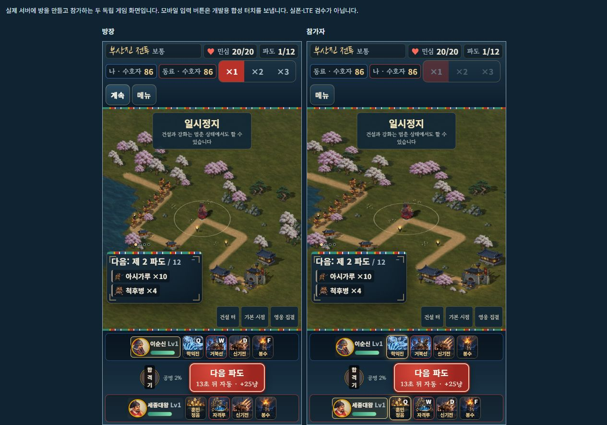

# Railway 공개 테스트 배포

2026-10-18. **솔로1영웅·온라인 방 협동·모바일 패드**로 갱신했다. 사용자가 지정한 아스트라 본부장이 계획·리스크·구현과 검증 결과를 검토하고 최종 배포를 승인했다. 커밋 `50d843f`의 배포 `e5d77199-a287-4ef7-a10c-6b3bee5f9087`는 `SUCCESS`, 싱가포르 인스턴스 **1/1 정상 실행**이며 진행 중 변경은0이다. 실제 휴대폰/LTE/앱 전환 미완료는 승인 때 명시적으로 수용했다.

**[호국영웅전 바로 플레이 — 음소거](https://hoguk-game-production.up.railway.app/?mute=1)** · [배경음 없이 효과음만](https://hoguk-game-production.up.railway.app/?sound=effects)

## 플레이 방법

- 혼자: 출정하기 → 홀로 출정 → 영웅1명 선택 → 출전.
- 협동: 각자 같은 주소로 접속 → 협동 출정. 한 사람이 **방 만들기**로 코드를 알려 주고, 다른 사람은 코드로 **참가**한다. 서로 다른 영웅을 한 명씩 선택한 뒤 참가자 준비 완료 → 호스트 함께 출전이다. 같은 화면의 로컬2인은 제거했다.
- 휴대폰: **왼쪽 아래 패드로 이동**, 빈 터를 터치해 건설, 오른쪽 기술 버튼 후 전장을 터치해 시전한다. 각자 자기 영웅·군자금·보급품을 사용한다.
- PC: 빈 터 클릭은 건설, 우클릭/길 클릭은 내 영웅 이동, Q/W는 기술/궁극기, D/F는 장착 비기, Z/X/C/V는 보급품이다. 합격기는 온라인에서 두 사람이 함께 Space를 누르거나 버튼을 사용한다.

공개 주소의 저장 데이터는 브라우저·주소별이다. 기존 localhost 성장 기록이 자동으로 옮겨지지는 않는다. 같은 주소의 이전 프로필은 재화·해금·구매·강화·의상·성적을 보존하고 솔로 편성만 유효한 첫 영웅1명으로 호환한다. 게임 계정 서버나 클라우드 저장을 추가한 범위는 아니다.

임시 연결 끊김은 최대30초 복구 유예와 상태·그림 준비 ACK를 사용한다. 호스트 백그라운드에서는 대기하고 복귀 동기화 후 재개한다. 영구 이탈이 먼저 확정되면 인계·보상·패배 집계 없이 중단한다. 서버가 먼저 확정한 정상 결과만 한 번 정산한다. [정확한 입력·종료·성장 규칙](MOBILE_ONLINE.md)

## 실제 배포 설정

- 기존 Railway `hoguk / hoguk-game`, production과 기존 도메인을 사용한다.
- 저장소 [evilmuff0805-create/Td](https://github.com/evilmuff0805-create/Td), 브랜치 `claude/korean-hero-tower-defense-i8ard8`, 고정 배포 소스 [`50d843fb515fb798c7322befe1acfbe914e1c05c`](https://github.com/evilmuff0805-create/Td/commit/50d843fb515fb798c7322befe1acfbe914e1c05c). 후속 문서 푸시만으로 게임을 재배포하지 않는다.
- Docker 빌드는 `pnpm@11.28.5`, 저장소 잠금 파일, `pnpm install --frozen-lockfile --ignore-scripts --prod=false`, `node tools/build-web.mjs`를 사용한다.
- Linux 공개 그림 **195개 / 125,348,090바이트**, 웹 전체 **127,303,262바이트**다. 원본 보관용 PNG·개발 화면·자유 전장 `3d.html`/`game.js`는 제외한다. Windows ZIP의 줄바꿈 차이와 구분한다.
- 실행 컨테이너는 `dist/web`만 담고 Node24의 `node` 사용자로 실행한다. `HOST=0.0.0.0`, `PORT=8080`, `PUBLIC_ONLY=1`. HTTPS·동일 호스트의 WSS `/ws`·건강 확인 `/_health`를 사용한다.
- 싱가포르 `asia-southeast1-eqsg3a`, 인스턴스 **1개**, **CPU0.5 vCPU / 메모리500,000,000바이트(0.5GB)** 제한이다. 유휴 절전이 켜져 있어 오랫동안 미사용한 뒤 첫 접속은 잠시 지연될 수 있다. 실제 사용량과 트래픽에 Railway 요금이 발생한다.
- 방은 한 프로세스 메모리에서 유지한다. 재시작·재배포하면 진행 중 방이 사라진다. 여러 인스턴스·영속 방 저장·도중 참가·호스트 승계는 지원 범위에 포함하지 않는다.
- 공개 HTTP는 정식 게임 HTML·CSS·컴파일 스크립트·그림만 허용한다. 서버 파일·package·매니페스트·Git·개발 문서·자유 미리보기를 GET/HEAD에서 차단한다. [실제 설정](PUBLIC_DEPLOYMENT_STATE.json)

## 검증 결과와 한계

전체 **513개/39검사군** 회귀, 영웅8명 기능, 기존2영웅 완주2판SHA 보존, 보통1영웅 솔로의 실제 획득 성장 **25전장×3시드**를 확인했다. 이순신의 특정 자동 전략 결과이며 모든 영웅·어려움/지옥·사람의 적정 난이도를 인증하지 않는다. 보통의 솔로1플레이어·1영웅에만 영웅 출처 피해1.5배를 적용한다. [전체 회귀](MOBILE_ONLINE_REGRESSION_VALIDATION.json) · [최종 성장 기록](SOLO_ONE_HERO_FINAL_PROGRESSION.json)

공개 주소에 `node tools/test-public-coop.mjs --url=https://hoguk-game-production.up.railway.app/`를 실행해 **6검사 모두 통과**했다. HTTPS 건강 확인·gzip·내부 경로 차단, 실제 WSS 방 생성/참가·명령 전달, 재접속, 호스트 좌표 기준 지속 이동·정지, 백그라운드/복귀 메시지, 영구 이탈 무인계/무보상을 확인했다. 공개 `app.js`1,445,963바이트는 승인 빌드와 정확히 일치하며 SHA256은 `221526847ee762fc751cf17cbe42088a769e764c1fdca86994f65cf57f6d2241`이다. [공개 네트워크](PUBLIC_NETWORK_VALIDATION.json) · [바이트 대조](MOBILE_ONLINE_PUBLIC_BUNDLE_VALIDATION.json)

실제 공개 브라우저 두 클라이언트도 방 생성·코드 참가·이순신/세종 각1영웅·준비/출전·내 영웅만 조작 가능·양측 일반 우클릭 이동·정지 동기화·독립 건설을 확인했다. 군자금은 **156/156 → 86/156 → 86/86**이며 두 화면의 건물2개·자금·정지가 같았다. 게스트가 나간 뒤 호스트는 방 입구로 돌아갔고 양측400엽전·0전0승을 보존했다. 그림/그래픽은준비됐고 공개 내비게이션 이후 콘솔 경고/오류는0이다. 과거 로컬 검수 도구의 Observer 오류1개는 별도 보존했다. [실제 화면·DOM](MOBILE_ONLINE_PUBLIC_BROWSER_VALIDATION.json)

공개 브라우저와 소켓 검사는 **한 PC에서 공개 서버를 경유한 검사**다. 414/360세로·896가로의 패드/44px 영역 검사는 실제 게임의 CSS 프레임과 개발용 합성 터치다. **실제 휴대폰·LTE·물리 두 기기·앱 잠금/전환·장시간 발열·부하 검수는 미완료**다. IAB 탭 전환이 실제 `document.hidden`을 바꾸지 않아 실기기 백그라운드 검수로 계산하지 않았다. 아스트라가 이 범위를 명시적으로 수용하고 배포를 승인했다. [승인/리스크](MOBILE_ONLINE_RISK_REVIEW.json) · [최종 배포 후 기록](MOBILE_ONLINE_PUBLIC_RELEASE_VALIDATION.json)

## 앞선 배포 이력

2026-10-14 최초 공개 배포는 `1b67aae`, 이후 발걸음/터치 구분 수정은 `86336aa`·배포 `fda344fb-ac8b-4136-8247-6e49381efd4a`였다. 당시 로컬2P·2영웅·터치 이동/건설 모드 설명은 현재 규칙과 구분한다. [이전 설정 보관](PUBLIC_DEPLOYMENT_STATE_2026-10-15.json) · [앞선 터치 수정](TOUCH_MOTION.md) · [최초 두 브라우저](PUBLIC_BROWSER_VALIDATION.json) · [당시 검토](PUBLIC_DEPLOYMENT_ASTRA_REVIEW.json)

구현·승인 커밋은 GitHub에 반영됐으며 공개 결과·검수 화면·상위 한국어 프로젝트 리뷰를 후속 문서 커밋으로 보관한다. [이번 GitHub 반영 기록](MOBILE_ONLINE_PUBLISH_RECEIPT.json)
