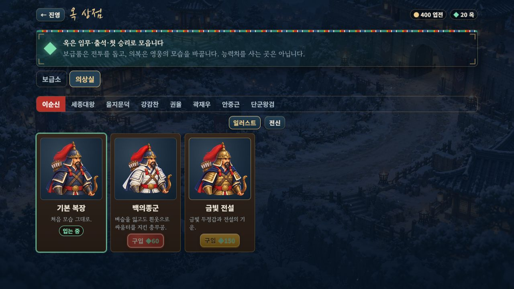
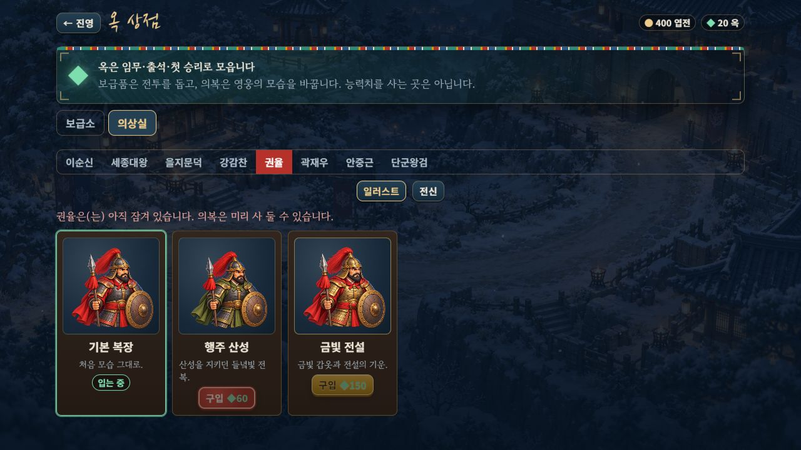
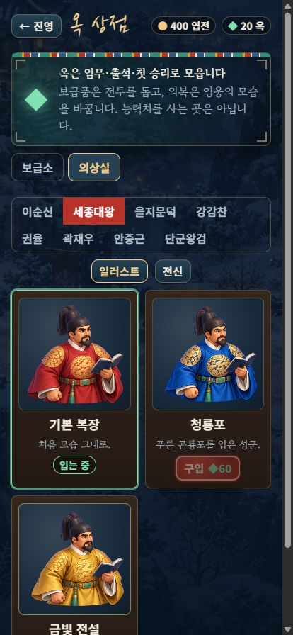
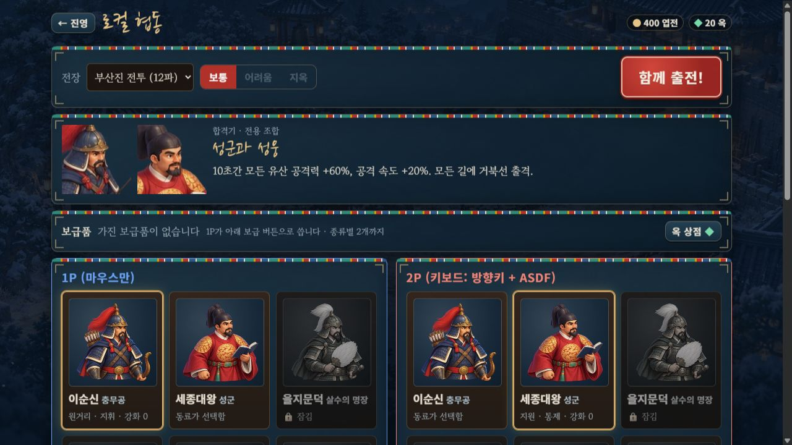
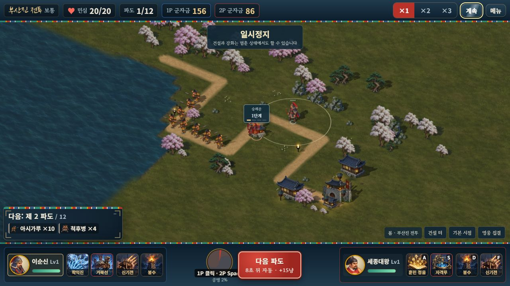

# 특수 의상 16종 큰 일러스트 · 2026-10-11

기본 영웅 8명의 큰 메뉴 그림에 이어 **특수 의상 16종의 전용 상반신 원화**를 추가했다. 기본·의상 합계 **24개 외형**이 같은 얼굴, 따뜻한 피부·금속빛과 남색 그림자를 사용한다. 도감·출전 선택은 장착 의상의 새 그림을 표시하며 의상실에서도 구매 전에 미리 볼 수 있다.


## 적용 범위

| 영웅 | 두 가지 의상과 구분 |
|---|---|
| 이순신 | 백의종군·금빛 전설. 남색 망토, 붉은 투구 깃, 활·화살통을 유지한다. |
| 세종대왕 | 청룡포·금빛 전설. 검은 익선관과 책을 유지한다. |
| 을지문덕 | 고구려 철기·금빛 전설. 흰 투구 깃·깃털 부채와 녹색/청회색 옷을 구분한다. |
| 강감찬 | 귀주의 붉은 별·금빛 전설. 백발·흰 수염, 검·방패와 붉은/보라 망토를 사용한다. |
| 권율 | 행주 산성·금빛 전설. 창·둥근 방패와 올리브/붉은 망토를 사용한다. |
| 곽재우 | 흑의 의병·금빛 전설. 검은 갓·도포·활·화살통을 유지한다. |
| 안중근 | 대한의군 군복·금빛 전설. 올리브/황갈색 코트와 권총을 사용한다. |
| 단군왕검 | 천제의 푸른 옷·금빛 전설. 백발·금관·녹색 옷깃과 종을 유지한다. |

위 의상명은 게임 데이터가 기준이며 배포 파일은 [16개 의상 매핑](../src/data/skin-bust-data.js)에 있다. 이순신의 활·화살통은 권율의 창·방패와 계속 구분된다. 기본 영웅 8개의 원화·WebP와 승인된 전장 **1,664자세**는 바꾸지 않았다.

의상실에는 **일러스트 / 전신** 전환을 추가했다. 영웅을 바꾸거나 구매·장착 후 돌아와도 보기 모드가 유지된다. 전신·작은 HUD는 승인된 기존 준비 포즈를 사용한다. 미리보기는 소유·능력치·재화·출전 사양을 바꾸지 않으며 기존 구매·장착 규칙과 가격을 유지한다.





## 원본과 재현

원화는 **내장 image_gen.imagegen**으로 만들었다. 외부 API/CLI는 사용하지 않았다. 기존 메뉴 시트에서 각 의상의 승인된 준비 자세를 픽셀 그대로 잘라 복식·무기 참조로 사용하고, 기본 흉상을 얼굴·조명·화풍 참조로 사용했다. 생성한 16개 원본을 모두 v1로 채택했다.

- [정확한 생성 프롬프트 16개와 참조 역할](../assets/illustrated/portraits/skins/source/prompts.json)
- [원본 PNG 16개·승인된 참조 PNG 16개](../assets/illustrated/portraits/skins/source/)
- [최종 배포 그림 16개](../assets/illustrated/portraits/skins/)
- [균일 축소·여백·픽셀 재현 도구](../tools/skin-bust-assets.mjs)

완전히 투명한 바깥 행·열만 정리하고 비영 알파 범위를 균일 축소했다. 사방 **32px 투명 여백을 둔 640×640 무손실 WebP**, 16개 합계 **4,333,550바이트**다. 기존 기본 흉상과 합한 24개 배포 그림은 **6,600,984바이트**다. 원본의 알파 128 이상 가장자리 픽셀, 축소 기준 대비 보이는 RGB·알파 차이와 여백 침범은 모두 0이다. 참조 16개도 승인된 메뉴 칸과 픽셀이 같다.

```bash
node tools/skin-bust-assets.mjs
node tools/test-skin-busts.mjs
node tools/test-hero-busts.mjs
npm run build:3d
npm run build
node tools/verify-embedded-art.mjs
node tools/check-motion-determinism.mjs
```

`skin-bust-assets.mjs --write`는 같은 배포 그림과 검증 보고서를 다시 만든다. [비교 화면](http://localhost:8080/dev/hero-bust-review.html?set=skins&mute=1)은 기본 8명·의상 16종·전체 24종과 일러스트/전신을 전환한다.

## 로딩과 검사

기본·의상별로 별도 Promise와 이미지 캐시를 사용한다. 동일 의상의 동시 카드는 한 요청을 공유하고, 늦은 이전 의상 응답은 제거된 캔버스나 새 의상을 덮지 않는다. 준비 전·누락·크기 오류에는 **그 의상의 기존 상반신**을 표시한다. 잘못된 의상·다른 영웅의 의상 ID는 자기 기본 복장으로 돌아간다. 전장 준비는 큰 메뉴 그림을 디코딩하지 않는다. 준비된 캐시를 퇴출하는 별도 메모리 정책은 이번 범위에 추가하지 않았다.

새 **10개 검사**는 16개 매핑, 의상별 캐시와 실패 격리, 늦은 응답, HUD·전신 유지, 실제 의상실 DOM의 8명 미리보기·구매·장착·모드 유지와 장착 의상을 사용한 로컬 2인 출전 사양을 확인한다. 전체 **294개 / 22검사군**을 통과했다. 모바일 영웅 이름 줄바꿈 수정 뒤 관련 메뉴 검사 22개도 다시 통과했다. 기존 솔로 seed42·협동 seed7 완주 SHA와 기준 fixture는 같다.

서버·단일 HTML 두 빌드를 확인했다. 최신 파일의 정확한 크기와 포함 수는 [내장 자산 검사](SKIN_BUST_EMBEDDED_VALIDATION.json)에 기록한다. 104방향/중간 시트·메뉴 1장·기본 흉상 8장·의상 흉상 16장과 기존 지면·수목·물·기술 그림을 각각 한 번 포함한다. 기본 흉상 원본/참조 PNG 18장, 새 의상 원본/참조 PNG 32장과 중간 원화 PNG 256장은 배포에서 제외한다.

실제 브라우저에서 의상 16종·전체 24종의 준비 완료와 전신 전환, 최신 단일 HTML의 **의상실 8명·24그림·전신 상태에서 영웅 교대**, **414×896 가로 넘침 없음**을 확인했다. 좁은 화면에서 이름이 한 글자씩 세로로 나뉘던 기존 영웅 버튼을 이름 단위로 줄바꿈하도록 고쳤다. 구매는 브라우저에서 실행하지 않았으며 구매·장착·장착 의상 협동은 자동 DOM 검사로 검증했다.

로컬 2인 준비에는 기본 영웅 흉상 16개와 동료 중복 선택 금지가 유지된다. 정상 UI로 이순신·세종을 출전시켜 기존 HUD, 첫 파도 진군과 **2P E키 숭례문 건설, 군자금 156/156→156/86**을 확인했다. 첫 파도 뒤 민심 20/20에서 정지했다. 해당 게임 탭 콘솔 경고·오류는 0이다. 양측 개별 이동·모든 기술을 이번에 다시 시연한 범위는 아니다.

**GPT-6 Astra xhigh**가 16개 원화와 24개 실제 비교 화면, 로더·검사 코드·의상실 데스크톱·수정 후 모바일 화면을 읽기 전용으로 검토했다. 권율 금빛 방패 끝도 잘리지 않았으며 최종 필수 수정은 없다. 실제 휴대폰 메모리·발열, 외부 네트워크 온라인, 사람 플레이 후반 밸런스는 별도 확인 범위다.

- [자산·여백·RGB·알파](SKIN_BUST_ASSET_VALIDATION.json)
- [새 실행 검사 10개](SKIN_BUST_RUNTIME_VALIDATION.json)
- [전체 294개 회귀 검사](SKIN_BUST_REGRESSION_VALIDATION.json)
- [실제 브라우저와 로컬 협동](SKIN_BUST_BROWSER_VALIDATION.json)
- [빌드·변경 보존·검토·GitHub 반영](SKIN_BUST_RELEASE_VALIDATION.json)

구현은 [d664277](https://github.com/evilmuff0805-create/Td/commit/d664277980212cffcc3451b871aa28d576b56fcf)로 같은 브랜치에 푸시하고 실제 원격 SHA 일치를 확인했다. 상세 시각은 릴리스 JSON에 보존한다.






