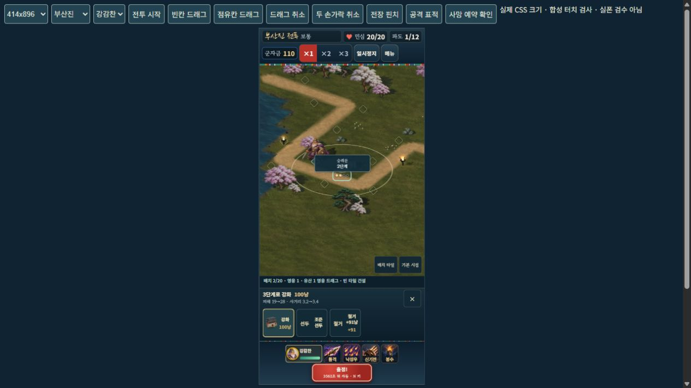
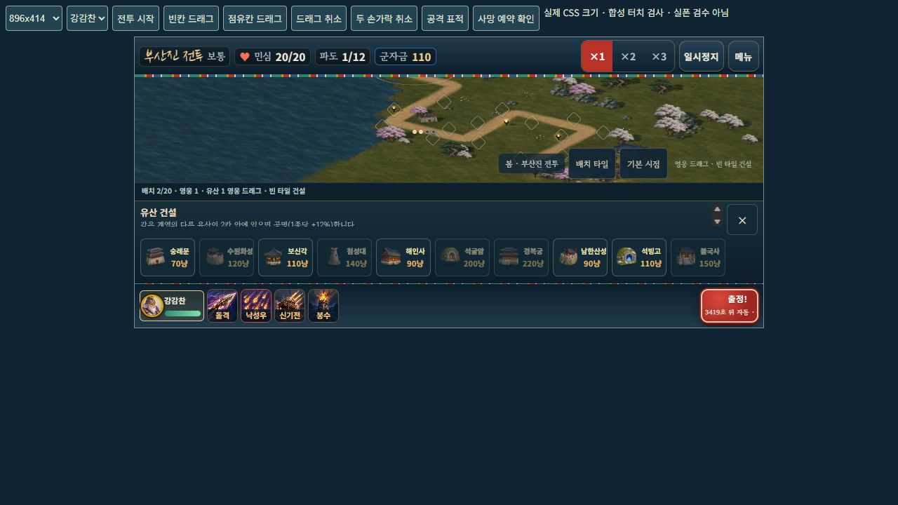
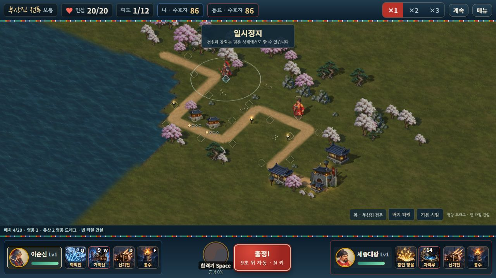

# 공용 타일 모바일 전투

2026-10-18 · 구현·아스트라 최종 승인·공개 배포 및 검수 완료

사용자가 설계안 v2에 대해 **“응 구현”**으로 착수를 승인했다. 이전 문서의 계획 단계 제한은 이 승인으로 종료했다. 솔로는 영웅 한 명, 온라인은 방 코드로 각자 다른 영웅 한 명을 조작한다. 로컬 2인 모드는 다시 추가하지 않는다.

## 실제 동작

- 25전장마다 영웅과 유산이 공유하는 지정 타일 20개를 사용한다. 한 칸에는 영웅 또는 유산 하나만 배치한다. 솔로는 유산 최대 19개, 온라인 두 영웅은 최대 18개다.
- 내 영웅이나 하단 초상화를 끌어 빈 타일에서 놓으면 재배치한다. 손가락 이동 7px 전에는 탭으로 구분한다. 미리보기 동안 실제 영웅은 원래 자리에서 계속 싸운다.
- 모든 준비 구간에서는 무료로 재배치한다. 전투 중에는 게임 시간 3초, 곽재우는 2초 대기시간을 적용한다. 배속·일시정지를 따르며 체력·공격/스킬 주기·버프를 초기화하지 않는다.
- 점유칸·HUD·배경 드롭과 포인터 취소·두 손가락 전환·앱 전환은 전송 전 미리보기만 취소한다. 자동 교환·철거는 하지 않는다. 만석이면 건물을 직접 철거해 빈칸을 확보해야 한다.
- 사망한 영웅도 타일을 예약한다. 자연 부활·동의보감·단군/세종 합격기 모두 같은 자리에서 부활한다.
- 빈 타일을 누르면 하단 유산 목록이 열린다. 유산을 누르면 같은 하단 패널에서 강화·최종 A/B·조준·철거를 선택한다. 가로로 스크롤하며 전장 위 원형 건설 메뉴는 사용하지 않는다.
- 기존 일러스트·사계절·건물의 일정한 크기와 네 점 강화 표시를 유지한다. 기본 시점과 전장 안 카메라 이동/확대는 유지하고 가상 이동 패드는 제거했다.

44px 타일 터치 영역이 축소 시 겹치더라도 실제 투영 중심에 가장 가까운 칸을 선택한다. 드래그는 실제 요소 hit-test로 HUD 뒤 타일을 제외한다. 카메라의 포인터 캡처로 후속 click 대상이 바뀌는 경우도 탭을 놓친 것으로 처리하지 않으며, 건설창을 중복해서 열지 않는다.

## 공격 변경

| 영웅 | 변경 |
|---|---|
| 강감찬 | 공격력 28·사거리 3.0·주기 1초. 푸른 별빛 검기가 실제 비행 후 착탄한다. 네 번째 발사 검기가 명중하면 낙성 후속타를 만든다. |
| 강감찬 기술 | 영웅은 타일에 남고 직선 돌격 검기를 발사한다. 이동 구간의 충돌을 검사하고 적마다 한 번만 피해·0.5초 기절을 준다. |
| 권율 | 공격력 24·사거리 2.9·주기 1.1초. 금빛 창기가 실제 착탄할 때 1.2초간 25% 둔화한다. 기존 회복·투석·목책은 유지한다. |
| 곽재우 | 은신 탐지를 유지하며 재배치 대기시간을 2초로 우대한다. |

영웅의 길 위 몸 저지·자동 추격은 제거했다. 병영 병사·의병·목책의 저지는 유지한다. 이미 발사된 투사체는 영웅의 재배치나 사망으로 초기화하지 않는다. 다른 영웅의 기존 원거리 공격·비기·합격기는 승인된 타일 위치에서 작동한다. 새 검기와 창기는 기존 원화의 무기 동작을 사용하며 별도의 캐릭터 원화를 만들었다고 주장하지 않는다.

## 협동

`deploymentSlotId`는 기존 편성 순서인 `h.slot`과 구분한다. 호스트가 타일 존재·점유·소유·생존·게임 시간 대기시간을 검사하고 출발칸 해제·목적지 점유·좌표를 한 번에 확정한다. 다른 플레이어 영웅의 이동을 거부한다.

전투 ID와 플레이어별 요청 번호로 중복/오래된 드롭을 거부한다. 승인 대기 요청은 하나만 유지한다. 재접속 전에 수신된 명령은 순서대로 확정한 뒤 전체 스냅샷을 보내므로, 거절로 보였다가 나중에 실행되는 요청이 남지 않는다. 스냅샷은 타일·사망 예약·대기시간·승인 결과·새 투사체 종류를 포함한다.

전투 규칙 `shared-tiles-1`과 지도 버전 `2026-10-18.1`이 다른 클라이언트는 함께 방에 들어갈 수 없다. 기존 자유 이동 명령은 무시한다. 독립 군자금·공동 강화·소유자 철거·기여자 환급·백그라운드 대기·영구 이탈 정책과 프로필 재화·구매·해금·성적은 유지한다.

## 지도와 난이도 검사

`src/data/deployment.js`에 고정 좌표를 저장한다. 생성 도구에는 검토한 합류 지점 수정도 함께 기록해 재생성으로 없어지지 않게 했다. 탄금대·옥포·진주 2차·직산·울산성·사천 왜성·순천 왜교성은 떨어진 타일 일부를 기존 경로의 합류 지점 주변으로 옮겨 공격·둔화·지원 건물을 함께 배치할 수 있게 했다. 길·적 HP·시작 군자금·전체 타일 수를 늘리는 보정은 하지 않았다.

검사 봇은 임의 좌표 건설을 하지 않는다. 현재 적만 보고 1초마다 빈 타일의 사거리 점수를 비교해 정상 `Session.relocateHero()`로 이동하며 실제 대기시간과 점유를 따른다. 이 정책은 검증 도구에만 있고 제품 영웅이 자동 재배치되는 기능은 아니다. 30초의 실제 첫 준비 시간, 여섯 전술 및 두 강화 분기를 최대 12회 안에서 비교한다. 실패는 해당 제한된 정책의 결과이며 모든 사람의 불가능을 증명하지 않는다.

무환전 기록과 실제 상점 환전 경로는 구분한다. `--exchange=on-retry`는 재시도마다 최대 한 번, 실제 획득한 10옥으로 `exchangeCoins()`에서 1,000엽전을 구입한 뒤 정상 강화 비용을 지불한다. 교환 전후 잔액·강화 항목/레벨/비용·전투 보상을 보고서에 기록한다. 이 경로의 성공을 무환전 난이도 통과로 바꿔 말하지 않는다.

보통 난이도의 새 프로필 세 경로가 모두 **25/25전장(합계75/75)**을 통과했다. 이순신 한 명으로 총91전·16재시도이며, 실제 획득한 옥의 재시도 환전과 정상 강화가 포함된 결과다. 마지막 전장은 기존20칸 그대로 통과했다. 무환전 경로와 후반 안중근 정상 구매를 시험한 경로는 실패 보고서를 보존하며, 현재 코드의 무환전 완주를 인증하지 않는다. 사람에게 적절한 재시도 횟수나 모든 영웅의 완주를 보장하는 결과도 아니다.

## 검증 자료

- [공용 타일 엔진·호스트/게스트·요청 경합·드래그](TILE_BOARD_RUNTIME_VALIDATION.json)
- [전체 회귀 결과](TILE_BOARD_REGRESSION_VALIDATION.json): **508개/38검사군 전부 통과**.  은퇴한 가상 패드·자유 이동·원형 메뉴 검사 세 군은 타일 검사로 대체했다. 과거 원화 비교 fixture의 좌표는 합법적인 타일로 명시적으로 변환하며 제품의 임의 이동을 허용하지 않는다.
- [무환전 성장 검사](TILE_BOARD_SOLO_PROGRESSION.json), [상점 환전 포함 성장 검사](TILE_BOARD_SHOP_PROGRESSION.json): 완료 여부와 출처 해시를 각 파일에서 확인한다. 과거 자유 이동 완주 SHA를 새 규칙의 통과 근거로 사용하지 않는다.
- [브라우저 조작 기록](TILE_BOARD_BROWSER_VALIDATION.json), [실제 두 브라우저 협동](tile-board/LOCAL_ONLINE_BROWSER.json): 호스트와 참가자가 각각 초상화에서 빈 타일로 드래그해 양측에 반영되고, 자기 군자금으로 하단 건설을 실행(156/156→86/86)하며 일시정지를 공유했다. 같은 PC의 HTTP/WS 검사이며 실폰/LTE 증거는 아니다. 정식 두 브라우저 콘솔 경고/오류0. 개발 iframe에는 과거 MutationObserver 오류1개가 기록되어 있어 정식 게임 오류와 구분한다.
- [웹·ZIP 패키지](tile-board/ZIP_PACKAGE_VALIDATION.json):195개 원화의 원본 바이트와214개 압축 항목을 전부 비교했다. 개발 페이지·원화 소스는 공개 패키지에서 제외한다.
- 브라우저 CSS414×896·360×800·896×414: 실제 제품 UI의 드래그 미리보기/취소/점유칸 거절·건설·강화·패널 위치를 검사한다. 개발용 페이지는 준비 시간을 고정하고 검사 편성을 사용하므로 난이도 완주 증거가 아니다.

## 공개 반영과 남은 검수

아스트라는 타일 검사23개·소스 해시13개·전체508/38회귀·ZIP을 독립 확인한 뒤 배포를 최종 승인했다. 기존 Railway 서비스·도메인·CPU0.5/메모리500MB·싱가포르1개 인스턴스를 유지해 코드 커밋 `61d11a81109cb166d1214f4f20be2cef35e8eba3`를 고정 배포했다. 배포 `7e67bce7-60b2-449f-b5b7-f58b005e7c39`는SUCCESS다. [승인 범위](TILE_BOARD_ASTRA_REVIEW.json) · [최종 공개 기록](TILE_BOARD_RELEASE_VALIDATION.json).

[공개 게임·음소거](https://hoguk-game-production.up.railway.app/?mute=1)에서 HTTPS/WSS6검사와 실제 정식 두 브라우저의 양측 드래그·각자 하단 건설(156/156→86/86)·정지·영구 이탈 후 보상/패배 없는 중단을 확인했다. 콘솔 경고/오류0이며 실행JS1,449,727바이트의SHA256 `7feafd992355a84b93f2ac654196e28c377b10e8c1a9df7bc7b0ac4526ae3cac`와 스타일은 승인 빌드와 바이트가 같다. HTML만Windows/Git의CRLF/LF차이가 있다. [공개 실제 소켓](tile-board/PUBLIC_NETWORK_VALIDATION.json) · [공개 실제 브라우저](tile-board/PUBLIC_BROWSER_VALIDATION.json) · [바이트 비교](tile-board/PUBLIC_BYTES.json).

 실제 휴대폰의 native pinch·손가락 크기·장시간 발열, 물리 두 기기 및 LTE 협동은 이 PC의 브라우저/소켓 검사로 대체하지 않는다. 전체 영웅·어려움/지옥의 사람 난이도 보장은 별도 범위다.
