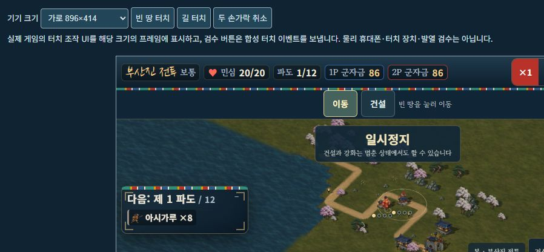

# 발걸음 속도와 휴대폰 이동·건설 구분

2026-10-15. 빠르게 반복되던 발 동작과 휴대폰에서 빈 땅을 누르면 건설이 열리던 조작을 수정하고, 같은 Railway 공개 서버에 반영했다. **[수정된 게임 플레이](https://hoguk-game-production.up.railway.app/?mute=1)**. 페이지를 새로 열거나 새로고침하면 적용된다.

## 달라진 조작

| 입력 | 동작 |
|---|---|
| 휴대폰의 빈 땅 터치 | 선택한 영웅 이동. 길 밖의 이동 가능한 땅도 지정할 수 있다. |
| 건설 버튼 → 빈 터 터치 | 건설 메뉴를 열고 유산을 선택한다. 건설을 완료하면 자동으로 이동 모드로 돌아간다. |
| 기존 유산·영웅 터치 | 기존 선택·강화·영웅 선택을 유지한다. |
| 기술 버튼 → 지점 터치 | 기술 조준이 이동·건설보다 우선한다. |
| 드래그·두 손가락 조작 | 놓을 때 이동·건설이 잘못 실행되지 않도록 취소한다. |
| PC 마우스 | 기존 왼쪽 빈 터 건설·오른쪽 이동을 유지한다. |
| 로컬 2P 키보드 | 기존 방향키 이동·E 건설·기술과 각자 군자금을 유지한다. |

터치의 이동·건설 버튼은 각각 **56×44px**이다. 터치 장치에서는 처음부터 표시하고, 혼합 입력 장치에서는 첫 터치부터 표시한다. 오래 누르기 타이머는 제거했으며, 길게 눌렀다 놓아도 현재 모드와 기술 조준 규칙을 따른다. 평면 대체 모드에도 같은 규칙을 적용했다. 물·막힌 지형의 기존 이동·건설 판정은 유지한다.

## 발걸음 수정

기존 영웅은 한 보행 주기가 0.64칸이어서 기본 이순신의 속도 2.2칸/초에서 주기가 초당 약3.44회, 양발 디딤은 약6.88회 반복됐다. 주기를 **1.5칸**으로 늘려 초당 약1.47회, 양발 디딤 약2.93회로 바꿨다. 같은 속도에서 그림의 보행 반복은 **약57.3% 느려지고 실제 이동 속도는 같다**. 기본·특수 의상 전체에 적용하며 일반 병력·기병/전령의 보폭도 각각 조정했다. 충차·거북선의 기존 접지 표현은 유지한다.

60Hz 전투에서 120/144Hz 화면이 같은 위치를 다시 그리거나 짧은 스냅샷 간격이 생길 때, 매번 정지·재출발 자세로 바뀌지 않도록 최근 걸음 자세를 실제 시간으로 최대100ms 유지한다. 위상은 실제 이동 거리로만 진행한다. 목표 도착·공격·기절·일시정지·큰 위치 변화는 별도로 처리한다. 온라인 게스트의 목표 좌표가 생략된 스냅샷과 도착 직전의 짧은 이동도 검사했다.

## 확인한 범위

관련 **136개 검사/11검사군**을 통과했다. 신규 터치·보행18개, 기존 자세·전환·긴 동작·기기 입력·건설 배치·WebGL 복구·네트워크 복구·자체 검사·웹 패키지와 기존 보통 솔로/협동 완주2판 SHA 비교를 포함한다. 이전 전체451개/34검사군은 앞선 버전의 기록이며 이번에 전체를 재실행했다고 합산하지 않는다. [관련 회귀 목록](TOUCH_MOTION_REGRESSION_VALIDATION.json) · [신규18개](TOUCH_MOTION_RUNTIME_VALIDATION.json)

실제 게임을414×896·360×800·896×414 CSS 프레임에서 열어 이동·명시적 건설·자동 복귀·기술 우선·두 손가락 취소와 가로 넘침 없음을 확인했다. 개발 화면의 보이는 시험 버튼이 합성 PointerEvent를 보내는 방식이며 물리 휴대폰 검사가 아니다. 로컬2P에서1P 합성 터치와2P 브라우저 키 입력으로 양측 이동을 확인했고, 각자 숭례문 건설 후 자금은 **156/156 → 156/86 → 86/86**, 유산2개다. [브라우저 원기록](TOUCH_MOTION_BROWSER_VALIDATION.json)

초기 개발 검수에서 합성 포인터 ID의 네이티브 캡처 오류를 발견해 개발 시험 도우미를 수정했다. 재검수에서는 이 오류가 없었다. iframe 검사 중 `MutationObserver.observe` 오류1개는 남아 있으며 원기록에 보존했다. 소스와 번들에서 해당 호출은 찾지 못했지만 검사 계층에서 발생했다는 확정 진단은 아니다. 공개 게임의 별도 브라우저 검수에서는 경고·오류0, 전장·영웅·병력·건물 그림 준비와 정상 전장 진입을 확인했다. [공개 브라우저 기록](TOUCH_MOTION_PUBLIC_BROWSER_VALIDATION.json)

Astra 하이 검토에서 발견한 게스트의 도착 직전 걸음 처리와 건설 고리의 제스처 취소 우회를 수정하고 회귀 검사를 추가했다. 최종 재검토에서 추가 필수 수정은 발견되지 않았다. [검토 기록](TOUCH_MOTION_ASTRA_REVIEW.json)

## 공개 반영과 남은 확인

구현 커밋은 [`86336aa`](https://github.com/evilmuff0805-create/Td/commit/86336aabcf7aa20dc8f38764feb82fbe331fa53e), Railway 배포는 `fda344fb-ac8b-4136-8247-6e49381efd4a`이며 `SUCCESS`다. 공개 스크립트와 최종 로컬 웹 스크립트의 바이트·SHA256이 일치한다. 공개 HTTPS/WSS의 건강 확인·압축·내부 파일 차단·두 클라이언트 협동·재접속 **3검사**도 통과했다. 기존 단일 인스턴스와CPU0.5/메모리0.5GB 제한을 유지한다. [공개 바이트 대조](TOUCH_MOTION_PUBLIC_VALIDATION.json) · [공개 협동3검사](PUBLIC_NETWORK_VALIDATION.json) · [빌드·배포 기록](TOUCH_MOTION_RELEASE_VALIDATION.json)

새 원화·게임 수치·서버/시뮬레이션 규칙을 바꾼 범위는 아니다. 실제 휴대폰에서 손가락으로 이동·건설·핀치 조작을 해 보는 것, PC+휴대폰 LTE 협동, 기기별 장시간 발열·지연·성능 확인은 남아 있다. 화면 반복 전환을 수정했다는 결과를 모든 기기의 끊김이 사라졌다는 보증으로 표현하지 않는다.

GitHub의 같은 작업 브랜치와 상위 한국어 프로젝트 기록을 함께 갱신한다. 원격 확인 커밋·문서·검증 파일의 해시는 [반영 기록](TOUCH_MOTION_PUBLISH_RECEIPT.json)에 남긴다.
