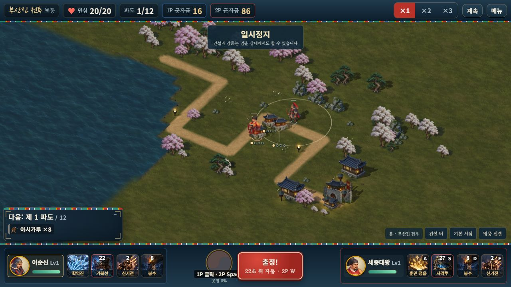
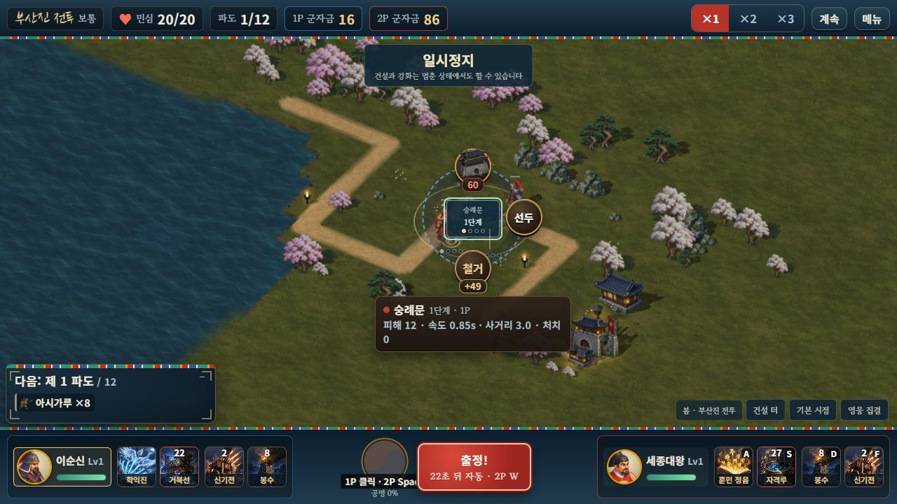
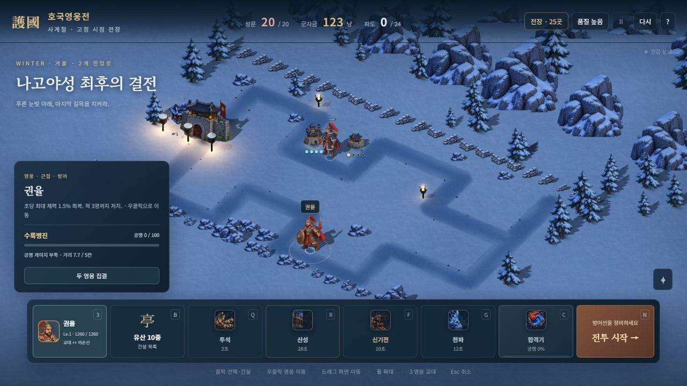

# 건물 아래 네 점으로 강화 단계 표시

최신 수정에서는 점을 건물 바로 아래에 고정하고 모든 연결선을 없앴다. [최신 메뉴·점 표시와 검증](BUILD_MENU_LAYOUT.md)을 기준으로 한다. 아래의 밀집 자동 이동·연결선과 검사 수는 첫 구현 당시 기록이다.

2026-10-11. 사용자 제안에 따라 숫자 배지를 건물 아래의 작은 원형 점 네 개로 바꿨다.

| 상태 | 기본 표시 |
| --- | --- |
| 1단계 | ● ○ ○ ○ |
| 2단계 | ● ● ○ ○ |
| 3단계 | ● ● ● ○ |
| 최종 A | 금색 ● ● ● ● |
| 최종 B | 청록색 ● ● ● ● |

평소에는 배경 박스와 글자 없이 점만 표시한다. 지붕 높이 대신 건물 바닥의 화면 좌표를 따라가므로 강화해도 표식이 지붕 위로 올라가지 않는다. 점은 지름 6 CSS 픽셀이며 실제 기본 버튼 영역은 41×20픽셀이다. 선택·가리킴·키보드 초점에서는 이름과 상세 단계가 펼쳐지고, 특화 이름은 상세·도움말·접근성 설명으로 확인할 수 있다. 스킬 조준 중에는 상세를 접고 표식을 흐리게 한다.

밀집한 표식은 서로 겹치지 않게 배치하되 기본 점이 해당 건물 바닥보다 위에 놓이지 않도록 제한한다. 밀려난 표식은 연결선으로 건물 바닥을 가리킨다. 포인터로 가리킨 표식은 제자리에서 펼쳐진다. 별도 3단계 겨울 실험 전장은 네 번째 점을 비활성 상태로 표시하며 기존 최대 단계는 유지한다.

## 검증

- 표시·발동음 15개, 정식 캠페인 16개, 고정 시점 그림 15개로 **관련 검사 46개 / 3검사군** 통과. 이전 전체 309개 / 23검사군의 기록은 [앞선 회귀 결과](BATTLE_FEEDBACK_REGRESSION_VALIDATION.json)에 보존한다.
- 새 단일 HTML에서 실제 1P 마우스 건설 2회·2P E키 건설 1회, 군자금 156/156→16/86, 선택·키보드 상세, 414×896 화면의 가로 넘침 0을 확인했다. 민심 20/20인 일시정지 상태이며 승패·보상을 발생시키지 않았다.
- 별도 자유 전장에서 실제 1→2→3→4A와 재시작 뒤 1→2→3→4B를 강화했다. 채운 점은 1·2·3·4개이고 A는 금색, B는 청록색이다. 선택 패널의 기존 단계 막대 네 개도 정상이다. 양쪽 테스트 탭의 경고·오류 로그는 없다.
- 건물 50외형과 높이 1.2칸·전장 1,664자세·전투·저장·로컬 2인·발동음 구현은 변경하지 않았다. 변경 파일은 표식 배치와 CSS, 해당 검사, 생성 서버 번들이다.
- 서버와 단일 HTML 빌드를 통과했다. 단일 HTML은 **119,363,170바이트**이며 기존 그림은 각각 한 번 포함한다. 사용자 Chrome의 진행 중인 플레이는 새로고침하거나 이동시키지 않았다. 모든 테스트 탭은 `?mute=1`로 확인했다.

[표시 검사](TOWER_DOTS_RUNTIME_VALIDATION.json) · [관련 회귀](TOWER_DOTS_REGRESSION_VALIDATION.json) · [실제 브라우저](TOWER_DOTS_BROWSER_VALIDATION.json) · [내장 그림](TOWER_DOTS_EMBEDDED_VALIDATION.json) · [릴리스](TOWER_DOTS_RELEASE_VALIDATION.json)
