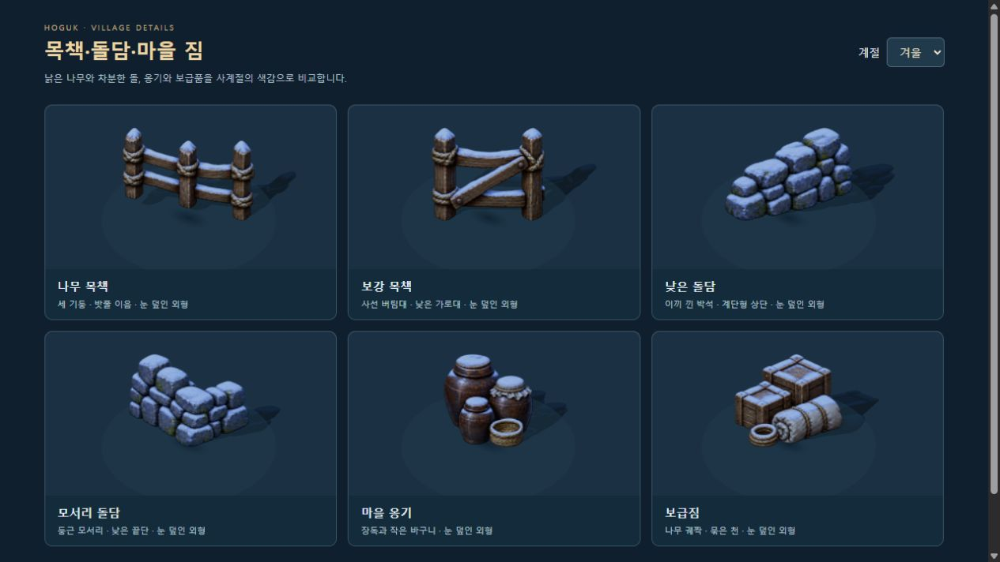
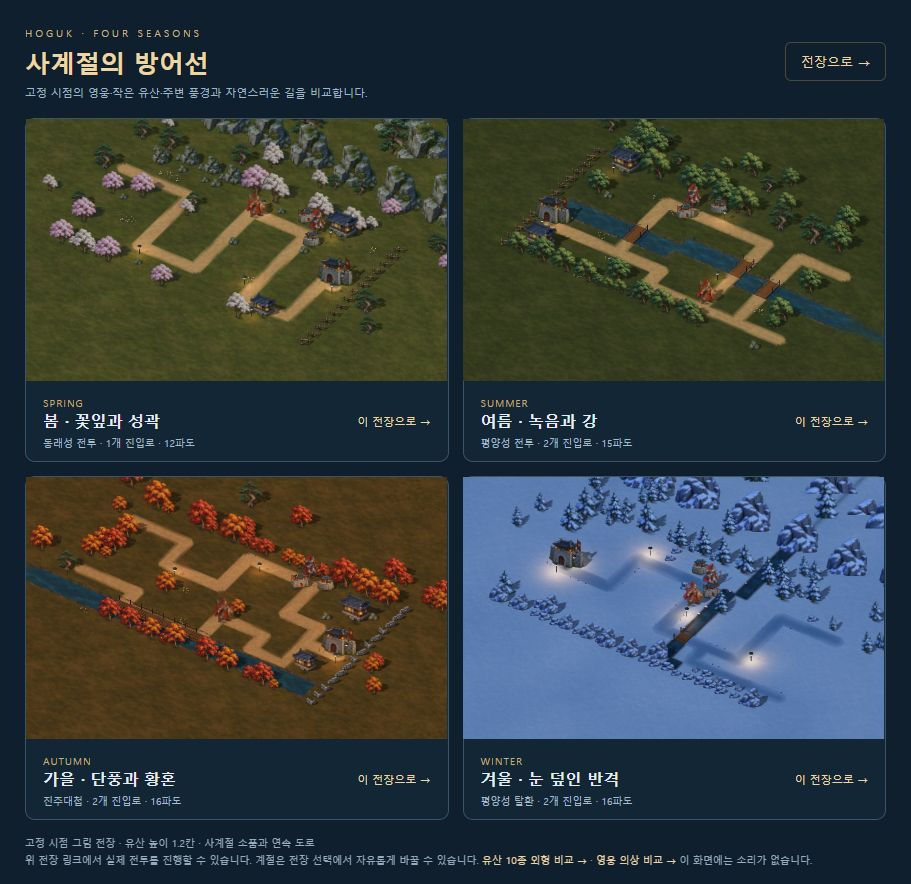
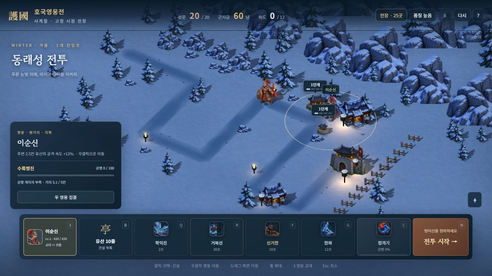
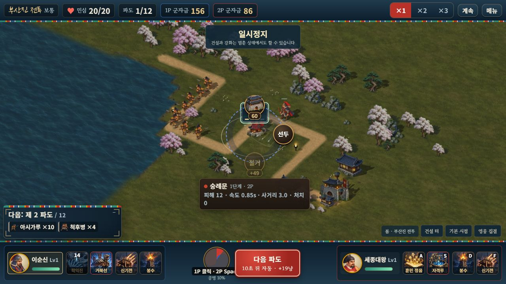

# 목책·돌담·마을 소품

> 2026-10-11 · 고정 시점의 그림 전장에 맞춘 새 주변 원화와 배치

반복되던 울타리를 낮은 목책과 돌담으로 바꾸고, 한옥 주변에 옹기와 보급짐을 연결했다. 낡은 목재·밧줄·이끼 낀 돌·차분한 남색 그림자의 미감을 기존 건물과 맞췄다. 같은 여섯 형태에 얇게 눈이 쌓인 겨울 그림도 추가했다. 승인된 캐릭터 1,664자세·유산 50외형·모든 단계의 높이 1.2칸·로컬 2인 규칙은 유지한다.


## 원화와 계절

| 형태 | 봄·여름·가을 | 겨울 |
|---|---|---|
| 목책 | 세 기둥과 밧줄 이음 / 사선 버팀대 | 같은 두 형태의 눈 덮인 상단 |
| 돌담 | 낮은 직선 / 둥근 모서리 | 같은 두 형태의 눈 덮인 상단 |
| 마을 짐 | 옹기·바구니 / 궤짝·묶은 천 | 같은 두 형태에 얇은 눈 |

내장 **imagegen**으로 생성·수정했다. 승인된 겨울 소품의 시점·재질을 참고해 비겨울 시트를 만들고, 그 시트를 참조해 겨울 외형을 만들었다. 코드로 그림을 다시 칠하지 않았으며 알파 경계 분석·12px 투명 여백 분리·무손실 WebP 변환만 적용했다.

- 원본: [비겨울 PNG](../assets/3d/fixed/source/village-props-v1.png), [겨울 PNG](../assets/3d/fixed/source/village-props-winter-v1.png)
- 배포: [비겨울 WebP](../assets/3d/fixed/village-props-v1.webp), [겨울 WebP](../assets/3d/fixed/village-props-winter-v1.webp)
- 정확한 생성 프롬프트·참조·방법: [비겨울 기록](../assets/3d/fixed/village-props-v1.prompt.json), [겨울 기록](../assets/3d/fixed/village-props-winter-v1.prompt.json)
- 픽셀 경계: [village-prop-data.js](../src/3d/village-prop-data.js) · [자산 검사](VILLAGE_PROP_ASSET_VALIDATION.json)

각 시트는 1,536×1,024의 여섯 형태이며, 두 WebP 합계는 **1,931,296바이트**다. 보이는 RGB·알파 차이, 이웃 혼입·누락·중복·시트 외곽 접촉은 모두 0이다. 봄·여름·가을은 같은 비겨울 원화에 기존 계절 색을 적용하며 계절마다 별도의 여섯 그림을 만든 범위는 아니다.



## 실제 전장 배치

25개 전장의 기존 `K` 장식 칸 **248개**를 두께 방향으로 묶어 **122개** 경계 그림으로 표시한다. 두세 줄로 쌓이던 격자를 줄이되 원래 막힌 칸·경로·건설 칸·시뮬레이션 RNG는 바꾸지 않는다. 묶은 그림은 원래 칸을 정확히 한 번씩 기록하고, 비정형 경계의 빈 칸을 가로질러 합치지 않는다. 현행 26지도(캠페인 25곳과 별도 겨울 미리보기)에서는 누락이 0이다.

안전한 한옥 모서리에만 작은 마당 목책을 추가한다. 캠페인 전체 **13개**이며 집·짐·주변 장식·입구 등불과 여백을 둔다. 기존 마을 짐 위치 **7곳**은 새 옹기 또는 보급짐 그림을 사용한다. 무작위 선택은 좌표 해시를 사용해 계절·순회 순서와 무관하다.

새 소품은 발 중심의 반지름만 가정하지 않는다. **실제 그림의 네 모서리를 카메라 방향으로 변환한 뒤 XZ 전체 범위**가 허용 반지름 안에 들도록 균일 축소한다. 접지·투영 그림자도 같은 배율을 사용한다. 새 목책·돌담·짐의 그림 본체는 도로에서 .58칸, 건설 중심에서 .30칸, 물·다리 경계에서 .04칸의 기존 최소 여백을 지킨다. 이 검증을 기존 수목 전체 수관이나 장식 그림자의 범위까지 확대해 주장하지 않는다.





## 로딩·대체·자원

작은 두 계절 시트를 모두 코어 로딩에 포함한다. 같은 그림 소유자를 재사용하는 `loadStage`에서도 새 계절의 정적 풍경을 즉시 다시 조립할 수 있다. 계절별로 한 장만 늦게 로딩하고 정적 풍경을 별도 교체하는 방식은 사용하지 않는다. 한 시트가 실패하면 나머지 계절은 유지하며 목책·돌담은 기존 `wall`, 마을 짐은 기존 `supplies`로 대체한다. 치우친 기준점을 가진 대체 그림에도 크기 제한을 적용한다.

원본 캔버스는 기존 불변 코어 캐시에 남고, 텍스처·재질·지오메트리는 전장 소유자별로 관리한다. 전장 교체는 이전 정적 메시를 먼저 정리하며 공유 그림은 소유자 종료 때 해제한다. 종료 뒤 늦은 완료는 DOM·GPU 자원을 다시 만들지 않는다. 이번 작업이 모든 CPU 캐시를 종료 때 비우거나 초기 다운로드를 줄인 작업은 아니다.

## 확인과 검증

서버 실행 후 [소품 확대 비교](http://localhost:8080/dev/3d-village-review.html?mute=1)에서 여섯 형태·사계절을 비교한다. 형태 확인을 위해 높이 .9칸으로 확대하며 실제 전장에는 허용 반지름에 맞춘 작은 크기를 쓴다. 이 비교 화면은 세션·프로필·보상·음향을 만들지 않는다. 실제 크기는 [사계절 배치](http://localhost:8080/dev/3d-season-review.html?mute=1)와 [자유 전장](http://localhost:8080/3d.html?mute=1)에서 확인한다.

```bash
node tools/test-village-props.mjs
node tools/village-prop-assets.mjs
node tools/check-motion-determinism.mjs
npm run build:3d
npm run build
node tools/verify-embedded-art.mjs
```

새 기능 검사 **10개**와 기존 **262개**, 총 **272개 / 20검사군**을 통과했다. 26지도×사계절의 실제 그림 네 모서리, 불규칙 경계·마당 여백, 세 카메라 높이·UV·그림자, 실제 `loadStage`의 반복 계절 교체, 소유자별 색·GPU 수명, 한 시트 실패와 종료 뒤 완료를 검사했다. 기존 소품 검사는 26지도 전체의 실제 2P 건설·소유·양측 군자금도 확인한다. Astra xhigh가 설계·원화·최종 렌더를 검토하고 새 10개와 기존 배치/픽셀 검사를 독립 재실행했으며 최종 필수 결함은 없었다. [실행 검사](VILLAGE_PROP_RUNTIME_VALIDATION.json) · [통합 릴리스](VILLAGE_PROP_RELEASE_VALIDATION.json).

변경 전 솔로 시드 42·협동 시드 7의 완주 결과 SHA가 이전 fixture와 일치했다. 기준 fixture와 기존 원화·좌표는 변경하지 않았다. 비교에서 제외하는 표시용 필드와 선택적 `cone.caster`는 [앞선 동작 기록](MOTION_TRANSITIONS.md)의 기존 정책을 그대로 사용한다.

브라우저에서는 여섯 형태×사계절과 따뜻한 계절/겨울 반복 교체를 확인했다. 양쪽을 한 번 그린 뒤 여덟 차례 전환에서 **텍스처 13개·지오메트리 19개**로 유지됐다. 이는 소품 확대 검수 장면의 수치이며 전체 전장의 성능 수치가 아니다. 414×896에서 문서 폭은 399px로 가로 넘침이 없었고 기본 크기로 복원했다. 동일 동래성의 겨울→여름 재출정은 경계 42칸→14그림·마당 목책 1개·짐 1개와 준비된 계절 원화를 유지했다. [브라우저 관측](VILLAGE_PROP_BROWSER_VALIDATION.json).

최신 단일 HTML의 정상 메뉴에서 이순신/세종 로컬 2인으로 출전해 **1P 지점 지정 학익진·2P 실제 A키 기술·E키 숭례문 건설**과 집결 명령을 실행했다. 건설 전 군자금 156/156에서 156/86으로 바뀌어 2P 비용 70냥만 소비했고, 민심 20/20·첫 파도에서 정지했다. 이번 UI 이동은 집결 명령이며 개별 방향키는 기존 실제 Session 검사 범위다. 승패·해금·구매·승리 보상은 발생시키지 않았다. 네 검수 탭의 콘솔 경고·오류는 0이다.



서버/단일 HTML 빌드와 포함 검사를 통과했다. 단일 HTML은 **110,553,522바이트**이며 기존 방향/중간 시트 104장·메뉴 1장·지면 3장·수목 1장·물 1장·기술 4장과 새 소품 2장을 각각 한 번 포함한다. 새 원본 PNG 2장과 기존 중간 보관 PNG 256장은 제외한다. `dist/`는 Git에서 제외하고 재현 소스·서버 번들·자산·검수 기록을 커밋한다.

## 남은 범위

이번은 주변 목책·돌담·마을 짐의 원화와 배치를 다듬은 작업이다. 더 큰 흉상·더 긴 캐릭터 연속 동작, 자유 곡선 지도, 실제 기기의 메모리·발열·터치, 외부 두 기기의 협동, 약 111MB 단일 파일 최적화와 후반 사람 플레이 밸런스는 계속 남아 있다.
